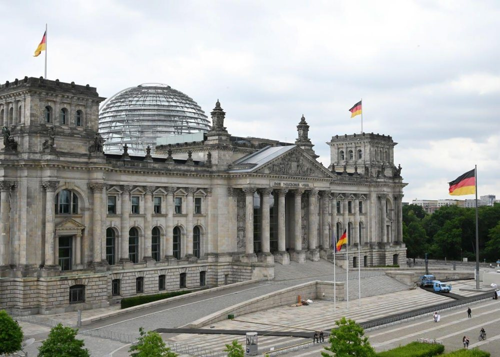

# General Questions 31-60

> Questions 31 to 60 of the official catalog. Answer first, then open the solution. Every question is bilingual and carries its own vocabulary table.

[Overview](../index.md) | [Mock test](../mock-test.md)

---

## Frage 31

> **Frage:** Die Zusammenarbeit von Parteien zur Bildung einer Regierung nennt man in Deutschland …  
> **English:** In Germany, the cooperation of parties to form a government is called a …

| # | Antwort | English |
|---|---|---|
| a | Einheit. | Unity. |
| b | Koalition. | Coalition. |
| c | Ministerium. | Ministry. |
| d | Fraktion. | Parliamentary group. |

??? success "Lösung / Answer - open after you have chosen"

    **b) Koalition.**  
    Coalition.

    **Warum / Why:** When two or more parties work together to form a government, this alliance is called a "Koalition" (coalition). Since no single party usually wins an absolute majority in German elections, coalitions are very common. The parties negotiate a coalition agreement (Koalitionsvertrag) that outlines their shared political goals. A "Fraktion" is a parliamentary group of one party, and a "Ministerium" is a government ministry.

??? note "Wortschatz / Vocabulary"

    | Deutsch | English |
    |---|---|
    | Zusammenarbeit | the cooperation |
    | Partei | the party |
    | Bildung | education |
    | Regierung | the government |
    | nennen | to name |
    | Deutschland | Germany |
    | Koalition | the coalition |
    | Einheit | unity |
    | Ministerium | the ministry |
    | Fraktion | the parliamentary group |

---

## Frage 32

> **Frage:** Was ist keine staatliche Gewalt in Deutschland?  
> **English:** Which is NOT a branch of state power in Germany?

| # | Antwort | English |
|---|---|---|
| a | Gesetzgebung | Legislation |
| b | Regierung | Government |
| c | Presse | Press |
| d | Rechtsprechung | Judiciary |

??? success "Lösung / Answer - open after you have chosen"

    **c) Presse**  
    Press

    **Warum / Why:** Germany has three branches of government (Gewaltenteilung): Legislative (Gesetzgebung - makes laws, e.g., Bundestag), Executive (Regierung - enforces laws, e.g., government/police), and Judiciary (Rechtsprechung - interprets laws, e.g., courts). The press is NOT a branch of state power. However, the media is sometimes informally called the "fourth estate" (vierte Gewalt) because of its important watchdog role.

??? note "Wortschatz / Vocabulary"

    | Deutsch | English |
    |---|---|
    | staatlich | state |
    | Gewalt | the power |
    | Deutschland | Germany |
    | Presse | the press |
    | Gesetzgebung | the legislation |
    | Regierung | the government |
    | Rechtsprechung | the case law |

---

## Frage 33

> **Frage:** Welche Aussage ist richtig? In Deutschland …  
> **English:** Which statement is correct? In Germany …

| # | Antwort | English |
|---|---|---|
| a | sind Staat und Religionsgemeinschaften voneinander getrennt. | the state and religious communities are separate from each other. |
| b | bilden die Religionsgemeinschaften den Staat. | religious communities form the state. |
| c | ist der Staat abhängig von den Religionsgemeinschaften. | the state is dependent on religious communities. |
| d | bilden Staat und Religionsgemeinschaften eine Einheit. | the state and religious communities form a single entity. |

??? success "Lösung / Answer - open after you have chosen"

    **a) sind Staat und Religionsgemeinschaften voneinander getrennt.**  
    the state and religious communities are separate from each other.

    **Warum / Why:** Germany practices separation of church and state. While Germany is not as strictly secular as France (churches can collect taxes through the state, and religious education is offered in public schools), the state and religious communities are constitutionally separate. No religion has governmental authority, and the state does not favor any particular religion.

??? note "Wortschatz / Vocabulary"

    | Deutsch | English |
    |---|---|
    | richtig | correct |
    | Deutschland | Germany |
    | Staat | the state |
    | Religionsgemeinschaft | the religious community |
    | trennen | to separate |
    | bilden | to form |
    | Einheit | unity |

---

## Frage 34

> **Frage:** Was ist Deutschland nicht?  
> **English:** What is Germany NOT?

| # | Antwort | English |
|---|---|---|
| a | eine Demokratie | a democracy |
| b | ein Rechtsstaat | a constitutional state |
| c | eine Monarchie | a monarchy |
| d | ein Sozialstaat | a welfare state |

??? success "Lösung / Answer - open after you have chosen"

    **c) eine Monarchie**  
    a monarchy

    **Warum / Why:** Germany is NOT a monarchy. It is a democracy, a constitutional state (Rechtsstaat), and a welfare state (Sozialstaat). Germany ended its monarchy in 1918 when Kaiser Wilhelm II abdicated at the end of World War I. Since then, Germany has been a republic with an elected head of state (the Federal President).

??? note "Wortschatz / Vocabulary"

    | Deutsch | English |
    |---|---|
    | Deutschland | Germany |
    | Monarchie | the monarchy |
    | Demokratie | democracy |
    | Rechtsstaat | constitutional state |
    | Sozialstaat | the welfare state |

---

## Frage 35

> **Frage:** Womit finanziert der deutsche Staat die Sozialversicherung?  
> **English:** How does the German government finance social insurance?

| # | Antwort | English |
|---|---|---|
| a | Kirchensteuer | Church tax |
| b | Sozialabgaben | Social security contributions |
| c | Spendengeldern | Donations |
| d | Vereinsbeiträgen | Membership fees |

??? success "Lösung / Answer - open after you have chosen"

    **b) Sozialabgaben**  
    Social security contributions

    **Warum / Why:** Social insurance in Germany is financed through social security contributions (Sozialabgaben), which are automatically deducted from employees' gross salaries. Both employers and employees contribute approximately equal shares. These contributions fund health insurance, pension insurance, unemployment insurance, long-term care insurance, and accident insurance. Church tax is a separate voluntary payment, and donations/membership fees play no role in public social insurance.

??? note "Wortschatz / Vocabulary"

    | Deutsch | English |
    |---|---|
    | deutsch | German |
    | Staat | the state |
    | Sozialversicherung | the social insurance |
    | Sozialabgaben | social security contributions |
    | Kirchensteuer | church tax |
    | Vereinsbeitrag | the membership fee |

---

## Frage 36

> **Frage:** Welche Maßnahme schafft in Deutschland soziale Sicherheit?  
> **English:** Which measure provides social security in Germany?

| # | Antwort | English |
|---|---|---|
| a | die Krankenversicherung | health insurance |
| b | die Autoversicherung | car insurance |
| c | die Gebäudeversicherung | property insurance |
| d | die Haftpflichtversicherung | liability insurance |

??? success "Lösung / Answer - open after you have chosen"

    **a) die Krankenversicherung**  
    health insurance

    **Warum / Why:** Health insurance (Krankenversicherung) is part of the German social security system (Sozialversicherung). It is mandatory for all residents of Germany. Car insurance, property insurance, and liability insurance are private insurances that protect against specific risks but are not part of the social security system. Germany's social insurance has five pillars: health, pension, unemployment, long-term care, and accident insurance.

??? note "Wortschatz / Vocabulary"

    | Deutsch | English |
    |---|---|
    | Maßnahme | the measure |
    | schaffen | to create |
    | Deutschland | Germany |
    | sozial | social |
    | Sicherheit | the security |
    | Krankenversicherung | the health insurance |
    | Autoversicherung | the car insurance |
    | Gebäudeversicherung | the building insurance |
    | Haftpflichtversicherung | the liability insurance |

---

## Frage 37

> **Frage:** Wie werden die Regierungschefinnen/Regierungschefs der meisten Bundesländer in Deutschland genannt?  
> **English:** What are the heads of government of most German federal states called?

| # | Antwort | English |
|---|---|---|
| a | Erste Ministerin/Erster Minister | First Minister |
| b | Premierministerin/Premierminister | Prime Minister |
| c | Senatorin/Senator | Senator |
| d | Ministerpräsidentin/Ministerpräsident | Minister-President |

??? success "Lösung / Answer - open after you have chosen"

    **d) Ministerpräsidentin/Ministerpräsident**  
    Minister-President

    **Warum / Why:** The heads of government in most German federal states are called "Ministerpräsident/in" (Minister-President). The exceptions are the three city-states: Berlin's head of government is the "Regierende/r Bürgermeister/in" (Governing Mayor), Hamburg's is the "Erste/r Bürgermeister/in" (First Mayor), and Bremen's is the "Präsident/in des Senats und Bürgermeister/in" (President of the Senate and Mayor).

??? note "Wortschatz / Vocabulary"

    | Deutsch | English |
    |---|---|
    | Regierungschefin | the head of government (female) |
    | Regierungschef | the head of government |
    | Bundesland | the federal state |
    | Deutschland | Germany |
    | nennen | to name |
    | Ministerpräsident | the Minister-President |
    | Erst | first |
    | Minister | the minister |
    | Premierministerin | the Prime Minister (female) |
    | Premierminister | the Prime Minister |
    | Senator | the senator |

---

## Frage 38

> **Frage:** Die Bundesrepublik Deutschland ist ein demokratischer und sozialer …  
> **English:** The Federal Republic of Germany is a democratic and social …

| # | Antwort | English |
|---|---|---|
| a | Staatenverbund. | association of states. |
| b | Bundesstaat. | federal state. |
| c | Staatenbund. | confederation of states. |
| d | Zentralstaat. | unitary state. |

??? success "Lösung / Answer - open after you have chosen"

    **b) Bundesstaat.**  
    federal state.

    **Warum / Why:** As stated in Article 20 of the Basic Law, Germany is a "demokratischer und sozialer Bundesstaat" (democratic and social federal state). A Bundesstaat (federal state) is different from a Staatenbund (confederation - a loose alliance of independent states like the EU) and a Zentralstaat (centralized/unitary state like France). In a federal state, power is shared between a central government and regional governments.

??? note "Wortschatz / Vocabulary"

    | Deutsch | English |
    |---|---|
    | Bundesrepublik | the Federal Republic |
    | Deutschland | Germany |
    | demokratisch | democratic |
    | sozial | social |
    | Bundesstaat | federal state |
    | Staatenverbund | the union of states |
    | Staatenbund | the confederation |
    | Zentralstaat | the centralised state |

---

## Frage 39

> **Frage:** Was hat jedes deutsche Bundesland?  
> **English:** What does every German federal state have?

| # | Antwort | English |
|---|---|---|
| a | eine eigene Außenministerin/einen eigenen Außenminister | its own foreign minister |
| b | eine eigene Währung | its own currency |
| c | eine eigene Armee | its own army |
| d | eine eigene Regierung | its own government |

??? success "Lösung / Answer - open after you have chosen"

    **d) eine eigene Regierung**  
    its own government

    **Warum / Why:** Each German federal state has its own state government (Landesregierung), led by a Minister-President, with its own state parliament (Landtag) and state constitution. However, states do NOT have their own foreign ministers (foreign policy is a federal matter), their own currency (Germany uses the Euro throughout), or their own military (the Bundeswehr is the sole military force for all of Germany).

??? note "Wortschatz / Vocabulary"

    | Deutsch | English |
    |---|---|
    | deutsch | German |
    | Bundesland | the federal state |
    | eigen | own |
    | Regierung | the government |
    | Außenministerin | the Foreign Minister (female) |
    | Außenminister | the Foreign Minister |
    | Währung | the currency |
    | Armee | the army |

---

## Frage 40

> **Frage:** Mit welchen Worten beginnt die deutsche Nationalhymne?  
> **English:** With which words does the German national anthem begin?

| # | Antwort | English |
|---|---|---|
| a | Völker, hört die Signale … | Peoples, hear the signals … |
| b | Einigkeit und Recht und Freiheit … | Unity and justice and freedom … |
| c | Freude schöner Götterfunken … | Joy, beautiful spark of the gods … |
| d | Deutschland einig Vaterland … | Germany, united fatherland … |

??? success "Lösung / Answer - open after you have chosen"

    **b) Einigkeit und Recht und Freiheit …**  
    Unity and justice and freedom …

    **Warum / Why:** The German national anthem uses only the third verse of the "Deutschlandlied" (Song of Germany), written by August Heinrich Hoffmann von Fallersleben in 1841. It begins with "Einigkeit und Recht und Freiheit" (Unity and justice and freedom). "Freude schöner Götterfunken" is from Beethoven's "Ode to Joy" (the EU anthem). "Völker, hört die Signale" is from "The Internationale" (a socialist anthem). "Deutschland einig Vaterland" was from the GDR national anthem.

??? note "Wortschatz / Vocabulary"

    | Deutsch | English |
    |---|---|
    | beginnen | to begin |
    | deutsch | German |
    | Nationalhymne | the national anthem |
    | Einigkeit | the unity |
    | Recht | the right |
    | Freiheit | freedom |
    | Volk | the people |
    | hören | to hear |
    | Freude | the joy |
    | Deutschland | Germany |
    | Vaterland | the fatherland |

---

## Frage 41

> **Frage:** Warum gibt es in einer Demokratie mehr als eine Partei?  
> **English:** Why is there more than one party in a democracy?

| # | Antwort | English |
|---|---|---|
| a | weil dadurch die unterschiedlichen Meinungen der Bürgerinnen und Bürger vertreten werden | because this allows the diverse opinions of citizens to be represented |
| b | damit Bestechung in der Politik begrenzt wird | to limit corruption in politics |
| c | um politische Demonstrationen zu verhindern | to prevent political demonstrations |
| d | um wirtschaftlichen Wettbewerb anzuregen | to stimulate economic competition |

??? success "Lösung / Answer - open after you have chosen"

    **a) weil dadurch die unterschiedlichen Meinungen der Bürgerinnen und Bürger vertreten werden**  
    because this allows the diverse opinions of citizens to be represented

    **Warum / Why:** Multiple parties exist in a democracy to represent the diversity of opinions and interests among citizens. Different groups of people have different values, priorities, and political views, and parties serve as vehicles for channeling these views into the political process. A one-party system would not represent this diversity and is characteristic of authoritarian regimes.

??? note "Wortschatz / Vocabulary"

    | Deutsch | English |
    |---|---|
    | geben | to give |
    | Demokratie | democracy |
    | Partei | the party |
    | dadurch | thereby |
    | unterschiedlich | different |
    | Meinung | the opinion |
    | Bürger | the citizen |
    | vertreten | to represent |
    | Bestechung | the bribery |
    | Politik | politics |
    | politisch | political |
    | Demonstration | the demonstration |

---

## Frage 42

> **Frage:** Wer beschließt in Deutschland ein neues Gesetz?  
> **English:** Who enacts a new law in Germany?

| # | Antwort | English |
|---|---|---|
| a | die Regierung | the government |
| b | das Parlament | the parliament |
| c | die Gerichte | the courts |
| d | die Polizei | the police |

??? success "Lösung / Answer - open after you have chosen"

    **b) das Parlament**  
    the parliament

    **Warum / Why:** New laws in Germany are enacted by parliament (the Bundestag, often with participation of the Bundesrat). While the government can propose laws, only parliament has the authority to pass them through a vote. Courts interpret and apply laws but do not create them. The police enforce laws but have no legislative power. This separation of powers is a fundamental principle of the Rechtsstaat.

??? note "Wortschatz / Vocabulary"

    | Deutsch | English |
    |---|---|
    | Deutschland | Germany |
    | neu | new |
    | Gesetz | the law |
    | Parlament | parliament |
    | Regierung | the government |
    | Gericht | the court |
    | Polizei | the police |

---

## Frage 43

> **Frage:** Wann kann in Deutschland eine Partei verboten werden?  
> **English:** When can a political party be banned in Germany?

| # | Antwort | English |
|---|---|---|
| a | wenn ihr Wahlkampf zu teuer ist | if its election campaign is too expensive |
| b | wenn sie gegen die Verfassung kämpft | if it fights against the constitution |
| c | wenn sie Kritik am Staatsoberhaupt äußert | if it criticizes the head of state |
| d | wenn ihr Programm eine neue Richtung vorschlägt | if its program proposes a new direction |

??? success "Lösung / Answer - open after you have chosen"

    **b) wenn sie gegen die Verfassung kämpft**  
    if it fights against the constitution

    **Warum / Why:** A party can only be banned in Germany if it actively seeks to undermine or abolish the free democratic basic order (freiheitliche demokratische Grundordnung). Only the Federal Constitutional Court (Bundesverfassungsgericht) can ban a party - no other body has this authority. Criticizing politicians, proposing new policies, or spending money on campaigns are all legitimate political activities. A notable recent example was the banning attempt against the NPD.

??? note "Wortschatz / Vocabulary"

    | Deutsch | English |
    |---|---|
    | Deutschland | Germany |
    | Partei | the party |
    | verbieten | to forbid |
    | Verfassung | the constitution |
    | kämpfen | to fight |
    | Wahlkampf | the election campaign |
    | Kritik | the criticism |
    | Staatsoberhaupt | the head of state |
    | äußern | to express |
    | Programm | the programme |
    | neu | new |
    | Richtung | the direction |

---

## Frage 44

> **Frage:** Wen kann man als Bürgerin/Bürger in Deutschland nicht direkt wählen?  
> **English:** Whom can citizens in Germany NOT directly elect?

| # | Antwort | English |
|---|---|---|
| a | Abgeordnete des EU-Parlaments | Members of the European Parliament |
| b | Die Bundespräsidentin/den Bundespräsidenten | The Federal President |
| c | Landtagsabgeordnete | State parliament members |
| d | Bundestagsabgeordnete | Members of the Bundestag |

??? success "Lösung / Answer - open after you have chosen"

    **b) Die Bundespräsidentin/den Bundespräsidenten**  
    The Federal President

    **Warum / Why:** German citizens cannot directly elect the Federal President (Bundespräsident/in). The President is elected by the Federal Convention (Bundesversammlung), a special body consisting of all Bundestag members plus an equal number of delegates chosen by the state parliaments. Citizens directly elect members of the Bundestag, state parliaments (Landtage), and the European Parliament.

??? note "Wortschatz / Vocabulary"

    | Deutsch | English |
    |---|---|
    | Bürger | the citizen |
    | Deutschland | Germany |
    | direkt | direct |
    | wählen | to vote / to choose |
    | Bundespräsident | the Federal President |
    | Abgeordnete | the member of parliament |

---

## Frage 45

> **Frage:** Zu welcher Versicherung gehört die Pflegeversicherung?  
> **English:** To which type of insurance does long-term care insurance belong?

| # | Antwort | English |
|---|---|---|
| a | Sozialversicherung | Social insurance |
| b | Unfallversicherung | Accident insurance |
| c | Hausratsversicherung | Home contents insurance |
| d | Haftpflicht- und Feuerversicherung | Liability and fire insurance |

??? success "Lösung / Answer - open after you have chosen"

    **a) Sozialversicherung**  
    Social insurance

    **Warum / Why:** Long-term care insurance (Pflegeversicherung) is one of the five pillars of the German social insurance system (Sozialversicherung). The five pillars are: health insurance (Krankenversicherung), pension insurance (Rentenversicherung), unemployment insurance (Arbeitslosenversicherung), long-term care insurance (Pflegeversicherung), and accident insurance (Unfallversicherung). Home contents insurance and liability insurance are private, voluntary insurances.

??? note "Wortschatz / Vocabulary"

    | Deutsch | English |
    |---|---|
    | Versicherung | the insurance |
    | gehören | to belong |
    | Pflegeversicherung | the long-term care insurance |
    | Sozialversicherung | the social insurance |
    | Unfallversicherung | the accident insurance |
    | Feuerversicherung | the fire insurance |

---

## Frage 46

> **Frage:** Der deutsche Staat hat viele Aufgaben. Welche Aufgabe gehört dazu?  
> **English:** The German state has many responsibilities. Which of the following IS one of them?

| # | Antwort | English |
|---|---|---|
| a | Er baut Straßen und Schulen. | It builds roads and schools. |
| b | Er verkauft Lebensmittel und Kleidung. | It sells food and clothing. |
| c | Er versorgt alle Einwohnerinnen und Einwohner kostenlos mit Zeitungen. | It provides all residents with newspapers free of charge. |
| d | Er produziert Autos und Busse. | It produces cars and buses. |

??? success "Lösung / Answer - open after you have chosen"

    **a) Er baut Straßen und Schulen.**  
    It builds roads and schools.

    **Warum / Why:** Building infrastructure like roads and public institutions like schools is a core task of the German state. The state does NOT sell food and clothing (that is done by private businesses), does NOT provide free newspapers (the press is independent), and does NOT produce cars and buses (that is done by private manufacturers like Volkswagen, BMW, etc.). Germany has a social market economy where the private sector handles most commercial activity.

??? note "Wortschatz / Vocabulary"

    | Deutsch | English |
    |---|---|
    | deutsch | German |
    | Staat | the state |
    | Aufgabe | the task |
    | gehören | to belong |
    | bauen | to build |
    | Straße | the street |
    | Schule | the school |
    | verkaufen | to sell |
    | Lebensmittel | the food |
    | Kleidung | the clothing |
    | versorgen | to provide for |
    | Einwohner | the inhabitant |

---

## Frage 47

> **Frage:** Der deutsche Staat hat viele Aufgaben. Welche Aufgabe gehört nicht dazu?  
> **English:** The German state has many responsibilities. Which of the following is NOT one of them?

| # | Antwort | English |
|---|---|---|
| a | Er bezahlt für alle Staatsangehörigen Urlaubsreisen. | It pays for vacation trips for all citizens. |
| b | Er zahlt Kindergeld. | It pays child benefit. |
| c | Er unterstützt Museen. | It supports museums. |
| d | Er fördert Sportlerinnen und Sportler. | It supports female and male athletes. |

??? success "Lösung / Answer - open after you have chosen"

    **a) Er bezahlt für alle Staatsangehörigen Urlaubsreisen.**  
    It pays for vacation trips for all citizens.

    **Warum / Why:** The German state does NOT pay for vacation trips for all citizens. However, the state does pay child benefit (Kindergeld - a monthly payment for each child), supports museums and cultural institutions, and funds sports and athletes. In the GDR, the state subsidized vacation trips for workers, but this is not the case in modern Germany's social market economy.

??? note "Wortschatz / Vocabulary"

    | Deutsch | English |
    |---|---|
    | deutsch | German |
    | Staat | the state |
    | Aufgabe | the task |
    | gehören | to belong |
    | bezahlen | to pay |
    | Staatsangehöriger | the national / citizen |
    | zahlen | to pay |
    | Kindergeld | the child benefit |
    | unterstützen | to support |
    | fördern | to promote |
    | Sportler | the athlete |

---

## Frage 48

> **Frage:** Welches Organ gehört nicht zu den Verfassungsorganen Deutschlands?  
> **English:** Which body is NOT a constitutional organ of Germany?

| # | Antwort | English |
|---|---|---|
| a | der Bundesrat | the Bundesrat |
| b | die Bundespräsidentin/der Bundespräsident | the Federal President |
| c | die Bürgerversammlung | the citizens' assembly |
| d | die Regierung | the government |

??? success "Lösung / Answer - open after you have chosen"

    **c) die Bürgerversammlung**  
    the citizens' assembly

    **Warum / Why:** Germany's constitutional organs (Verfassungsorgane) are: the Bundestag (parliament), the Bundesrat (Federal Council representing the states), the Federal President (Bundespräsident/in), the Federal Government (Bundesregierung), and the Federal Constitutional Court (Bundesverfassungsgericht). A "Bürgerversammlung" (citizens' assembly) is NOT a constitutional organ - it is a concept from local or participatory democracy but not part of Germany's constitutional structure.

??? note "Wortschatz / Vocabulary"

    | Deutsch | English |
    |---|---|
    | gehören | to belong |
    | Bürgerversammlung | the citizens' meeting |
    | Bundesrat | the Federal Council |
    | Bundespräsident | the Federal President |
    | Regierung | the government |

---

## Frage 49

> **Frage:** Wer bestimmt in Deutschland die Schulpolitik?  
> **English:** Who determines educational policy in Germany?

| # | Antwort | English |
|---|---|---|
| a | die Lehrer und Lehrerinnen | teachers |
| b | die Bundesländer | the federal states |
| c | das Familienministerium | the Ministry of Family Affairs |
| d | die Universitäten | the universities |

??? success "Lösung / Answer - open after you have chosen"

    **b) die Bundesländer**  
    the federal states

    **Warum / Why:** Educational policy in Germany is determined by the federal states (Bundesländer), not the central government. This is called "Kulturhoheit der Länder" (cultural sovereignty of the states). Each state has its own Ministry of Education and sets its own curriculum, school system, and educational standards. This is why school systems can differ significantly between states - for example, the number of years in primary school or the types of secondary schools available.

??? note "Wortschatz / Vocabulary"

    | Deutsch | English |
    |---|---|
    | bestimmen | to determine |
    | Deutschland | Germany |
    | Schulpolitik | school policy |
    | Bundesland | the federal state |
    | Lehrer | the teacher |
    | Universität | the university |

---

## Frage 50

> **Frage:** Die Wirtschaftsform in Deutschland nennt man …  
> **English:** The economic system in Germany is called …

| # | Antwort | English |
|---|---|---|
| a | freie Zentralwirtschaft. | free centrally planned economy. |
| b | soziale Marktwirtschaft. | social market economy. |
| c | gelenkte Zentralwirtschaft. | controlled centrally planned economy. |
| d | Planwirtschaft. | planned economy. |

??? success "Lösung / Answer - open after you have chosen"

    **b) soziale Marktwirtschaft.**  
    social market economy.

    **Warum / Why:** Germany's economic system is the "soziale Marktwirtschaft" (social market economy). This model was developed by Ludwig Erhard after WWII and combines free market principles with social welfare policies. Businesses operate freely and compete in the market, but the state intervenes to provide social security, prevent monopolies, and ensure fair working conditions. The GDR (East Germany) had a "Planwirtschaft" (planned economy), where the state controlled all economic activity.

??? note "Wortschatz / Vocabulary"

    | Deutsch | English |
    |---|---|
    | Wirtschaftsform | the economic system |
    | Deutschland | Germany |
    | nennen | to name |
    | sozial | social |
    | Marktwirtschaft | the market economy |
    | frei | free |
    | Planwirtschaft | the planned economy |

---

## Frage 51

> **Frage:** Zu einem demokratischen Rechtsstaat gehört es nicht, dass …  
> **English:** It is NOT part of a democratic rule-of-law state that …

| # | Antwort | English |
|---|---|---|
| a | Menschen sich kritisch über die Regierung äußern können. | people can express criticism of the government. |
| b | Bürger friedlich demonstrieren gehen dürfen. | citizens are allowed to participate in peaceful demonstrations. |
| c | Menschen von einer Privatpolizei ohne Grund verhaftet werden. | people are arrested without cause by a private police force. |
| d | jemand ein Verbrechen begeht und deshalb verhaftet wird. | someone commits a crime and is therefore arrested. |

??? success "Lösung / Answer - open after you have chosen"

    **c) Menschen von einer Privatpolizei ohne Grund verhaftet werden.**  
    people are arrested without cause by a private police force.

    **Warum / Why:** In a democratic Rechtsstaat, only the state police can arrest people, and only with legal justification. A "private police" arresting people without reason would be illegal and undemocratic. Criticizing the government, peaceful demonstrations, and lawful arrests for crimes are all normal parts of a democratic society.

??? note "Wortschatz / Vocabulary"

    | Deutsch | English |
    |---|---|
    | demokratisch | democratic |
    | Rechtsstaat | constitutional state |
    | gehören | to belong |
    | Mensch | the human being |
    | Grund | the reason |
    | verhaften | to arrest |
    | Regierung | the government |
    | äußern | to express |
    | Bürger | the citizen |
    | friedlich | peaceful |
    | demonstrieren | to demonstrate |
    | gehen | to go |

---

## Frage 52

> **Frage:** Was bedeutet "Volkssouveränität"? Alle Staatsgewalt geht vom …  
> **English:** What does "popular sovereignty" mean? All state authority emanates from the …

| # | Antwort | English |
|---|---|---|
| a | Volke aus. | people. |
| b | Bundestag aus. | Bundestag. |
| c | preußischen König aus. | Prussian king. |
| d | Bundesverfassungsgericht aus. | Federal Constitutional Court. |

??? success "Lösung / Answer - open after you have chosen"

    **a) Volke aus.**  
    people.

    **Warum / Why:** "Volkssouveränität" (popular sovereignty) is established in Article 20 of the Basic Law: "Alle Staatsgewalt geht vom Volke aus" - "All state authority emanates from the people." This means the people are the ultimate source of political power. They exercise this power through elections and votes. The Bundestag represents the people, but the power originates from the citizens themselves.

??? note "Wortschatz / Vocabulary"

    | Deutsch | English |
    |---|---|
    | bedeuten | to mean |
    | Volkssouveränität | popular sovereignty |
    | Staatsgewalt | the state power |
    | gehen | to go |
    | Volk | the people |
    | Bundestag | the Federal Parliament |
    | König | the king |
    | Bundesverfassungsgericht | the Federal Constitutional Court |

---

## Frage 53

> **Frage:** Was bedeutet "Rechtsstaat" in Deutschland?  
> **English:** What does "Rechtsstaat" (rule of law) mean in Germany?

| # | Antwort | English |
|---|---|---|
| a | Der Staat hat Recht. | The state is right. |
| b | Es gibt nur rechte Parteien. | There are only right-wing parties. |
| c | Die Bürgerinnen und Bürger entscheiden über Gesetze. | Citizens decide on laws. |
| d | Der Staat muss die Gesetze einhalten. | The state must abide by the laws. |

??? success "Lösung / Answer - open after you have chosen"

    **d) Der Staat muss die Gesetze einhalten.**  
    The state must abide by the laws.

    **Warum / Why:** "Rechtsstaat" literally translates to "law state" or "state of law." It means the state and all its institutions are bound by law - the government cannot act arbitrarily but must follow legal rules. This is different from "the state is right" (a common misunderstanding) or "only right-wing parties" (a play on the word "Recht" which can mean both "law/right" and "right-wing").

??? note "Wortschatz / Vocabulary"

    | Deutsch | English |
    |---|---|
    | bedeuten | to mean |
    | Rechtsstaat | constitutional state |
    | Deutschland | Germany |
    | Staat | the state |
    | Gesetz | the law |
    | einhalten | to comply with |
    | Recht | the right |
    | geben | to give |
    | Partei | the party |
    | Bürger | the citizen |
    | entscheiden | to decide |

---

## Frage 54

> **Frage:** Was ist keine staatliche Gewalt in Deutschland?  
> **English:** Which is NOT a branch of state power in Germany?

| # | Antwort | English |
|---|---|---|
| a | Legislative | Legislative |
| b | Judikative | Judiciary |
| c | Exekutive | Executive |
| d | Direktive | Directive |

??? success "Lösung / Answer - open after you have chosen"

    **d) Direktive**  
    Directive

    **Warum / Why:** Germany's state power is divided into three branches: Legislative (law-making), Executive (Exekutive, law-enforcing), and Judiciary (Judikative, law-interpreting). "Direktive" is not a real branch of government - it is the trick answer.

??? note "Wortschatz / Vocabulary"

    | Deutsch | English |
    |---|---|
    | staatlich | state |
    | Gewalt | the power |
    | Deutschland | Germany |
    | Direktive | the directive |
    | Legislative | the legislature |
    | Judikative | the judiciary |
    | Exekutive | the executive |

---

## Frage 55

> **Frage:** Was zeigt dieses Bild?  
> **English:** What does this picture show?

| # | Antwort | English |
|---|---|---|
| a | den Bundestagssitz in Berlin | the seat of the Bundestag in Berlin |
| b | das Bundesverfassungsgericht in Karlsruhe | the Federal Constitutional Court in Karlsruhe |
| c | das Bundesratsgebäude in Berlin | the Bundesrat building in Berlin |
| d | das Bundeskanzleramt in Berlin | the Federal Chancellery in Berlin |

??? success "Lösung / Answer - open after you have chosen"

    **a) den Bundestagssitz in Berlin**  
    the seat of the Bundestag in Berlin

    **Warum / Why:** The picture shows the Reichstag building in Berlin, which houses the German Bundestag (federal parliament) - recognizable by its glass dome.

??? note "Wortschatz / Vocabulary"

    | Deutsch | English |
    |---|---|
    | zeigen | to show |
    | Bild | the picture |
    | Bundesverfassungsgericht | the Federal Constitutional Court |
    | Bundeskanzleramt | the Federal Chancellery |

---

## Frage 56

> **Frage:** Welches Amt gehört in Deutschland zur Gemeindeverwaltung?  
> **English:** Which office belongs to municipal administration in Germany?

| # | Antwort | English |
|---|---|---|
| a | Pfarramt | Parish office |
| b | Ordnungsamt | Public order office |
| c | Finanzamt | Tax office |
| d | Auswärtiges Amt | Federal Foreign Office |

??? success "Lösung / Answer - open after you have chosen"

    **b) Ordnungsamt**  
    Public order office

    **Warum / Why:** The Ordnungsamt (public order office) is a municipal authority responsible for local public order and safety. The Pfarramt is religious, the Finanzamt is a state tax office, and the Auswärtiges Amt is the federal foreign ministry - none are municipal.

??? note "Wortschatz / Vocabulary"

    | Deutsch | English |
    |---|---|
    | Amt | the office |
    | gehören | to belong |
    | Deutschland | Germany |
    | Gemeindeverwaltung | the municipal administration |
    | Ordnungsamt | the public order office |
    | Pfarramt | the parish office |
    | Finanzamt | the tax office |

---

## Frage 57

> **Frage:** Wer wird meistens zur Präsidentin/zum Präsidenten des Deutschen Bundestages gewählt?  
> **English:** Who is usually elected President of the German Bundestag?

| # | Antwort | English |
|---|---|---|
| a | die/der älteste Abgeordnete im Parlament | the oldest member of parliament |
| b | die Ministerpräsidentin/der Ministerpräsident des größten Bundeslandes | the Minister-President of the largest federal state |
| c | eine ehemalige Bundeskanzlerin/ein ehemaliger Bundeskanzler | a former Federal Chancellor |
| d | eine Abgeordnete/ein Abgeordneter der stärksten Fraktion | a member of the strongest parliamentary group |

??? success "Lösung / Answer - open after you have chosen"

    **d) eine Abgeordnete/ein Abgeordneter der stärksten Fraktion**  
    a member of the strongest parliamentary group

    **Warum / Why:** By convention, the President of the Bundestag is a member of the strongest parliamentary group (Fraktion), not necessarily the oldest MP or a former Chancellor.

??? note "Wortschatz / Vocabulary"

    | Deutsch | English |
    |---|---|
    | meistens | mostly |
    | Präsident | the president |
    | Deutsch | German |
    | Bundestag | the Federal Parliament |
    | wählen | to vote / to choose |
    | Abgeordnete | the member of parliament |
    | stark | strong |
    | Fraktion | the parliamentary group |
    | alt | old |
    | Parlament | parliament |
    | Ministerpräsident | the Minister-President |
    | groß | big |

---

## Frage 58

> **Frage:** Wer ernennt in Deutschland die Ministerinnen/die Minister der Bundesregierung?  
> **English:** Who appoints the ministers of the federal government in Germany?

| # | Antwort | English |
|---|---|---|
| a | die Präsidentin/der Präsident des Bundesverfassungsgerichtes | the President of the Federal Constitutional Court |
| b | die Bundespräsidentin/der Bundespräsident | the Federal President |
| c | die Bundesratspräsidentin/der Bundesratspräsident | the President of the Bundesrat |
| d | die Bundestagspräsidentin/der Bundestagspräsident | the President of the Bundestag |

??? success "Lösung / Answer - open after you have chosen"

    **b) die Bundespräsidentin/der Bundespräsident**  
    the Federal President

    **Warum / Why:** The Federal President formally appoints and dismisses federal ministers, on the proposal of the Chancellor.

??? note "Wortschatz / Vocabulary"

    | Deutsch | English |
    |---|---|
    | ernennen | to appoint |
    | Deutschland | Germany |
    | Minister | the minister |
    | Bundesregierung | the Federal Government |
    | Bundespräsident | the Federal President |
    | Präsident | the president |
    | Bundesverfassungsgericht | the Federal Constitutional Court |
    | Bundesratspräsidentin | the President of the Federal Council (female) |
    | Bundesratspräsident | the President of the Federal Council |
    | Bundestagspräsidentin | the President of the Bundestag (female) |
    | Bundestagspräsident | the President of the Bundestag |

---

## Frage 59

> **Frage:** Vor wie vielen Jahren gab es erstmals eine jüdische Gemeinde auf dem Gebiet des heutigen Deutschlands?  
> **English:** How many years ago did a Jewish community first exist on the territory of present-day Germany?

| # | Antwort | English |
|---|---|---|
| a | vor etwa 300 Jahren | about 300 years ago |
| b | vor etwa 700 Jahren | about 700 years ago |
| c | vor etwa 1150 Jahren | about 1150 years ago |
| d | vor etwa 1700 Jahren | about 1700 years ago |

??? success "Lösung / Answer - open after you have chosen"

    **d) vor etwa 1700 Jahren**  
    about 1700 years ago

    **Warum / Why:** Jewish communities have existed on German territory for about 1,700 years, with documented evidence dating to Roman-era Cologne in 321 CE - among the oldest Jewish settlements in Europe north of the Alps.

??? note "Wortschatz / Vocabulary"

    | Deutsch | English |
    |---|---|
    | Jahr | the year |
    | geben | to give |
    | jüdisch | Jewish |
    | Gemeinde | the municipality |
    | Gebiet | the area |
    | heutig | current |

---

## Frage 60

> **Frage:** In Deutschland gehören der Bundestag und der Bundesrat zur …  
> **English:** In Germany, the Bundestag and Bundesrat belong to the …

| # | Antwort | English |
|---|---|---|
| a | Exekutive. | Executive. |
| b | Legislative. | Legislature. |
| c | Direktive. | Directive. |
| d | Judikative. | Judiciary. |

??? success "Lösung / Answer - open after you have chosen"

    **b) Legislative.**  
    Legislature.

    **Warum / Why:** The Bundestag and Bundesrat are both legislative bodies (Legislative) - they make laws, unlike the executive (government) or judiciary (courts).

??? note "Wortschatz / Vocabulary"

    | Deutsch | English |
    |---|---|
    | Deutschland | Germany |
    | gehören | to belong |
    | Bundestag | the Federal Parliament |
    | Bundesrat | the Federal Council |
    | Legislative | the legislature |
    | Exekutive | the executive |
    | Direktive | the directive |
    | Judikative | the judiciary |

---

## Set check

- [ ] I answered all 30 questions before opening any solution.
- [ ] I scored at least 24/30.
- [ ] I reviewed every wrong answer and said the correct sentence aloud.

---

[← Questions 1-30](01-questions-001-030.md) | [Overview](../index.md) | [Questions 61-90 →](03-questions-061-090.md)
