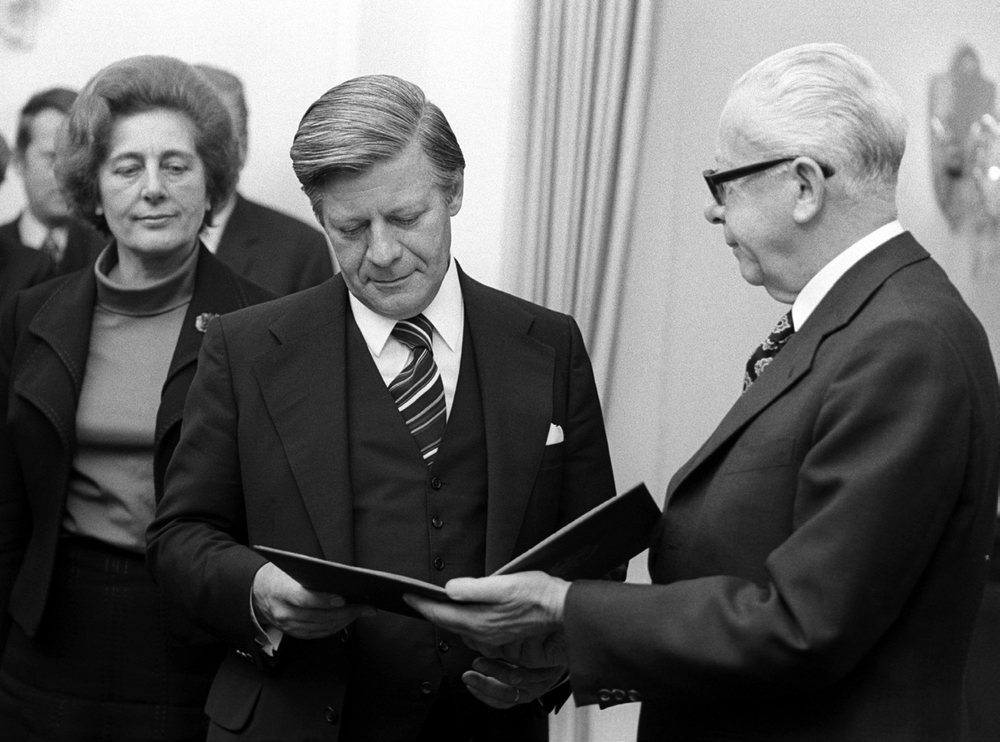

# General Questions 61-90

> Questions 61 to 90 of the official catalog. Answer first, then open the solution. Every question is bilingual and carries its own vocabulary table.

[Overview](../index.md) | [Mock test](../mock-test.md)

---

## Frage 61

> **Frage:** Was bedeutet "Volkssouveränität"?  
> **English:** What does "popular sovereignty" mean?

| # | Antwort | English |
|---|---|---|
| a | Die Königin/der König herrscht über das Volk. | The king/queen rules over the people. |
| b | Das Bundesverfassungsgericht steht über der Verfassung. | The Federal Constitutional Court stands above the constitution. |
| c | Die Interessenverbände üben die Souveränität zusammen mit der Regierung aus. | Interest groups exercise sovereignty together with the government. |
| d | Die Staatsgewalt geht vom Volke aus. | State power originates from the people. |

??? success "Lösung / Answer - open after you have chosen"

    **d) Die Staatsgewalt geht vom Volke aus.**  
    State power originates from the people.

    **Warum / Why:** Popular sovereignty, enshrined in Article 20 of the Basic Law, means all state authority is derived from the people, exercised through elections and referenda.

??? note "Wortschatz / Vocabulary"

    | Deutsch | English |
    |---|---|
    | bedeuten | to mean |
    | Volkssouveränität | popular sovereignty |
    | Staatsgewalt | the state power |
    | gehen | to go |
    | Volk | the people |
    | König | the king |
    | Bundesverfassungsgericht | the Federal Constitutional Court |
    | stehen | to stand |
    | Verfassung | the constitution |
    | Souveränität | the sovereignty |
    | zusammen | together |
    | Regierung | the government |

---

## Frage 62

> **Frage:** Wenn das Parlament eines deutschen Bundeslandes gewählt wird, nennt man das …  
> **English:** When the parliament of a German federal state is elected, this is called …

| # | Antwort | English |
|---|---|---|
| a | Kommunalwahl | Municipal election. |
| b | Landtagswahl | State parliament election. |
| c | Europawahl | European election. |
| d | Bundestagswahl | Federal election. |

??? success "Lösung / Answer - open after you have chosen"

    **b) Landtagswahl**  
    State parliament election.

    **Warum / Why:** Electing a state parliament (Landtag) is called a Landtagswahl, distinct from municipal, European, or federal elections.

??? note "Wortschatz / Vocabulary"

    | Deutsch | English |
    |---|---|
    | Parlament | parliament |
    | deutsch | German |
    | Bundesland | the federal state |
    | wählen | to vote / to choose |
    | nennen | to name |
    | Landtagswahl | the state election |
    | Kommunalwahl | the local election |
    | Bundestagswahl | the federal election |

---

## Frage 63

> **Frage:** Was gehört in Deutschland nicht zur Exekutive?  
> **English:** What does NOT belong to the executive branch in Germany?

| # | Antwort | English |
|---|---|---|
| a | die Polizei | the police |
| b | die Gerichte | the courts |
| c | das Finanzamt | the tax office |
| d | die Ministerien | the ministries |

??? success "Lösung / Answer - open after you have chosen"

    **b) die Gerichte**  
    the courts

    **Warum / Why:** Courts belong to the judiciary (Judikative), not the executive. Police, tax offices, and ministries are all part of the executive branch.

??? note "Wortschatz / Vocabulary"

    | Deutsch | English |
    |---|---|
    | gehören | to belong |
    | Deutschland | Germany |
    | Exekutive | the executive |
    | Gericht | the court |
    | Polizei | the police |
    | Finanzamt | the tax office |
    | Ministerium | the ministry |

---

## Frage 64

> **Frage:** Die Bundesrepublik Deutschland ist heute gegliedert in …  
> **English:** Today, the Federal Republic of Germany is organized into …

| # | Antwort | English |
|---|---|---|
| a | vier Besatzungszonen. | four occupation zones. |
| b | einen Oststaat und einen Weststaat. | an eastern state and a western state. |
| c | 16 Kantone. | 16 cantons. |
| d | Bund, Länder und Kommunen. | Federation, states, and municipalities. |

??? success "Lösung / Answer - open after you have chosen"

    **d) Bund, Länder und Kommunen.**  
    Federation, states, and municipalities.

    **Warum / Why:** Germany's administrative structure has three levels: the federal government (Bund), the 16 states (Länder), and local municipalities (Kommunen).

??? note "Wortschatz / Vocabulary"

    | Deutsch | English |
    |---|---|
    | Bundesrepublik | the Federal Republic |
    | Deutschland | Germany |
    | Bund | the federation |
    | Land | the country / federal state |
    | Kommune | the municipality |
    | vier | four |
    | Besatzungszone | the occupation zone |

---

## Frage 65

> **Frage:** Es gehört nicht zu den Aufgaben des Deutschen Bundestages, …  
> **English:** It is NOT a task of the German Bundestag to …

| # | Antwort | English |
|---|---|---|
| a | Gesetze zu entwerfen. | draft laws. |
| b | die Bundesregierung zu kontrollieren. | control the federal government. |
| c | die Bundeskanzlerin/den Bundeskanzler zu wählen. | elect the Federal Chancellor. |
| d | das Bundeskabinett zu bilden. | form the federal cabinet. |

??? success "Lösung / Answer - open after you have chosen"

    **d) das Bundeskabinett zu bilden.**  
    form the federal cabinet.

    **Warum / Why:** Forming the cabinet is the Chancellor's job, not the Bundestag's. The Bundestag drafts laws, elects the Chancellor, and controls the government.

??? note "Wortschatz / Vocabulary"

    | Deutsch | English |
    |---|---|
    | gehören | to belong |
    | Aufgabe | the task |
    | Deutsch | German |
    | Bundestag | the Federal Parliament |
    | Bundeskabinett | the Federal Cabinet |
    | bilden | to form |
    | Gesetz | the law |
    | Bundesregierung | the Federal Government |
    | kontrollieren | to control |
    | Bundeskanzler | the Federal Chancellor |
    | wählen | to vote / to choose |

---

## Frage 66

> **Frage:** Welche Städte haben die größten jüdischen Gemeinden in Deutschland?  
> **English:** Which cities have the largest Jewish communities in Germany?

| # | Antwort | English |
|---|---|---|
| a | Berlin und München | Berlin and Munich |
| b | Hamburg und Essen | Hamburg and Essen |
| c | Nürnberg und Stuttgart | Nuremberg and Stuttgart |
| d | Worms und Speyer | Worms and Speyer |

??? success "Lösung / Answer - open after you have chosen"

    **a) Berlin und München**  
    Berlin and Munich

    **Warum / Why:** Berlin and Munich have Germany's largest Jewish communities today, reflecting post-reunification and post-Soviet immigration patterns.

??? note "Wortschatz / Vocabulary"

    | Deutsch | English |
    |---|---|
    | Stadt | the city |
    | groß | big |
    | jüdisch | Jewish |
    | Gemeinden | the municipalities |
    | Deutschland | Germany |
    | München | Munich |
    | Essen | the food |
    | Nürnberg | Nuremberg |

---

## Frage 67

> **Frage:** Was ist in Deutschland vor allem eine Aufgabe der Bundesländer?  
> **English:** What is primarily a task of the federal states in Germany?

| # | Antwort | English |
|---|---|---|
| a | Verteidigungspolitik | Defense policy |
| b | Außenpolitik | Foreign policy |
| c | Wirtschaftspolitik | Economic policy |
| d | Schulpolitik | Education policy |

??? success "Lösung / Answer - open after you have chosen"

    **d) Schulpolitik**  
    Education policy

    **Warum / Why:** Education policy (Schulpolitik) is primarily a state responsibility in Germany, unlike defense, foreign affairs, and much of economic policy, which are federal matters.

??? note "Wortschatz / Vocabulary"

    | Deutsch | English |
    |---|---|
    | Deutschland | Germany |
    | Aufgabe | the task |
    | Bundesland | the federal state |
    | Schulpolitik | school policy |
    | Verteidigungspolitik | defence policy |
    | Außenpolitik | the foreign policy |
    | Wirtschaftspolitik | economic policy |

---

## Frage 68

> **Frage:** Warum kontrolliert der Staat in Deutschland das Schulwesen?  
> **English:** Why does the state control the school system in Germany?

| # | Antwort | English |
|---|---|---|
| a | weil es in Deutschland nur staatliche Schulen gibt | because there are only state schools in Germany |
| b | weil alle Schülerinnen und Schüler einen Schulabschluss haben müssen | because all students must have a school qualification |
| c | weil es in den Bundesländern verschiedene Schulen gibt | because there are different schools in the federal states |
| d | weil es nach dem Grundgesetz seine Aufgabe ist | because it is the state's responsibility under the Basic Law |

??? success "Lösung / Answer - open after you have chosen"

    **d) weil es nach dem Grundgesetz seine Aufgabe ist**  
    because it is the state's responsibility under the Basic Law

    **Warum / Why:** State oversight of schools (Schulaufsicht) is a constitutional duty under the Basic Law, ensuring educational quality and standards nationwide.

??? note "Wortschatz / Vocabulary"

    | Deutsch | English |
    |---|---|
    | kontrollieren | to control |
    | Staat | the state |
    | Deutschland | Germany |
    | Grundgesetz | the Basic Law (constitution) |
    | Aufgabe | the task |
    | staatlich | state |
    | Schule | the school |
    | geben | to give |
    | Schüler | the pupil |
    | Schulabschluss | the school-leaving certificate |
    | Bundesland | the federal state |
    | verschieden | different |

---

## Frage 69

> **Frage:** Die Bundesrepublik Deutschland hat einen dreistufigen Verwaltungsaufbau. Wie heißt die unterste politische Stufe?  
> **English:** Germany has a three-tier administrative structure. What is the lowest political level called?

| # | Antwort | English |
|---|---|---|
| a | Stadträte | City councils |
| b | Landräte | District administrators |
| c | Gemeinden | Municipalities |
| d | Bezirksämter | District offices |

??? success "Lösung / Answer - open after you have chosen"

    **c) Gemeinden**  
    Municipalities

    **Warum / Why:** The Gemeinden (municipalities) form the lowest administrative and political level in Germany's three-tier structure of Bund, Länder, and Gemeinden.

??? note "Wortschatz / Vocabulary"

    | Deutsch | English |
    |---|---|
    | Bundesrepublik | the Federal Republic |
    | Deutschland | Germany |
    | heißen | to be called |
    | politisch | political |
    | Gemeinden | the municipalities |
    | Landrat | the district administrator |

---

## Frage 70

> **Frage:** Der deutsche Bundespräsident Gustav Heinemann gibt Helmut Schmidt 1974 die Ernennungsurkunde zum deutschen Bundeskanzler. Was gehört zu den Aufgaben der deutschen Bundespräsidentin/des deutschen Bundespräsidenten?  
> **English:** In 1974, German President Gustav Heinemann hands Helmut Schmidt his certificate of appointment as Federal Chancellor. What is one of the duties of the German Federal President?

| # | Antwort | English |
|---|---|---|
| a | Sie/Er führt die Regierungsgeschäfte. | He/she runs the day-to-day business of government. |
| b | Sie/Er kontrolliert die Regierungspartei. | He/she controls the governing party. |
| c | Sie/Er wählt die Ministerinnen/Minister aus. | He/she selects the ministers. |
| d | Sie/Er schlägt die Kanzlerin/den Kanzler zur Wahl vor. | He/she proposes the Chancellor for election. |

??? success "Lösung / Answer - open after you have chosen"

    **d) Sie/Er schlägt die Kanzlerin/den Kanzler zur Wahl vor.**  
    He/she proposes the Chancellor for election.

    **Warum / Why:** The Federal President proposes a candidate for Chancellor to the Bundestag for election, and formally appoints the Chancellor and ministers - but does not run the government or select ministers personally.

??? note "Wortschatz / Vocabulary"

    | Deutsch | English |
    |---|---|
    | deutsch | German |
    | Bundespräsident | the Federal President |
    | geben | to give |
    | Ernennungsurkunde | the certificate of appointment |
    | Bundeskanzler | the Federal Chancellor |
    | gehören | to belong |
    | Aufgabe | the task |
    | schlagen | to beat |
    | Kanzlerin | the Chancellor (female) |
    | Kanzler | the Chancellor |
    | Wahl | the election |
    | führen | to lead |

---

## Frage 71

> **Frage:** Wo hält sich die deutsche Bundeskanzlerin/der deutsche Bundeskanzler am häufigsten auf? Am häufigsten ist sie/er …  
> **English:** Where is the German Federal Chancellor most often located? He/she is most often …

| # | Antwort | English |
|---|---|---|
| a | in Bonn, weil sich dort das Bundeskanzleramt und der Bundestag befinden. | in Bonn, because the Chancellery and Bundestag are located there. |
| b | auf Schloss Meseberg, dem Gästehaus der Bundesregierung, um Staatsgäste zu empfangen. | at Schloss Meseberg, the government's guest house, to receive state guests. |
| c | auf Schloss Bellevue, dem Amtssitz der Bundespräsidentin/des Bundespräsidenten, um Staatsgäste zu empfangen. | at Schloss Bellevue, the President's official residence, to receive state guests. |
| d | in Berlin, weil sich dort das Bundeskanzleramt und der Bundestag befinden. | in Berlin, because the Chancellery and Bundestag are located there. |

??? success "Lösung / Answer - open after you have chosen"

    **d) in Berlin, weil sich dort das Bundeskanzleramt und der Bundestag befinden.**  
    in Berlin, because the Chancellery and Bundestag are located there.

    **Warum / Why:** Since the government moved from Bonn to Berlin in 1999, the Chancellor is most often in Berlin, home to both the Chancellery and the Bundestag.

??? note "Wortschatz / Vocabulary"

    | Deutsch | English |
    |---|---|
    | halten | to hold |
    | deutsch | German |
    | Bundeskanzler | the Federal Chancellor |
    | häufig | frequent |
    | Bundeskanzleramt | the Federal Chancellery |
    | Bundestag | the Federal Parliament |
    | befinden | to be located |
    | Schließen | to close |
    | Gästehaus | the guest house |
    | Bundesregierung | the Federal Government |
    | empfangen | to receive |
    | Amtssitz | the official seat |

---

## Frage 72

> **Frage:** Wie heißt die jetzige Bundeskanzlerin/der jetzige Bundeskanzler von Deutschland?  
> **English:** What is the name of the current Federal Chancellor of Germany?

| # | Antwort | English |
|---|---|---|
| a | Gerhard Schröder | Gerhard Schröder |
| b | Angela Merkel | Angela Merkel |
| c | Ursula von der Leyen | Ursula von der Leyen |
| d | Friedrich Merz | Friedrich Merz |

??? success "Lösung / Answer - open after you have chosen"

    **d) Friedrich Merz**  
    Friedrich Merz

    **Warum / Why:** Friedrich Merz (CDU) has been Federal Chancellor since 2025. Note: this is a current-affairs question the real test updates periodically - always verify the current officeholder before the exam.

??? note "Wortschatz / Vocabulary"

    | Deutsch | English |
    |---|---|
    | heißen | to be called |
    | jetzig | current |
    | Bundeskanzler | the Federal Chancellor |
    | Deutschland | Germany |

---

## Frage 73

> **Frage:** Die beiden größten Fraktionen im Deutschen Bundestag heißen zurzeit …  
> **English:** The two largest parliamentary groups in the German Bundestag are currently called …

| # | Antwort | English |
|---|---|---|
| a | CDU/CSU und AfD. | CDU/CSU and AfD. |
| b | Die Linke und Bündnis 90/Die Grünen. | Die Linke and Bündnis 90/Die Grünen. |
| c | Bündnis 90/Die Grünen und SPD. | Bündnis 90/Die Grünen and SPD. |
| d | Die Linke und CDU/CSU. | Die Linke and CDU/CSU. |

??? success "Lösung / Answer - open after you have chosen"

    **a) CDU/CSU und AfD.**  
    CDU/CSU and AfD.

    **Warum / Why:** Following the 2025 federal election, CDU/CSU and AfD are the two largest parliamentary groups. Note: this is a current-affairs question - verify before the exam, as party standings change with each election.

??? note "Wortschatz / Vocabulary"

    | Deutsch | English |
    |---|---|
    | beide | both |
    | groß | big |
    | Fraktion | the parliamentary group |
    | Deutsch | German |
    | Bundestag | the Federal Parliament |
    | heißen | to be called |
    | Bündnis | the alliance |
    | Grüne | the Greens |

---

## Frage 74

> **Frage:** Wie heißt das Parlament für ganz Deutschland?  
> **English:** What is the parliament for all of Germany called?

| # | Antwort | English |
|---|---|---|
| a | Bundesversammlung | Federal Convention |
| b | Volkskammer | People's Chamber |
| c | Bundestag | Bundestag |
| d | Bundesgerichtshof | Federal Court of Justice |

??? success "Lösung / Answer - open after you have chosen"

    **c) Bundestag**  
    Bundestag

    **Warum / Why:** The Bundestag is Germany's national parliament. The Bundesversammlung only convenes to elect the President, the Volkskammer was the former East German parliament, and the Bundesgerichtshof is a court.

??? note "Wortschatz / Vocabulary"

    | Deutsch | English |
    |---|---|
    | heißen | to be called |
    | Parlament | parliament |
    | Deutschland | Germany |
    | Bundestag | the Federal Parliament |
    | Bundesversammlung | the Federal Assembly |
    | Volkskammer | the People's Chamber |
    | Bundesgerichtshof | the Federal Court of Justice |

---

## Frage 75

> **Frage:** Wie heißt Deutschlands heutiges Staatsoberhaupt?  
> **English:** What is the name of Germany's current head of state?

| # | Antwort | English |
|---|---|---|
| a | Frank-Walter Steinmeier | Frank-Walter Steinmeier |
| b | Bärbel Bas | Bärbel Bas |
| c | Bodo Ramelow | Bodo Ramelow |
| d | Joachim Gauck | Joachim Gauck |

??? success "Lösung / Answer - open after you have chosen"

    **a) Frank-Walter Steinmeier**  
    Frank-Walter Steinmeier

    **Warum / Why:** Frank-Walter Steinmeier is Germany's Federal President (head of state). Note: this is a current-affairs question - verify the current officeholder before the exam.

??? note "Wortschatz / Vocabulary"

    | Deutsch | English |
    |---|---|
    | heißen | to be called |
    | heutig | current |
    | Staatsoberhaupt | the head of state |

---

## Frage 76

> **Frage:** Was bedeutet die Abkürzung CDU in Deutschland?  
> **English:** What does the abbreviation CDU stand for in Germany?

| # | Antwort | English |
|---|---|---|
| a | Christliche Deutsche Union | Christian German Union |
| b | Club Deutscher Unternehmer | Club of German Entrepreneurs |
| c | Christlicher Deutscher Umweltschutz | Christian German Environmental Protection |
| d | Christlich Demokratische Union | Christian Democratic Union |

??? success "Lösung / Answer - open after you have chosen"

    **d) Christlich Demokratische Union**  
    Christian Democratic Union

    **Warum / Why:** CDU stands for Christlich Demokratische Union (Christian Democratic Union), one of Germany's major political parties.

??? note "Wortschatz / Vocabulary"

    | Deutsch | English |
    |---|---|
    | bedeuten | to mean |
    | Abkürzung | the abbreviation |
    | Deutschland | Germany |
    | Christlich | Christian |
    | Demokratisch | democratic |
    | Deutsch | German |
    | Unternehmer | the entrepreneur |
    | Umweltschutz | environmental protection |

---

## Frage 77

> **Frage:** Was ist die Bundeswehr?  
> **English:** What is the Bundeswehr?

| # | Antwort | English |
|---|---|---|
| a | die deutsche Polizei | the German police |
| b | ein deutscher Hafen | a German port |
| c | eine deutsche Bürgerinitiative | a German citizens' initiative |
| d | die deutsche Armee | the German army |

??? success "Lösung / Answer - open after you have chosen"

    **d) die deutsche Armee**  
    the German army

    **Warum / Why:** The Bundeswehr is Germany's armed forces (the military), not the police, a port, or a citizens' group.

??? note "Wortschatz / Vocabulary"

    | Deutsch | English |
    |---|---|
    | Bundeswehr | the armed forces |
    | deutsch | German |
    | Armee | the army |
    | Polizei | the police |
    | Hafen | the harbour |
    | Bürgerinitiative | the citizens' initiative |

---

## Frage 78

> **Frage:** Was bedeutet die Abkürzung SPD?  
> **English:** What does the abbreviation SPD stand for?

| # | Antwort | English |
|---|---|---|
| a | Sozialistische Partei Deutschlands | Socialist Party of Germany |
| b | Sozialpolitische Partei Deutschlands | Social Policy Party of Germany |
| c | Sozialdemokratische Partei Deutschlands | Social Democratic Party of Germany |
| d | Sozialgerechte Partei Deutschlands | Social Justice Party of Germany |

??? success "Lösung / Answer - open after you have chosen"

    **c) Sozialdemokratische Partei Deutschlands**  
    Social Democratic Party of Germany

    **Warum / Why:** SPD stands for Sozialdemokratische Partei Deutschlands (Social Democratic Party of Germany), one of Germany's oldest and largest parties.

??? note "Wortschatz / Vocabulary"

    | Deutsch | English |
    |---|---|
    | bedeuten | to mean |
    | Abkürzung | the abbreviation |
    | Sozialdemokratisch | social democratic |
    | Partei | the party |
    | Sozialistisch | socialist |

---

## Frage 79

> **Frage:** Was bedeutet die Abkürzung FDP in Deutschland?  
> **English:** What does the abbreviation FDP stand for in Germany?

| # | Antwort | English |
|---|---|---|
| a | Friedliche Demonstrative Partei | Peaceful Demonstrative Party |
| b | Freie Deutschland Partei | Free Germany Party |
| c | Führende Demokratische Partei | Leading Democratic Party |
| d | Freie Demokratische Partei | Free Democratic Party |

??? success "Lösung / Answer - open after you have chosen"

    **d) Freie Demokratische Partei**  
    Free Democratic Party

    **Warum / Why:** FDP stands for Freie Demokratische Partei (Free Democratic Party), a liberal party in Germany.

??? note "Wortschatz / Vocabulary"

    | Deutsch | English |
    |---|---|
    | bedeuten | to mean |
    | Abkürzung | the abbreviation |
    | Deutschland | Germany |
    | Frei | free |
    | Demokratisch | democratic |
    | Partei | the party |
    | Friedlich | peaceful |

---

## Frage 80

> **Frage:** Welches Gericht in Deutschland ist zuständig für die Auslegung des Grundgesetzes?  
> **English:** Which court in Germany is responsible for interpreting the Basic Law?

| # | Antwort | English |
|---|---|---|
| a | Oberlandesgericht | Higher Regional Court |
| b | Amtsgericht | Local Court |
| c | Bundesverfassungsgericht | Federal Constitutional Court |
| d | Verwaltungsgericht | Administrative Court |

??? success "Lösung / Answer - open after you have chosen"

    **c) Bundesverfassungsgericht**  
    Federal Constitutional Court

    **Warum / Why:** The Bundesverfassungsgericht (Federal Constitutional Court), located in Karlsruhe, is responsible for interpreting the Basic Law and reviewing the constitutionality of laws.

??? note "Wortschatz / Vocabulary"

    | Deutsch | English |
    |---|---|
    | Gericht | the court |
    | Deutschland | Germany |
    | zuständig | responsible |
    | Auslegung | the interpretation |
    | Grundgesetz | the Basic Law (constitution) |
    | Bundesverfassungsgericht | the Federal Constitutional Court |
    | Oberlandesgericht | the higher regional court |
    | Amtsgericht | the local court |
    | Verwaltungsgericht | the administrative court |

---

## Frage 81

> **Frage:** Wer wählt die Bundeskanzlerin/den Bundeskanzler in Deutschland?  
> **English:** Who elects the Federal Chancellor in Germany?

| # | Antwort | English |
|---|---|---|
| a | der Bundesrat | the Bundesrat |
| b | die Bundesversammlung | the Federal Convention |
| c | das Volk | the people |
| d | der Bundestag | the Bundestag |

??? success "Lösung / Answer - open after you have chosen"

    **d) der Bundestag**  
    the Bundestag

    **Warum / Why:** The Bundestag elects the Federal Chancellor, on the proposal of the Federal President - not the people directly, the Bundesrat, or the Bundesversammlung (which only elects the President).

??? note "Wortschatz / Vocabulary"

    | Deutsch | English |
    |---|---|
    | wählen | to vote / to choose |
    | Bundeskanzler | the Federal Chancellor |
    | Deutschland | Germany |
    | Bundestag | the Federal Parliament |
    | Bundesrat | the Federal Council |
    | Bundesversammlung | the Federal Assembly |
    | Volk | the people |

---

## Frage 82

> **Frage:** Wer leitet das deutsche Bundeskabinett?  
> **English:** Who leads the German federal cabinet?

| # | Antwort | English |
|---|---|---|
| a | die Bundestagspräsidentin/der Bundestagspräsident | the President of the Bundestag |
| b | die Bundespräsidentin/der Bundespräsident | the Federal President |
| c | die Bundesratspräsidentin/der Bundesratspräsident | the President of the Bundesrat |
| d | die Bundeskanzlerin/der Bundeskanzler | the Federal Chancellor |

??? success "Lösung / Answer - open after you have chosen"

    **d) die Bundeskanzlerin/der Bundeskanzler**  
    the Federal Chancellor

    **Warum / Why:** The Federal Chancellor leads the federal cabinet and determines the general policy guidelines (Richtlinienkompetenz).

??? note "Wortschatz / Vocabulary"

    | Deutsch | English |
    |---|---|
    | deutsch | German |
    | Bundeskabinett | the Federal Cabinet |
    | Bundeskanzler | the Federal Chancellor |
    | Bundestagspräsidentin | the President of the Bundestag (female) |
    | Bundestagspräsident | the President of the Bundestag |
    | Bundespräsident | the Federal President |
    | Bundesratspräsidentin | the President of the Federal Council (female) |
    | Bundesratspräsident | the President of the Federal Council |

---

## Frage 83

> **Frage:** Wer wählt die deutsche Bundeskanzlerin/den deutschen Bundeskanzler?  
> **English:** Who elects the German Federal Chancellor?

| # | Antwort | English |
|---|---|---|
| a | das Volk | the people |
| b | die Bundesversammlung | the Federal Convention |
| c | der Bundestag | the Bundestag |
| d | die Bundesregierung | the federal government |

??? success "Lösung / Answer - open after you have chosen"

    **c) der Bundestag**  
    the Bundestag

    **Warum / Why:** The Bundestag elects the Federal Chancellor - Germans do not vote for the Chancellor directly.

??? note "Wortschatz / Vocabulary"

    | Deutsch | English |
    |---|---|
    | wählen | to vote / to choose |
    | deutsch | German |
    | Bundeskanzler | the Federal Chancellor |
    | Bundestag | the Federal Parliament |
    | Volk | the people |
    | Bundesversammlung | the Federal Assembly |
    | Bundesregierung | the Federal Government |

---

## Frage 84

> **Frage:** Welche Hauptaufgabe hat die deutsche Bundespräsidentin/der deutsche Bundespräsident? Sie/Er …  
> **English:** What is the main task of the German Federal President? He/she …

| # | Antwort | English |
|---|---|---|
| a | regiert das Land. | governs the country. |
| b | entwirft die Gesetze. | drafts laws. |
| c | repräsentiert das Land. | represents the country. |
| d | überwacht die Einhaltung der Gesetze. | oversees compliance with laws. |

??? success "Lösung / Answer - open after you have chosen"

    **c) repräsentiert das Land.**  
    represents the country.

    **Warum / Why:** The Federal President's main role is representative (a largely ceremonial head of state) - the Chancellor governs, and the Bundestag drafts laws.

??? note "Wortschatz / Vocabulary"

    | Deutsch | English |
    |---|---|
    | Hauptaufgabe | the main task |
    | deutsch | German |
    | Bundespräsident | the Federal President |
    | repräsentieren | to represent |
    | Land | the country / federal state |
    | regieren | to govern |
    | Gesetz | the law |
    | überwachen | to monitor |
    | Einhaltung | the compliance |

---

## Frage 85

> **Frage:** Wer bildet den deutschen Bundesrat?  
> **English:** Who makes up the German Bundesrat?

| # | Antwort | English |
|---|---|---|
| a | die Abgeordneten des Bundestages | the members of the Bundestag |
| b | die Ministerinnen und Minister der Bundesregierung | the ministers of the federal government |
| c | die Regierungsvertreter der Bundesländer | government representatives of the federal states |
| d | die Parteimitglieder | party members |

??? success "Lösung / Answer - open after you have chosen"

    **c) die Regierungsvertreter der Bundesländer**  
    government representatives of the federal states

    **Warum / Why:** The Bundesrat consists of representatives of the state governments (Länder), representing regional interests in federal legislation.

??? note "Wortschatz / Vocabulary"

    | Deutsch | English |
    |---|---|
    | bilden | to form |
    | deutsch | German |
    | Bundesrat | the Federal Council |
    | Regierungsvertreter | the government representative |
    | Bundesland | the federal state |
    | Abgeordnete | the member of parliament |
    | Bundestag | the Federal Parliament |
    | Minister | the minister |
    | Bundesregierung | the Federal Government |

---

## Frage 86

> **Frage:** Wer wählt in Deutschland die Bundespräsidentin/den Bundespräsidenten?  
> **English:** Who elects the Federal President in Germany?

| # | Antwort | English |
|---|---|---|
| a | die Bundesversammlung | the Federal Convention |
| b | der Bundesrat | the Bundesrat |
| c | das Bundesparlament | the federal parliament |
| d | das Bundesverfassungsgericht | the Federal Constitutional Court |

??? success "Lösung / Answer - open after you have chosen"

    **a) die Bundesversammlung**  
    the Federal Convention

    **Warum / Why:** The Bundesversammlung (Federal Convention) - a special body of Bundestag members and state delegates - elects the Federal President every five years.

??? note "Wortschatz / Vocabulary"

    | Deutsch | English |
    |---|---|
    | wählen | to vote / to choose |
    | Deutschland | Germany |
    | Bundespräsident | the Federal President |
    | Bundesversammlung | the Federal Assembly |
    | Bundesrat | the Federal Council |
    | Bundesverfassungsgericht | the Federal Constitutional Court |

---

## Frage 87

> **Frage:** Wer ist das Staatsoberhaupt der Bundesrepublik Deutschland?  
> **English:** Who is the head of state of the Federal Republic of Germany?

| # | Antwort | English |
|---|---|---|
| a | die Bundeskanzlerin/der Bundeskanzler | the Federal Chancellor |
| b | die Bundespräsidentin/der Bundespräsident | the Federal President |
| c | die Bundesratspräsidentin/der Bundesratspräsident | the President of the Bundesrat |
| d | die Bundestagspräsidentin/der Bundestagspräsident | the President of the Bundestag |

??? success "Lösung / Answer - open after you have chosen"

    **b) die Bundespräsidentin/der Bundespräsident**  
    the Federal President

    **Warum / Why:** The Federal President is Germany's head of state, a largely ceremonial role, distinct from the Chancellor who heads the government.

??? note "Wortschatz / Vocabulary"

    | Deutsch | English |
    |---|---|
    | Staatsoberhaupt | the head of state |
    | Bundesrepublik | the Federal Republic |
    | Deutschland | Germany |
    | Bundespräsident | the Federal President |
    | Bundeskanzler | the Federal Chancellor |
    | Bundesratspräsidentin | the President of the Federal Council (female) |
    | Bundesratspräsident | the President of the Federal Council |
    | Bundestagspräsidentin | the President of the Bundestag (female) |
    | Bundestagspräsident | the President of the Bundestag |

---

## Frage 88

> **Frage:** Die parlamentarische Opposition im Deutschen Bundestag …  
> **English:** The parliamentary opposition in the German Bundestag …

| # | Antwort | English |
|---|---|---|
| a | kontrolliert die Regierung. | controls the government. |
| b | entscheidet, wer Bundesministerin/Bundesminister wird. | decides who becomes a federal minister. |
| c | bestimmt, wer im Bundesrat sitzt. | determines who sits in the Bundesrat. |
| d | schlägt die Regierungschefinnen/Regierungschefs der Länder vor. | proposes the heads of government of the states. |

??? success "Lösung / Answer - open after you have chosen"

    **a) kontrolliert die Regierung.**  
    controls the government.

    **Warum / Why:** The parliamentary opposition's key role is to control and scrutinize the government - it does not appoint ministers or determine Bundesrat/state leadership.

??? note "Wortschatz / Vocabulary"

    | Deutsch | English |
    |---|---|
    | Deutsch | German |
    | Bundestag | the Federal Parliament |
    | kontrollieren | to control |
    | Regierung | the government |
    | entscheiden | to decide |
    | Bundesministerin | the federal minister (female) |
    | Bundesminister | the federal minister |
    | bestimmen | to determine |
    | Bundesrat | the Federal Council |
    | sitzen | to sit |
    | schlagen | to beat |
    | Regierungschefin | the head of government (female) |

---

## Frage 89

> **Frage:** Wie nennt man in Deutschland die Vereinigung von Abgeordneten einer Partei im Parlament?  
> **English:** What is the association of a party's members of parliament called in Germany?

| # | Antwort | English |
|---|---|---|
| a | Verband | Association |
| b | Ältestenrat | Council of Elders |
| c | Fraktion | Parliamentary group |
| d | Opposition | Opposition |

??? success "Lösung / Answer - open after you have chosen"

    **c) Fraktion**  
    Parliamentary group

    **Warum / Why:** A Fraktion is the parliamentary group formed by members of the same party (or allied parties) in the Bundestag.

??? note "Wortschatz / Vocabulary"

    | Deutsch | English |
    |---|---|
    | nennen | to name |
    | Deutschland | Germany |
    | Vereinigung | the association |
    | Abgeordnete | the member of parliament |
    | Partei | the party |
    | Parlament | parliament |
    | Fraktion | the parliamentary group |
    | Verbinden | to connect |

---

## Frage 90

> **Frage:** Die deutschen Bundesländer wirken an der Gesetzgebung des Bundes mit durch …  
> **English:** The German federal states participate in federal legislation through …

| # | Antwort | English |
|---|---|---|
| a | den Bundesrat. | the Bundesrat. |
| b | die Bundesversammlung. | the Federal Convention. |
| c | den Bundestag. | the Bundestag. |
| d | die Bundesregierung. | the federal government. |

??? success "Lösung / Answer - open after you have chosen"

    **a) den Bundesrat.**  
    the Bundesrat.

    **Warum / Why:** The Bundesrat is the chamber through which the states participate in federal lawmaking, giving them a voice in national legislation.

??? note "Wortschatz / Vocabulary"

    | Deutsch | English |
    |---|---|
    | deutsch | German |
    | Bundesland | the federal state |
    | Gesetzgebung | the legislation |
    | Bund | the federation |
    | Bundesrat | the Federal Council |
    | Bundesversammlung | the Federal Assembly |
    | Bundestag | the Federal Parliament |
    | Bundesregierung | the Federal Government |

---

## Set check

- [ ] I answered all 30 questions before opening any solution.
- [ ] I scored at least 24/30.
- [ ] I reviewed every wrong answer and said the correct sentence aloud.

---

[← Questions 31-60](02-questions-031-060.md) | [Overview](../index.md) | [Questions 91-120 →](04-questions-091-120.md)
