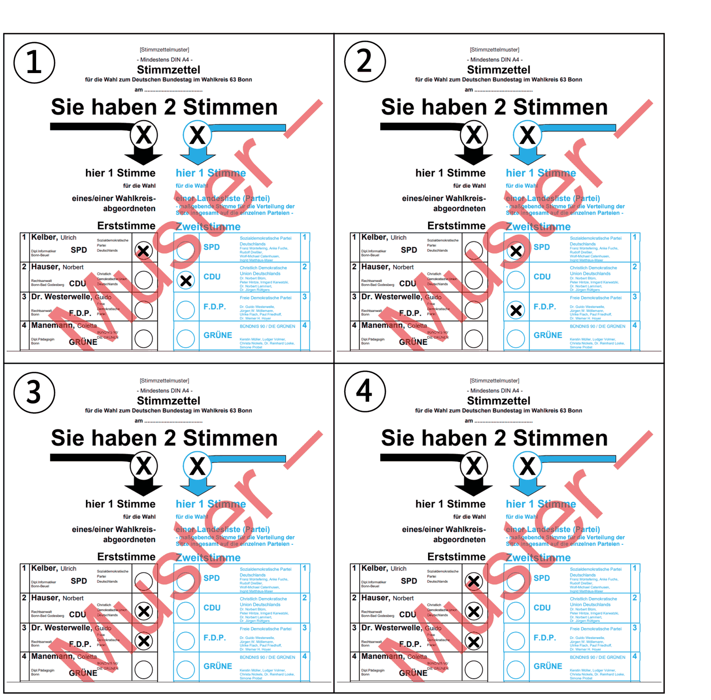

# General Questions 121-150

> Questions 121 to 150 of the official catalog. Answer first, then open the solution. Every question is bilingual and carries its own vocabulary table.

[Overview](../index.md) | [Mock test](../mock-test.md)

---

## Frage 121

> **Frage:** Eine Partei möchte in den Deutschen Bundestag. Sie muss aber einen Mindestanteil an Wählerstimmen haben. Das heißt …  
> **English:** A party wants to enter the German Bundestag. But it must have a minimum share of voter support. This is called …

| # | Antwort | English |
|---|---|---|
| a | 5%-Hürde. | 5% threshold. |
| b | Zulassungsgrenze. | Admission limit. |
| c | Basiswert. | Base value. |
| d | Richtlinie. | Guideline. |

??? success "Lösung / Answer - open after you have chosen"

    **a) 5%-Hürde.**  
    5% threshold.

    **Warum / Why:** This minimum vote requirement is called the 5%-Hürde (5% threshold/hurdle).

??? note "Wortschatz / Vocabulary"

    | Deutsch | English |
    |---|---|
    | Partei | the party |
    | Deutsch | German |
    | Bundestag | the Federal Parliament |
    | Mindestanteil | the minimum share |
    | Wählerstimme | the vote |
    | heißen | to be called |
    | Hürde | the threshold |
    | Basiswert | the underlying value |
    | Richtlinie | the guideline |

---

## Frage 122

> **Frage:** Welchem Grundsatz unterliegen Wahlen in Deutschland? Wahlen in Deutschland sind …  
> **English:** What principle governs elections in Germany? Elections in Germany are …

| # | Antwort | English |
|---|---|---|
| a | frei, gleich, geheim. | free, equal, secret. |
| b | offen, sicher, frei. | open, secure, free. |
| c | geschlossen, gleich, sicher. | closed, equal, secure. |
| d | sicher, offen, freiwillig. | secure, open, voluntary. |

??? success "Lösung / Answer - open after you have chosen"

    **a) frei, gleich, geheim.**  
    free, equal, secret.

    **Warum / Why:** German elections follow five principles: universal, direct, free, equal, and secret - here shortened to free, equal, secret.

??? note "Wortschatz / Vocabulary"

    | Deutsch | English |
    |---|---|
    | Grundsatz | the principle |
    | Wahlen | the elections |
    | Deutschland | Germany |
    | frei | free |
    | gleich | equal |
    | geheim | secret |
    | offen | open |
    | sicher | safe |
    | schließen | to close |
    | freiwillig | voluntary |

---

## Frage 123

> **Frage:** Was ist in Deutschland die "5%-Hürde"?  
> **English:** What is the "5% threshold" in Germany?

| # | Antwort | English |
|---|---|---|
| a | Abstimmungsregelung im Bundestag für kleine Parteien | Voting rule in the Bundestag for small parties |
| b | Anwesenheitskontrolle im Bundestag für Abstimmungen | Attendance check in the Bundestag for votes |
| c | Mindestanteil an Wählerstimmen, um ins Parlament zu kommen | Minimum share of voter votes required to enter parliament |
| d | Anwesenheitskontrolle im Bundesrat für Abstimmungen | Attendance check in the Bundesrat for votes |

??? success "Lösung / Answer - open after you have chosen"

    **c) Mindestanteil an Wählerstimmen, um ins Parlament zu kommen**  
    Minimum share of voter votes required to enter parliament

    **Warum / Why:** The 5% threshold is the minimum share of votes (5%) a party needs nationwide to enter parliament.

??? note "Wortschatz / Vocabulary"

    | Deutsch | English |
    |---|---|
    | Deutschland | Germany |
    | Hürde | the threshold |
    | Mindestanteil | the minimum share |
    | Wählerstimme | the vote |
    | Parlament | parliament |
    | kommen | to come |
    | Bundestag | the Federal Parliament |
    | klein | small |
    | Partei | the party |
    | Anwesenheitskontrolle | the attendance check |
    | Abstimmung | the vote |
    | Bundesrat | the Federal Council |

---

## Frage 124

> **Frage:** Die Bundestagswahl in Deutschland ist die Wahl …  
> **English:** The Bundestag election in Germany is the election of the …

| # | Antwort | English |
|---|---|---|
| a | der Bundeskanzlerin/des Bundeskanzlers. | of the Federal Chancellor. |
| b | der Parlamente der Länder. | of the state parliaments. |
| c | des Parlaments für Deutschland. | of the parliament for Germany. |
| d | der Bundespräsidentin/des Bundespräsidenten. | of the Federal President. |

??? success "Lösung / Answer - open after you have chosen"

    **c) des Parlaments für Deutschland.**  
    of the parliament for Germany.

    **Warum / Why:** The Bundestagswahl elects Germany's national parliament (the Bundestag itself), not the Chancellor or President directly.

??? note "Wortschatz / Vocabulary"

    | Deutsch | English |
    |---|---|
    | Bundestagswahl | the federal election |
    | Deutschland | Germany |
    | Wahl | the election |
    | Parlament | parliament |
    | Bundeskanzler | the Federal Chancellor |
    | Land | the country / federal state |
    | Bundespräsident | the Federal President |

---

## Frage 125

> **Frage:** In einer Demokratie ist eine Funktion von regelmäßigen Wahlen, …  
> **English:** In a democracy, one function of regular elections is to …

| # | Antwort | English |
|---|---|---|
| a | die Bürgerinnen und Bürger zu zwingen, ihre Stimme abzugeben. | to force citizens to cast their vote. |
| b | nach dem Willen der Wählermehrheit den Wechsel der Regierung zu ermöglichen. | to enable a change of government according to the will of the majority of voters. |
| c | im Land bestehende Gesetze beizubehalten. | to preserve existing laws in the country. |
| d | den Armen mehr Macht zu geben. | to give more power to the poor. |

??? success "Lösung / Answer - open after you have chosen"

    **b) nach dem Willen der Wählermehrheit den Wechsel der Regierung zu ermöglichen.**  
    to enable a change of government according to the will of the majority of voters.

    **Warum / Why:** Regular elections enable peaceful change of government based on voter majority will - a core democratic function.

??? note "Wortschatz / Vocabulary"

    | Deutsch | English |
    |---|---|
    | Demokratie | democracy |
    | Funktion | the function |
    | regelmäßig | regular |
    | Wahlen | the elections |
    | Wechseln | to change / to switch |
    | Regierung | the government |
    | ermöglichen | to make possible |
    | Bürger | the citizen |
    | zwingen | to force |
    | Stimme | the vote |
    | abgeben | to hand in |
    | Land | the country / federal state |

---

## Frage 126

> **Frage:** Was bekommen wahlberechtigte Bürgerinnen und Bürger in Deutschland vor einer Wahl?  
> **English:** What do eligible voters in Germany receive before an election?

| # | Antwort | English |
|---|---|---|
| a | eine Wahlbenachrichtigung von der Gemeinde | a voting notification from the municipality |
| b | eine Wahlerlaubnis von der Bundespräsidentin/von dem Bundespräsidenten | a voting permit from the Federal President |
| c | eine Benachrichtigung von der Bundesversammlung | a notification from the Federal Convention |
| d | eine Benachrichtigung vom Pfarramt | a notification from the parish office |

??? success "Lösung / Answer - open after you have chosen"

    **a) eine Wahlbenachrichtigung von der Gemeinde**  
    a voting notification from the municipality

    **Warum / Why:** Eligible voters receive a Wahlbenachrichtigung (voting notification) from their local municipality ahead of elections.

??? note "Wortschatz / Vocabulary"

    | Deutsch | English |
    |---|---|
    | bekommen | to get |
    | Wahlberechtigte | the eligible voter |
    | Bürger | the citizen |
    | Deutschland | Germany |
    | Wahl | the election |
    | Wahlbenachrichtigung | the polling card |
    | Gemeinde | the municipality |
    | Bundespräsident | the Federal President |
    | Benachrichtigung | the notification |
    | Bundesversammlung | the Federal Assembly |
    | Pfarramt | the parish office |

---

## Frage 127

> **Frage:** Warum gibt es die 5%-Hürde im Wahlgesetz der Bundesrepublik Deutschland? Es gibt sie, weil …  
> **English:** Why does the 5% threshold exist in German electoral law? It exists because …

| # | Antwort | English |
|---|---|---|
| a | die Programme von vielen kleinen Parteien viele Gemeinsamkeiten haben. | the programs of many small parties have a lot in common. |
| b | die Bürgerinnen und Bürger bei vielen kleinen Parteien die Orientierung verlieren können. | citizens can lose orientation with too many small parties. |
| c | viele kleine Parteien die Regierungsbildung erschweren. | many small parties make forming a government harder. |
| d | die kleinen Parteien nicht so viel Geld haben, um die Politikerinnen und Politiker zu bezahlen. | small parties don't have enough money to pay politicians. |

??? success "Lösung / Answer - open after you have chosen"

    **c) viele kleine Parteien die Regierungsbildung erschweren.**  
    many small parties make forming a government harder.

    **Warum / Why:** The threshold exists to prevent excessive party fragmentation, which historically made forming stable governments difficult (as in the Weimar Republic).

??? note "Wortschatz / Vocabulary"

    | Deutsch | English |
    |---|---|
    | geben | to give |
    | Hürde | the threshold |
    | Wahlgesetz | the electoral law |
    | Bundesrepublik | the Federal Republic |
    | Deutschland | Germany |
    | klein | small |
    | Partei | the party |
    | Regierungsbildung | the formation of a government |
    | erschweren | to make difficult |
    | Bürger | the citizen |
    | Orientierung | the orientation |
    | verlieren | to lose |

---

## Frage 128

> **Frage:** Parlamentsmitglieder, die von den Bürgerinnen und Bürgern gewählt werden, nennt man …  
> **English:** Members of parliament elected by citizens are called …

| # | Antwort | English |
|---|---|---|
| a | Abgeordnete. | Members of parliament (Abgeordnete). |
| b | Kanzlerinnen/Kanzler. | Chancellors. |
| c | Botschafterinnen/Botschafter. | Ambassadors. |
| d | Ministerpräsidentinnen/Ministerpräsidenten. | Minister-Presidents. |

??? success "Lösung / Answer - open after you have chosen"

    **a) Abgeordnete.**  
    Members of parliament (Abgeordnete).

    **Warum / Why:** Elected members of parliament are called Abgeordnete (members/deputies).

??? note "Wortschatz / Vocabulary"

    | Deutsch | English |
    |---|---|
    | Bürger | the citizen |
    | wählen | to vote / to choose |
    | nennen | to name |
    | Abgeordnete | the member of parliament |
    | Kanzlerin | the Chancellor (female) |
    | Kanzler | the Chancellor |
    | Botschafter | the ambassador |
    | Ministerpräsident | the Minister-President |

---

## Frage 129

> **Frage:** Vom Volk gewählt wird in Deutschland …  
> **English:** In Germany, the people directly elect the …

| # | Antwort | English |
|---|---|---|
| a | die Bundeskanzlerin/der Bundeskanzler. | the Federal Chancellor. |
| b | die Ministerpräsidentin/der Ministerpräsident eines Bundeslandes. | the Minister-President of a federal state. |
| c | der Bundestag. | the Bundestag. |
| d | die Bundespräsidentin/der Bundespräsident. | the Federal President. |

??? success "Lösung / Answer - open after you have chosen"

    **c) der Bundestag.**  
    the Bundestag.

    **Warum / Why:** Citizens directly elect the Bundestag; the Chancellor, Minister-Presidents, and Federal President are elected indirectly by other bodies.

??? note "Wortschatz / Vocabulary"

    | Deutsch | English |
    |---|---|
    | Volk | the people |
    | wählen | to vote / to choose |
    | Deutschland | Germany |
    | Bundestag | the Federal Parliament |
    | Bundeskanzler | the Federal Chancellor |
    | Ministerpräsident | the Minister-President |
    | Bundesland | the federal state |
    | Bundespräsident | the Federal President |

---

## Frage 130

> **Frage:** Welcher Stimmzettel wäre bei einer Bundestagswahl gültig?  
> **English:** Which ballot paper would be valid in a Bundestag election?

| # | Antwort | English |
|---|---|---|
| a | 1 | Number 1 |
| b | 2 | Number 2 |
| c | 3 | Number 3 |
| d | 4 | Number 4 |

??? success "Lösung / Answer - open after you have chosen"

    **a) 1**  
    Number 1

    **Warum / Why:** A valid ballot has exactly one mark in the first-vote column and one in the second-vote column - any other marking pattern invalidates the ballot.

??? note "Wortschatz / Vocabulary"

    | Deutsch | English |
    |---|---|
    | Stimmzettel | the ballot paper |
    | Bundestagswahl | the federal election |
    | gültig | valid |

---

## Frage 131

> **Frage:** In Deutschland ist eine Bürgermeisterin/ein Bürgermeister …  
> **English:** In Germany, a mayor is …

| # | Antwort | English |
|---|---|---|
| a | die Leiterin/der Leiter einer Schule. | the head of a school. |
| b | die Chefin/der Chef einer Bank. | the head of a bank. |
| c | das Oberhaupt einer Gemeinde. | the head of a municipality. |
| d | die/der Vorsitzende einer Partei. | the chairperson of a political party. |

??? success "Lösung / Answer - open after you have chosen"

    **c) das Oberhaupt einer Gemeinde.**  
    the head of a municipality.

    **Warum / Why:** A Bürgermeister/in is the head of a municipality (Gemeinde) - not a school, bank, or political party.

??? note "Wortschatz / Vocabulary"

    | Deutsch | English |
    |---|---|
    | Deutschland | Germany |
    | Bürgermeister | the mayor |
    | Oberhaupt | the head |
    | Gemeinde | the municipality |
    | Leiterin | the head (female) |
    | Leiter | the head |
    | Schule | the school |
    | Chefin | the head / boss (female) |
    | Chef | the head / boss |
    | Vorsitzende | the chairperson |
    | Partei | the party |

---

## Frage 132

> **Frage:** Viele Menschen in Deutschland arbeiten in ihrer Freizeit ehrenamtlich. Was bedeutet das?  
> **English:** Many people in Germany volunteer in their free time. What does that mean?

| # | Antwort | English |
|---|---|---|
| a | Sie arbeiten als Soldatinnen/Soldaten. | They work as soldiers. |
| b | Sie arbeiten freiwillig und unbezahlt in Vereinen und Verbänden. | They work voluntarily and unpaid in clubs and associations. |
| c | Sie arbeiten in der Bundesregierung. | They work in the federal government. |
| d | Sie arbeiten in einem Krankenhaus und verdienen dabei Geld. | They work in a hospital and earn money. |

??? success "Lösung / Answer - open after you have chosen"

    **b) Sie arbeiten freiwillig und unbezahlt in Vereinen und Verbänden.**  
    They work voluntarily and unpaid in clubs and associations.

    **Warum / Why:** Ehrenamtliche (voluntary) work means working unpaid in clubs, associations, or charities - a widespread and valued practice in German society.

??? note "Wortschatz / Vocabulary"

    | Deutsch | English |
    |---|---|
    | Mensch | the human being |
    | Deutschland | Germany |
    | arbeiten | to work |
    | Freizeit | the free time |
    | ehrenamtlich | voluntary |
    | bedeuten | to mean |
    | freiwillig | voluntary |
    | unbezahlt | unpaid |
    | Vereinen | to unite |
    | Verbinden | to connect |
    | Soldatin | the soldier (female) |
    | Soldat | the soldier |

---

## Frage 133

> **Frage:** Was ist bei Bundestags- und Landtagswahlen in Deutschland erlaubt?  
> **English:** What is allowed in Bundestag and state parliament elections in Germany?

| # | Antwort | English |
|---|---|---|
| a | Der Ehemann wählt für seine Frau mit. | The husband votes on behalf of his wife too. |
| b | Man kann durch Briefwahl seine Stimme abgeben. | One can cast a vote by postal ballot. |
| c | Man kann am Wahltag telefonisch seine Stimme abgeben. | One can vote by phone on election day. |
| d | Kinder ab dem Alter von 14 Jahren dürfen wählen. | Children from age 14 may vote. |

??? success "Lösung / Answer - open after you have chosen"

    **b) Man kann durch Briefwahl seine Stimme abgeben.**  
    One can cast a vote by postal ballot.

    **Warum / Why:** Postal voting (Briefwahl) is a legal and common way to vote in Germany - phone voting, proxy voting by a spouse, and voting under 18 are not allowed.

??? note "Wortschatz / Vocabulary"

    | Deutsch | English |
    |---|---|
    | Landtagswahl | the state election |
    | Deutschland | Germany |
    | erlauben | to allow |
    | Briefwahl | the postal vote |
    | Stimme | the vote |
    | abgeben | to hand in |
    | Ehemann | the husband |
    | wählen | to vote / to choose |
    | Frau | the woman |
    | Wahltag | election day |
    | Kind | the child |
    | Alter | the age |

---

## Frage 134

> **Frage:** Man will die Buslinie abschaffen, mit der Sie immer zur Arbeit fahren. Was können Sie machen, um die Buslinie zu erhalten?  
> **English:** Someone wants to abolish the bus line you always use to get to work. What can you do to preserve it?

| # | Antwort | English |
|---|---|---|
| a | Ich beteilige mich an einer Bürgerinitiative für die Erhaltung der Buslinie oder gründe selber eine Initiative. | I join a citizens' initiative to preserve the bus line, or start one myself. |
| b | Ich werde Mitglied in einem Sportverein und trainiere Radfahren. | I join a sports club and practice cycling. |
| c | Ich wende mich an das Finanzamt, weil ich als Steuerzahlerin/Steuerzahler ein Recht auf die Buslinie habe. | I contact the tax office because as a taxpayer I have a right to the bus line. |
| d | Ich schreibe einen Brief an das Forstamt der Gemeinde. | I write a letter to the municipal forestry office. |

??? success "Lösung / Answer - open after you have chosen"

    **a) Ich beteilige mich an einer Bürgerinitiative für die Erhaltung der Buslinie oder gründe selber eine Initiative.**  
    I join a citizens' initiative to preserve the bus line, or start one myself.

    **Warum / Why:** Joining or forming a citizens' initiative (Bürgerinitiative) is the recognized, effective way to advocate for local issues like public transit in Germany.

??? note "Wortschatz / Vocabulary"

    | Deutsch | English |
    |---|---|
    | Buslinie | the bus line |
    | abschaffen | to abolish |
    | Arbeit | the work |
    | fahren | to drive |
    | machen | to do / make |
    | erhalten | to receive |
    | beteiligen | to take part |
    | Bürgerinitiative | the citizens' initiative |
    | Erhaltung | the preservation |
    | gründen | to found |
    | selber | oneself |
    | Mitglied | the member |

---

## Frage 135

> **Frage:** Wen vertreten die Gewerkschaften in Deutschland?  
> **English:** Who do trade unions represent in Germany?

| # | Antwort | English |
|---|---|---|
| a | große Unternehmen | large companies |
| b | kleine Unternehmen | small companies |
| c | Selbstständige | the self-employed |
| d | Arbeitnehmerinnen und Arbeitnehmer | employees |

??? success "Lösung / Answer - open after you have chosen"

    **d) Arbeitnehmerinnen und Arbeitnehmer**  
    employees

    **Warum / Why:** Trade unions represent employees (workers), negotiating on their behalf with employers - not businesses or the self-employed.

??? note "Wortschatz / Vocabulary"

    | Deutsch | English |
    |---|---|
    | vertreten | to represent |
    | Gewerkschaft | the trade union |
    | Deutschland | Germany |
    | Arbeitnehmer | the employee |
    | groß | big |
    | Unternehmen | the company |
    | klein | small |
    | Selbstständig | self-employed |

---

## Frage 136

> **Frage:** Sie gehen in Deutschland zum Arbeitsgericht bei …  
> **English:** In Germany, you go to the labor court in case of …

| # | Antwort | English |
|---|---|---|
| a | falscher Nebenkostenabrechnung. | an incorrect utility bill statement. |
| b | ungerechtfertigter Kündigung durch Ihre Chefin/Ihren Chef. | unjustified dismissal by your boss. |
| c | Problemen mit den Nachbarinnen/Nachbarn. | problems with neighbors. |
| d | Schwierigkeiten nach einem Verkehrsunfall. | difficulties following a traffic accident. |

??? success "Lösung / Answer - open after you have chosen"

    **b) ungerechtfertigter Kündigung durch Ihre Chefin/Ihren Chef.**  
    unjustified dismissal by your boss.

    **Warum / Why:** Labor courts (Arbeitsgerichte) handle employment disputes such as unjustified dismissal - not utility bills, neighbor disputes, or traffic accidents.

??? note "Wortschatz / Vocabulary"

    | Deutsch | English |
    |---|---|
    | gehen | to go |
    | Deutschland | Germany |
    | Arbeitsgericht | the labour court |
    | Kündigung | the dismissal |
    | Chefin | the head / boss (female) |
    | Chef | the head / boss |
    | falsch | wrong |
    | Problem | the problem |
    | Nachbar | the neighbour |
    | Schwierigkeit | the difficulty |
    | Verkehrsunfall | the road accident |

---

## Frage 137

> **Frage:** Welches Gericht ist in Deutschland bei Konflikten in der Arbeitswelt zuständig?  
> **English:** Which court is responsible for workplace conflicts in Germany?

| # | Antwort | English |
|---|---|---|
| a | das Familiengericht | the family court |
| b | das Strafgericht | the criminal court |
| c | das Arbeitsgericht | the labor court |
| d | das Amtsgericht | the local court |

??? success "Lösung / Answer - open after you have chosen"

    **c) das Arbeitsgericht**  
    the labor court

    **Warum / Why:** The Arbeitsgericht (labor court) handles workplace and employment-related conflicts specifically.

??? note "Wortschatz / Vocabulary"

    | Deutsch | English |
    |---|---|
    | Gericht | the court |
    | Deutschland | Germany |
    | Arbeitswelt | the working world |
    | zuständig | responsible |
    | Arbeitsgericht | the labour court |
    | Familiengericht | the family court |
    | Strafgericht | the criminal court |
    | Amtsgericht | the local court |

---

## Frage 138

> **Frage:** Was kann ich in Deutschland machen, wenn mir meine Arbeitgeberin/mein Arbeitgeber zu Unrecht gekündigt hat?  
> **English:** What can I do in Germany if my employer wrongfully dismissed me?

| # | Antwort | English |
|---|---|---|
| a | weiterarbeiten und freundlich zur Chefin/zum Chef sein | keep working and be friendly to the boss |
| b | ein Mahnverfahren gegen die Arbeitgeberin/den Arbeitgeber führen | initiate a debt collection procedure against the employer |
| c | Kündigungsschutzklage erheben | file a wrongful dismissal lawsuit |
| d | die Arbeitgeberin/den Arbeitgeber bei der Polizei anzeigen | report the employer to the police |

??? success "Lösung / Answer - open after you have chosen"

    **c) Kündigungsschutzklage erheben**  
    file a wrongful dismissal lawsuit

    **Warum / Why:** The correct legal remedy is a Kündigungsschutzklage (wrongful dismissal lawsuit) filed at the labor court - not a police report or debt claim.

??? note "Wortschatz / Vocabulary"

    | Deutsch | English |
    |---|---|
    | Deutschland | Germany |
    | machen | to do / make |
    | mein | my |
    | Arbeitgeber | the employer |
    | Unrecht | the injustice |
    | kündigen | to cancel / to quit |
    | erheben | to raise |
    | Chefin | the head / boss (female) |
    | Chef | the head / boss |
    | Mahnverfahren | the dunning procedure |
    | führen | to lead |
    | Polizei | the police |

---

## Frage 139

> **Frage:** Wann kommt es in Deutschland zu einem Prozess vor Gericht? Wenn jemand …  
> **English:** When does a trial occur in Germany? When someone …

| # | Antwort | English |
|---|---|---|
| a | zu einer anderen Religion übertritt. | converts to another religion. |
| b | eine Straftat begangen hat und angeklagt wird. | has committed a crime and is charged. |
| c | eine andere Meinung als die der Regierung vertritt. | holds a different opinion than the government. |
| d | sein Auto falsch geparkt hat und es abgeschleppt wird. | has parked their car wrong and it gets towed. |

??? success "Lösung / Answer - open after you have chosen"

    **b) eine Straftat begangen hat und angeklagt wird.**  
    has committed a crime and is charged.

    **Warum / Why:** A criminal trial occurs when someone commits and is charged with a crime - not for religious conversion, differing political opinions, or parking violations.

??? note "Wortschatz / Vocabulary"

    | Deutsch | English |
    |---|---|
    | kommen | to come |
    | Deutschland | Germany |
    | Prozess | the trial / lawsuit |
    | Gericht | the court |
    | jemand | somebody |
    | Straftat | the criminal offence |
    | begehen | to commit |
    | anklagen | to accuse |
    | Meinung | the opinion |
    | Regierung | the government |
    | vertreten | to represent |
    | Auto | the car |

---

## Frage 140

> **Frage:** Was macht eine Schöffin/ein Schöffe in Deutschland? Sie/Er …  
> **English:** What does a lay judge do in Germany? He/she …

| # | Antwort | English |
|---|---|---|
| a | entscheidet mit Richterinnen/Richtern über Schuld und Strafe. | decides on guilt and punishment together with judges. |
| b | gibt Bürgerinnen/Bürgern rechtlichen Rat. | gives citizens legal advice. |
| c | stellt Urkunden aus. | issues official documents. |
| d | verteidigt die Angeklagte/den Angeklagten. | defends the accused. |

??? success "Lösung / Answer - open after you have chosen"

    **a) entscheidet mit Richterinnen/Richtern über Schuld und Strafe.**  
    decides on guilt and punishment together with judges.

    **Warum / Why:** A Schöffe/in (lay judge) is a citizen volunteer who sits alongside professional judges and votes on guilt and sentencing - not a legal advisor or defense attorney.

??? note "Wortschatz / Vocabulary"

    | Deutsch | English |
    |---|---|
    | Macht | the power |
    | Schöffe | the lay judge |
    | Deutschland | Germany |
    | entscheiden | to decide |
    | Richter | the judge |
    | Schuld | the guilt |
    | Strafe | the punishment |
    | geben | to give |
    | Bürger | the citizen |
    | rechtlich | legal |
    | stellen | to place |
    | Urkunde | the certificate |

---

## Frage 141

> **Frage:** Wer berät in Deutschland Personen bei Rechtsfragen und vertritt sie vor Gericht?  
> **English:** Who advises people on legal matters and represents them in court in Germany?

| # | Antwort | English |
|---|---|---|
| a | eine Rechtsanwältin/ein Rechtsanwalt | a lawyer |
| b | eine Richterin/ein Richter | a judge |
| c | eine Schöffin/ein Schöffe | a lay judge |
| d | eine Staatsanwältin/ein Staatsanwalt | a public prosecutor |

??? success "Lösung / Answer - open after you have chosen"

    **a) eine Rechtsanwältin/ein Rechtsanwalt**  
    a lawyer

    **Warum / Why:** A Rechtsanwalt/in (lawyer) advises clients and represents them legally - judges, lay judges, and prosecutors have different, impartial roles in court.

??? note "Wortschatz / Vocabulary"

    | Deutsch | English |
    |---|---|
    | Deutschland | Germany |
    | Person | the person |
    | vertreten | to represent |
    | Gericht | the court |
    | Rechtsanwältin | the lawyer (female) |
    | Rechtsanwalt | the lawyer |
    | Richter | the judge |
    | Schöffe | the lay judge |
    | Staatsanwalt | the public prosecutor |

---

## Frage 142

> **Frage:** Was ist die Hauptaufgabe einer Richterin/eines Richters in Deutschland? Eine Richterin/ein Richter …  
> **English:** What is the main task of a judge in Germany? A judge …

| # | Antwort | English |
|---|---|---|
| a | vertritt Bürgerinnen und Bürger vor einem Gericht. | represents citizens in court. |
| b | arbeitet an einem Gericht und spricht Urteile. | works at a court and delivers verdicts. |
| c | ändert Gesetze. | changes laws. |
| d | betreut Jugendliche vor Gericht. | looks after youths in court. |

??? success "Lösung / Answer - open after you have chosen"

    **b) arbeitet an einem Gericht und spricht Urteile.**  
    works at a court and delivers verdicts.

    **Warum / Why:** A judge's main role is to work at a court and deliver rulings/verdicts - not to represent citizens, change laws, or act as a youth caseworker.

??? note "Wortschatz / Vocabulary"

    | Deutsch | English |
    |---|---|
    | Hauptaufgabe | the main task |
    | Richter | the judge |
    | Deutschland | Germany |
    | arbeiten | to work |
    | Gericht | the court |
    | sprechen | to speak |
    | Urteil | the judgment |
    | vertreten | to represent |
    | Bürger | the citizen |
    | ändern | to change |
    | Gesetz | the law |
    | Jugendliche | the young person |

---

## Frage 143

> **Frage:** Eine Richterin/ein Richter in Deutschland gehört zur …  
> **English:** A judge in Germany belongs to the …

| # | Antwort | English |
|---|---|---|
| a | Judikative. | Judiciary. |
| b | Exekutive. | Executive. |
| c | Operative. | Operative branch. |
| d | Legislative. | Legislature. |

??? success "Lösung / Answer - open after you have chosen"

    **a) Judikative.**  
    Judiciary.

    **Warum / Why:** Judges belong to the Judikative (judiciary), the third branch of state power alongside the executive and legislature.

??? note "Wortschatz / Vocabulary"

    | Deutsch | English |
    |---|---|
    | Richter | the judge |
    | Deutschland | Germany |
    | gehören | to belong |
    | Judikative | the judiciary |
    | Exekutive | the executive |
    | Legislative | the legislature |

---

## Frage 144

> **Frage:** Eine Richterin/ein Richter gehört in Deutschland zur …  
> **English:** A judge in Germany belongs to the …

| # | Antwort | English |
|---|---|---|
| a | vollziehenden Gewalt. | executive power. |
| b | rechtsprechenden Gewalt. | judicial power. |
| c | planenden Gewalt. | planning power. |
| d | gesetzgebenden Gewalt. | legislative power. |

??? success "Lösung / Answer - open after you have chosen"

    **b) rechtsprechenden Gewalt.**  
    judicial power.

    **Warum / Why:** Judges belong to the rechtsprechende Gewalt (judicial power) - the power to interpret and apply the law.

??? note "Wortschatz / Vocabulary"

    | Deutsch | English |
    |---|---|
    | Richter | the judge |
    | gehören | to belong |
    | Deutschland | Germany |
    | Gewalt | the power |

---

## Frage 145

> **Frage:** In Deutschland wird die Staatsgewalt geteilt. Für welche Staatsgewalt arbeitet eine Richterin/ein Richter? Für die …  
> **English:** In Germany, state power is divided. Which branch of state power does a judge work for? For the …

| # | Antwort | English |
|---|---|---|
| a | Judikative | Judiciary. |
| b | Exekutive | Executive. |
| c | Presse | Press. |
| d | Legislative | Legislature. |

??? success "Lösung / Answer - open after you have chosen"

    **a) Judikative**  
    Judiciary.

    **Warum / Why:** Judges belong to the Judikative (judiciary), the branch of state power responsible for interpreting and applying the law - distinct from the executive, legislature, or the press, which is not a branch of state power at all.

??? note "Wortschatz / Vocabulary"

    | Deutsch | English |
    |---|---|
    | Deutschland | Germany |
    | Staatsgewalt | the state power |
    | teilen | to share / to divide |
    | arbeiten | to work |
    | Richter | the judge |
    | Judikative | the judiciary |
    | Exekutive | the executive |
    | Presse | the press |
    | Legislative | the legislature |

---

## Frage 146

> **Frage:** Wie nennt man in Deutschland ein Verfahren vor einem Gericht?  
> **English:** What is a proceeding before a court called in Germany?

| # | Antwort | English |
|---|---|---|
| a | Programm | Program |
| b | Prozedur | Procedure |
| c | Protokoll | Protocol |
| d | Prozess | Trial/proceeding |

??? success "Lösung / Answer - open after you have chosen"

    **d) Prozess**  
    Trial/proceeding

    **Warum / Why:** A court proceeding is called a Prozess (trial/legal proceeding) in German.

??? note "Wortschatz / Vocabulary"

    | Deutsch | English |
    |---|---|
    | nennen | to name |
    | Deutschland | Germany |
    | Verfahren | the procedure |
    | Gericht | the court |
    | Prozess | the trial / lawsuit |
    | Programm | the programme |
    | Prozedur | the procedure |
    | Protokoll | the record |

---

## Frage 147

> **Frage:** Was ist die Arbeit einer Richterin/eines Richters in Deutschland?  
> **English:** What is the work of a judge in Germany?

| # | Antwort | English |
|---|---|---|
| a | Deutschland regieren | Governing Germany |
| b | Recht sprechen | Delivering justice/rulings |
| c | Pläne erstellen | Making plans |
| d | Gesetze erlassen | Enacting laws |

??? success "Lösung / Answer - open after you have chosen"

    **b) Recht sprechen**  
    Delivering justice/rulings

    **Warum / Why:** A judge's work is Recht sprechen - delivering rulings/administering justice, not governing or legislating.

??? note "Wortschatz / Vocabulary"

    | Deutsch | English |
    |---|---|
    | Arbeit | the work |
    | Richter | the judge |
    | Deutschland | Germany |
    | Recht | the right |
    | sprechen | to speak |
    | regieren | to govern |
    | erstellen | to create |
    | Gesetz | the law |
    | erlassen | to issue |

---

## Frage 148

> **Frage:** Was ist eine Aufgabe der Polizei in Deutschland?  
> **English:** What is a task of the police in Germany?

| # | Antwort | English |
|---|---|---|
| a | das Land zu verteidigen | to defend the country |
| b | die Bürgerinnen und Bürger abzuhören | to wiretap citizens |
| c | die Gesetze zu beschließen | to pass laws |
| d | die Einhaltung von Gesetzen zu überwachen | to monitor compliance with laws |

??? success "Lösung / Answer - open after you have chosen"

    **d) die Einhaltung von Gesetzen zu überwachen**  
    to monitor compliance with laws

    **Warum / Why:** Policing law compliance is the police's core task - defending the country is the military's job, and passing laws is parliament's.

??? note "Wortschatz / Vocabulary"

    | Deutsch | English |
    |---|---|
    | Aufgabe | the task |
    | Polizei | the police |
    | Deutschland | Germany |
    | Einhaltung | the compliance |
    | Gesetz | the law |
    | überwachen | to monitor |
    | Land | the country / federal state |
    | verteidigen | to defend |
    | Bürger | the citizen |
    | abhören | to eavesdrop |

---

## Frage 149

> **Frage:** Was ist ein Beispiel für antisemitisches Verhalten?  
> **English:** What is an example of antisemitic behavior?

| # | Antwort | English |
|---|---|---|
| a | ein jüdisches Fest besuchen | visiting a Jewish festival |
| b | die israelische Regierung kritisieren | criticizing the Israeli government |
| c | den Holocaust leugnen | denying the Holocaust |
| d | gegen Juden Fußball spielen. | playing football against Jews |

??? success "Lösung / Answer - open after you have chosen"

    **c) den Holocaust leugnen**  
    denying the Holocaust

    **Warum / Why:** Denying the Holocaust is a clear example of antisemitic behavior and is a criminal offense in Germany. Important distinctions: visiting Jewish festivals, criticizing Israeli government policies, and playing sports with or against Jewish people are all normal, acceptable activities. Criticism of Israeli government policy is NOT antisemitism. However, denying the systematic murder of 6 million Jews is both antisemitic and illegal.

??? note "Wortschatz / Vocabulary"

    | Deutsch | English |
    |---|---|
    | Beispiel | the example |
    | Verhalten | the behaviour |
    | leugnen | to deny |
    | jüdisch | Jewish |
    | Fest | permanent |
    | besuchen | to visit / to attend |
    | israelisch | Israeli |
    | Regierung | the government |
    | Jude | the Jew |
    | Fußball | football |
    | spielen | to play |

---

## Frage 150

> **Frage:** Eine Gerichtsschöffin/ein Gerichtsschöffe in Deutschland ist …  
> **English:** A lay judge in Germany is …

| # | Antwort | English |
|---|---|---|
| a | die Stellvertreterin/der Stellvertreter des Stadtoberhaupts. | the deputy head of the city. |
| b | eine ehrenamtliche Richterin/ein ehrenamtlicher Richter. | a volunteer (honorary) judge. |
| c | ein Mitglied eines Gemeinderats. | a member of a municipal council. |
| d | eine Person, die Jura studiert hat. | a person who studied law. |

??? success "Lösung / Answer - open after you have chosen"

    **b) eine ehrenamtliche Richterin/ein ehrenamtlicher Richter.**  
    a volunteer (honorary) judge.

    **Warum / Why:** A Gerichtsschöffe/in is a volunteer, honorary lay judge - no law degree is required, unlike professional judges.

??? note "Wortschatz / Vocabulary"

    | Deutsch | English |
    |---|---|
    | Deutschland | Germany |
    | ehrenamtlich | voluntary |
    | Richter | the judge |
    | Stellvertreterin | the deputy (female) |
    | Stellvertreter | the deputy |
    | Mitglied | the member |
    | Jura | law (the subject) |
    | studieren | to study |

---

## Set check

- [ ] I answered all 30 questions before opening any solution.
- [ ] I scored at least 24/30.
- [ ] I reviewed every wrong answer and said the correct sentence aloud.

---

[← Questions 91-120](04-questions-091-120.md) | [Overview](../index.md) | [Questions 151-180 →](06-questions-151-180.md)
