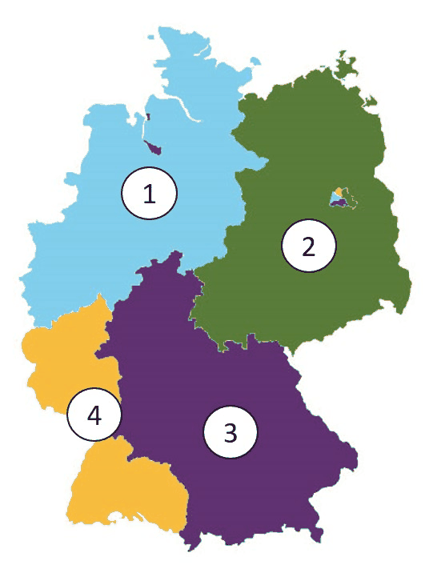

# General Questions 151-180

> Questions 151 to 180 of the official catalog. Answer first, then open the solution. Every question is bilingual and carries its own vocabulary table.

[Overview](../index.md) | [Mock test](../mock-test.md)

---

## Frage 151

> **Frage:** Wer baute die Mauer in Berlin?  
> **English:** Who built the Berlin Wall?

| # | Antwort | English |
|---|---|---|
| a | Großbritannien | Great Britain |
| b | die DDR | the GDR |
| c | die Bundesrepublik Deutschland | the Federal Republic of Germany |
| d | die USA | the USA |

??? success "Lösung / Answer - open after you have chosen"

    **b) die DDR**  
    the GDR

    **Warum / Why:** The GDR (East Germany) built the Berlin Wall in 1961 to stop mass emigration to the West.

??? note "Wortschatz / Vocabulary"

    | Deutsch | English |
    |---|---|
    | bauen | to build |
    | Mauer | the Wall |
    | Ddr | the GDR (East Germany) |
    | Großbritannien | Great Britain |
    | Bundesrepublik | the Federal Republic |
    | Deutschland | Germany |

---

## Frage 152

> **Frage:** Wann waren die Nationalsozialisten mit Adolf Hitler in Deutschland an der Macht?  
> **English:** When were the National Socialists with Adolf Hitler in power in Germany?

| # | Antwort | English |
|---|---|---|
| a | 1918 bis 1923 | 1918 to 1923 |
| b | 1932 bis 1950 | 1932 to 1950 |
| c | 1933 bis 1945 | 1933 to 1945 |
| d | 1945 bis 1989 | 1945 to 1989 |

??? success "Lösung / Answer - open after you have chosen"

    **c) 1933 bis 1945**  
    1933 to 1945

    **Warum / Why:** The Nazi regime held power from 1933 (Hitler's appointment as Chancellor) to 1945 (Germany's defeat in WWII).

??? note "Wortschatz / Vocabulary"

    | Deutsch | English |
    |---|---|
    | Nationalsozialist | the National Socialist |
    | Deutschland | Germany |
    | Macht | the power |

---

## Frage 153

> **Frage:** Was war am 8. Mai 1945?  
> **English:** What happened on May 8, 1945?

| # | Antwort | English |
|---|---|---|
| a | Tod Adolf Hitlers | Death of Adolf Hitler |
| b | Beginn des Berliner Mauerbaus | Start of the Berlin Wall's construction |
| c | Wahl von Konrad Adenauer zum Bundeskanzler | Election of Konrad Adenauer as Chancellor |
| d | Ende des Zweiten Weltkriegs in Europa | End of WWII in Europe |

??? success "Lösung / Answer - open after you have chosen"

    **d) Ende des Zweiten Weltkriegs in Europa**  
    End of WWII in Europe

    **Warum / Why:** May 8, 1945 marks Germany's unconditional surrender, ending World War II in Europe.

??? note "Wortschatz / Vocabulary"

    | Deutsch | English |
    |---|---|
    | Mai | May |
    | Ende | the end |
    | Zweit | second |
    | Weltkrieg | the world war |
    | Europa | Europe |
    | Tod | death |
    | Beginn | the beginning |
    | Berliner | the Berliner (person from Berlin) |
    | Wahl | the election |
    | Bundeskanzler | the Federal Chancellor |

---

## Frage 154

> **Frage:** Wann war der Zweite Weltkrieg zu Ende?  
> **English:** When did World War II end?

| # | Antwort | English |
|---|---|---|
| a | 1933 | 1933 |
| b | 1945 | 1945 |
| c | 1949 | 1949 |
| d | 1961 | 1961 |

??? success "Lösung / Answer - open after you have chosen"

    **b) 1945**  
    1945

    **Warum / Why:** World War II ended in 1945.

??? note "Wortschatz / Vocabulary"

    | Deutsch | English |
    |---|---|
    | Zweite | second |
    | Weltkrieg | the world war |
    | Ende | the end |

---

## Frage 155

> **Frage:** Wann waren die Nationalsozialisten in Deutschland an der Macht?  
> **English:** When were the National Socialists in power in Germany?

| # | Antwort | English |
|---|---|---|
| a | 1888 bis 1918 | 1888 to 1918 |
| b | 1921 bis 1934 | 1921 to 1934 |
| c | 1933 bis 1945 | 1933 to 1945 |
| d | 1949 bis 1963 | 1949 to 1963 |

??? success "Lösung / Answer - open after you have chosen"

    **c) 1933 bis 1945**  
    1933 to 1945

    **Warum / Why:** The Nazi regime governed Germany from 1933 to 1945.

??? note "Wortschatz / Vocabulary"

    | Deutsch | English |
    |---|---|
    | Nationalsozialist | the National Socialist |
    | Deutschland | Germany |
    | Macht | the power |

---

## Frage 156

> **Frage:** In welchem Jahr wurde Hitler Reichskanzler?  
> **English:** In what year did Hitler become Reich Chancellor?

| # | Antwort | English |
|---|---|---|
| a | 1923 | 1923 |
| b | 1927 | 1927 |
| c | 1933 | 1933 |
| d | 1936 | 1936 |

??? success "Lösung / Answer - open after you have chosen"

    **c) 1933**  
    1933

    **Warum / Why:** Hitler became Reich Chancellor in 1933, appointed by President Hindenburg.

??? note "Wortschatz / Vocabulary"

    | Deutsch | English |
    |---|---|
    | Jahr | the year |
    | Reichskanzler | the Reich Chancellor |

---

## Frage 157

> **Frage:** Die Nationalsozialisten mit Adolf Hitler errichteten 1933 in Deutschland …  
> **English:** In 1933, the National Socialists with Adolf Hitler established in Germany …

| # | Antwort | English |
|---|---|---|
| a | eine Diktatur. | a dictatorship. |
| b | einen demokratischen Staat. | a democratic state. |
| c | eine Monarchie. | a monarchy. |
| d | ein Fürstentum. | a principality. |

??? success "Lösung / Answer - open after you have chosen"

    **a) eine Diktatur.**  
    a dictatorship.

    **Warum / Why:** The Nazis established a dictatorship, abolishing democratic institutions and civil liberties.

??? note "Wortschatz / Vocabulary"

    | Deutsch | English |
    |---|---|
    | Nationalsozialist | the National Socialist |
    | errichten | to establish |
    | Deutschland | Germany |
    | Diktatur | the dictatorship |
    | demokratisch | democratic |
    | Staat | the state |
    | Monarchie | the monarchy |
    | Fürstentum | the principality |

---

## Frage 158

> **Frage:** Das "Dritte Reich" war eine …  
> **English:** The "Third Reich" was a …

| # | Antwort | English |
|---|---|---|
| a | Diktatur. | Dictatorship. |
| b | Demokratie. | Democracy. |
| c | Monarchie. | Monarchy. |
| d | Räterepublik. | Council republic. |

??? success "Lösung / Answer - open after you have chosen"

    **a) Diktatur.**  
    Dictatorship.

    **Warum / Why:** The "Third Reich" (Nazi Germany, 1933-1945) was a dictatorship under Hitler.

??? note "Wortschatz / Vocabulary"

    | Deutsch | English |
    |---|---|
    | Dritte | third |
    | Reich | the empire |
    | Diktatur | the dictatorship |
    | Demokratie | democracy |
    | Monarchie | the monarchy |
    | Räterepublik | the council republic |

---

## Frage 159

> **Frage:** Was gab es in Deutschland nicht während der Zeit des Nationalsozialismus?  
> **English:** What did NOT exist in Germany during the Nazi era?

| # | Antwort | English |
|---|---|---|
| a | freie Wahlen | free elections |
| b | Pressezensur | press censorship |
| c | willkürliche Verhaftungen | arbitrary arrests |
| d | Verfolgung von Juden | persecution of Jews |

??? success "Lösung / Answer - open after you have chosen"

    **a) freie Wahlen**  
    free elections

    **Warum / Why:** Free elections did NOT exist under Nazi rule - censorship, arbitrary arrests, and persecution were widespread instead.

??? note "Wortschatz / Vocabulary"

    | Deutsch | English |
    |---|---|
    | geben | to give |
    | Deutschland | Germany |
    | während | during |
    | Zeit | the time |
    | Nationalsozialismus | National Socialism |
    | frei | free |
    | Wahlen | the elections |
    | Pressezensur | censorship of the press |
    | Verfolgung | the persecution |
    | Jude | the Jew |

---

## Frage 160

> **Frage:** Welcher Krieg dauerte von 1939 bis 1945?  
> **English:** Which war lasted from 1939 to 1945?

| # | Antwort | English |
|---|---|---|
| a | der Erste Weltkrieg | World War I |
| b | der Zweite Weltkrieg | World War II |
| c | der Vietnamkrieg | the Vietnam War |
| d | der Golfkrieg | the Gulf War |

??? success "Lösung / Answer - open after you have chosen"

    **b) der Zweite Weltkrieg**  
    World War II

    **Warum / Why:** World War II lasted from 1939 to 1945.

??? note "Wortschatz / Vocabulary"

    | Deutsch | English |
    |---|---|
    | Krieg | the war |
    | dauern | to last |
    | Zweite | second |
    | Weltkrieg | the world war |
    | Erst | first |

---

## Frage 161

> **Frage:** Was kennzeichnete den NS-Staat? Eine Politik …  
> **English:** What characterized the Nazi state? A policy …

| # | Antwort | English |
|---|---|---|
| a | des staatlichen Rassismus | of state racism |
| b | der Meinungsfreiheit | of freedom of speech |
| c | der allgemeinen Religionsfreiheit | of general freedom of religion |
| d | der Entwicklung der Demokratie | of developing democracy |

??? success "Lösung / Answer - open after you have chosen"

    **a) des staatlichen Rassismus**  
    of state racism

    **Warum / Why:** State racism was a defining feature of the Nazi regime, underpinning its persecution policies - the opposite of free speech, religious freedom, or democracy.

??? note "Wortschatz / Vocabulary"

    | Deutsch | English |
    |---|---|
    | Politik | politics |
    | staatlich | state |
    | Rassismus | the racism |
    | Meinungsfreiheit | freedom of speech |
    | allgemein | general |
    | Religionsfreiheit | freedom of religion |
    | Entwicklung | the development |
    | Demokratie | democracy |

---

## Frage 162

> **Frage:** Claus Schenk Graf von Stauffenberg wurde bekannt durch …  
> **English:** Claus Schenk Graf von Stauffenberg became known for …

| # | Antwort | English |
|---|---|---|
| a | eine Goldmedaille bei den Olympischen Spielen 1936. | a gold medal at the 1936 Olympics. |
| b | den Bau des Reichstagsgebäudes. | building the Reichstag building. |
| c | den Aufbau der Wehrmacht. | building up the Wehrmacht. |
| d | das Attentat auf Hitler am 20. Juli 1944. | the assassination attempt on Hitler on July 20, 1944. |

??? success "Lösung / Answer - open after you have chosen"

    **d) das Attentat auf Hitler am 20. Juli 1944.**  
    the assassination attempt on Hitler on July 20, 1944.

    **Warum / Why:** Stauffenberg led the failed July 20, 1944 assassination attempt on Hitler, a key act of German resistance to Nazism.

??? note "Wortschatz / Vocabulary"

    | Deutsch | English |
    |---|---|
    | Graf | the count |
    | bekannt | well-known |
    | Attentat | the assassination attempt |
    | Juli | July |
    | Goldmedaille | the gold medal |
    | Spielen | to play |
    | Bauen | to build |
    | Aufbau | the structure |

---

## Frage 163

> **Frage:** In welchem Jahr zerstörten die Nationalsozialisten Synagogen und jüdische Geschäfte in Deutschland?  
> **English:** In what year did the National Socialists destroy synagogues and Jewish businesses in Germany?

| # | Antwort | English |
|---|---|---|
| a | 1925 | 1925 |
| b | 1930 | 1930 |
| c | 1938 | 1938 |
| d | 1945 | 1945 |

??? success "Lösung / Answer - open after you have chosen"

    **c) 1938**  
    1938

    **Warum / Why:** The Nazis destroyed synagogues and Jewish businesses across Germany in 1938, during the November Pogrom (Kristallnacht) on November 9, 1938.

??? note "Wortschatz / Vocabulary"

    | Deutsch | English |
    |---|---|
    | Jahr | the year |
    | zerstören | to destroy |
    | Nationalsozialist | the National Socialist |
    | Synagoge | the synagogue |
    | jüdisch | Jewish |
    | Geschäft | the shop / business |
    | Deutschland | Germany |

---

## Frage 164

> **Frage:** Was passierte am 9. November 1938 in Deutschland?  
> **English:** What happened on November 9, 1938 in Germany?

| # | Antwort | English |
|---|---|---|
| a | Mit dem Angriff auf Polen beginnt der Zweite Weltkrieg. | World War II begins with the attack on Poland. |
| b | Die Nationalsozialisten verlieren eine Wahl und lösen den Reichstag auf. | The Nazis lose an election and dissolve the Reichstag. |
| c | Jüdische Geschäfte und Synagogen werden durch Nationalsozialisten und ihre Anhänger zerstört. | Jewish businesses and synagogues are destroyed by Nazis and their supporters. |
| d | Hitler wird Reichspräsident und lässt alle Parteien verbieten. | Hitler becomes Reich President and bans all parties. |

??? success "Lösung / Answer - open after you have chosen"

    **c) Jüdische Geschäfte und Synagogen werden durch Nationalsozialisten und ihre Anhänger zerstört.**  
    Jewish businesses and synagogues are destroyed by Nazis and their supporters.

    **Warum / Why:** November 9, 1938 was the November Pogrom ("Kristallnacht"), when Nazis and supporters destroyed Jewish synagogues and businesses across Germany.

??? note "Wortschatz / Vocabulary"

    | Deutsch | English |
    |---|---|
    | Deutschland | Germany |
    | Jüdisch | Jewish |
    | Geschäft | the shop / business |
    | Synagoge | the synagogue |
    | Nationalsozialist | the National Socialist |
    | Anhänger | the supporter |
    | zerstören | to destroy |
    | Angriff | the attack |
    | Polen | Poland |
    | beginnen | to begin |
    | Zweite | second |
    | Weltkrieg | the world war |

---

## Frage 165

> **Frage:** Wie hieß der erste Bundeskanzler der Bundesrepublik Deutschland?  
> **English:** What was the name of the first Federal Chancellor of Germany?

| # | Antwort | English |
|---|---|---|
| a | Konrad Adenauer | Konrad Adenauer |
| b | Kurt Georg Kiesinger | Kurt Georg Kiesinger |
| c | Helmut Schmidt | Helmut Schmidt |
| d | Willy Brandt | Willy Brandt |

??? success "Lösung / Answer - open after you have chosen"

    **a) Konrad Adenauer**  
    Konrad Adenauer

    **Warum / Why:** Konrad Adenauer was the first Federal Chancellor of West Germany, serving from 1949 to 1963.

??? note "Wortschatz / Vocabulary"

    | Deutsch | English |
    |---|---|
    | heißen | to be called |
    | erst | first |
    | Bundeskanzler | the Federal Chancellor |
    | Bundesrepublik | the Federal Republic |
    | Deutschland | Germany |

---

## Frage 166

> **Frage:** Bei welchen Demonstrationen in Deutschland riefen die Menschen "Wir sind das Volk"?  
> **English:** At which demonstrations in Germany did people chant "We are the people"?

| # | Antwort | English |
|---|---|---|
| a | beim Arbeiteraufstand 1953 in der DDR | at the 1953 workers' uprising in the GDR |
| b | bei den Demonstrationen 1968 in der Bundesrepublik Deutschland | at the 1968 demonstrations in West Germany |
| c | bei den Anti-Atomkraft-Demonstrationen 1985 in der Bundesrepublik Deutschland | at the 1985 anti-nuclear demonstrations in West Germany |
| d | bei den Montagsdemonstrationen 1989 in der DDR | at the 1989 Monday demonstrations in the GDR |

??? success "Lösung / Answer - open after you have chosen"

    **d) bei den Montagsdemonstrationen 1989 in der DDR**  
    at the 1989 Monday demonstrations in the GDR

    **Warum / Why:** The 1989 Monday demonstrations (Montagsdemonstrationen) in the GDR, especially in Leipzig, were key to the Peaceful Revolution that led to the Wall's fall.

??? note "Wortschatz / Vocabulary"

    | Deutsch | English |
    |---|---|
    | Demonstration | the demonstration |
    | Deutschland | Germany |
    | Mensch | the human being |
    | Volk | the people |
    | Ddr | the GDR (East Germany) |
    | Bundesrepublik | the Federal Republic |

---

## Frage 167

> **Frage:** Welche Länder wurden nach dem Zweiten Weltkrieg in Deutschland als "Alliierte Besatzungsmächte" bezeichnet?  
> **English:** Which countries were called the "Allied occupying powers" in Germany after WWII?

| # | Antwort | English |
|---|---|---|
| a | Sowjetunion, Großbritannien, Polen, Schweden | Soviet Union, Great Britain, Poland, Sweden |
| b | Frankreich, Sowjetunion, Italien, Japan | France, Soviet Union, Italy, Japan |
| c | USA, Sowjetunion, Spanien, Portugal | USA, Soviet Union, Spain, Portugal |
| d | USA, Sowjetunion, Großbritannien, Frankreich | USA, Soviet Union, Great Britain, France |

??? success "Lösung / Answer - open after you have chosen"

    **d) USA, Sowjetunion, Großbritannien, Frankreich**  
    USA, Soviet Union, Great Britain, France

    **Warum / Why:** The four Allied occupying powers were the USA, Soviet Union, Great Britain, and France, each administering a zone of postwar Germany.

??? note "Wortschatz / Vocabulary"

    | Deutsch | English |
    |---|---|
    | Land | the country / federal state |
    | Zweit | second |
    | Weltkrieg | the world war |
    | Deutschland | Germany |
    | Alliierte | the Allies |
    | Besatzungsmacht | the occupying power |
    | bezeichnen | to describe / to call |
    | Sowjetunion | the Soviet Union |
    | Großbritannien | Great Britain |
    | Frankreich | France |
    | Polen | Poland |
    | Schweden | Sweden |

---

## Frage 168

> **Frage:** Welches Land war keine "Alliierte Besatzungsmacht" in Deutschland?  
> **English:** Which country was NOT an "Allied occupying power" in Germany?

| # | Antwort | English |
|---|---|---|
| a | USA | USA |
| b | Sowjetunion | Soviet Union |
| c | Frankreich | France |
| d | Japan | Japan |

??? success "Lösung / Answer - open after you have chosen"

    **d) Japan**  
    Japan

    **Warum / Why:** Japan was not one of the four occupying powers in Germany - it was itself occupied separately after WWII.

??? note "Wortschatz / Vocabulary"

    | Deutsch | English |
    |---|---|
    | Land | the country / federal state |
    | Alliierte | the Allies |
    | Besatzungsmacht | the occupying power |
    | Deutschland | Germany |
    | Sowjetunion | the Soviet Union |
    | Frankreich | France |

---

## Frage 169

> **Frage:** Wann wurde die Bundesrepublik Deutschland gegründet?  
> **English:** When was the Federal Republic of Germany founded?

| # | Antwort | English |
|---|---|---|
| a | 1939 | 1939 |
| b | 1945 | 1945 |
| c | 1949 | 1949 |
| d | 1951 | 1951 |

??? success "Lösung / Answer - open after you have chosen"

    **c) 1949**  
    1949

    **Warum / Why:** The Federal Republic of Germany (West Germany) was founded in 1949.

??? note "Wortschatz / Vocabulary"

    | Deutsch | English |
    |---|---|
    | Bundesrepublik | the Federal Republic |
    | Deutschland | Germany |
    | gründen | to found |

---

## Frage 170

> **Frage:** Was gab es während der Zeit des Nationalsozialismus in Deutschland?  
> **English:** What existed in Germany during the Nazi era?

| # | Antwort | English |
|---|---|---|
| a | das Verbot von Parteien | the ban on political parties |
| b | das Recht zur freien Entfaltung der Persönlichkeit | the right to free personal development |
| c | Pressefreiheit | freedom of the press |
| d | den Schutz der Menschenwürde | protection of human dignity |

??? success "Lösung / Answer - open after you have chosen"

    **a) das Verbot von Parteien**  
    the ban on political parties

    **Warum / Why:** The Nazi regime banned all political parties except the NSDAP - the opposite of personal freedoms, press freedom, or human dignity protections.

??? note "Wortschatz / Vocabulary"

    | Deutsch | English |
    |---|---|
    | geben | to give |
    | während | during |
    | Zeit | the time |
    | Nationalsozialismus | National Socialism |
    | Deutschland | Germany |
    | Verbot | the ban |
    | Partei | the party |
    | Recht | the right |
    | frei | free |
    | Entfaltung | the development |
    | Persönlichkeit | the personality |
    | Pressefreiheit | freedom of the press |

---

## Frage 171

> **Frage:** Soziale Marktwirtschaft bedeutet, die Wirtschaft …  
> **English:** Social market economy means the economy …

| # | Antwort | English |
|---|---|---|
| a | steuert sich allein nach Angebot und Nachfrage. | is regulated solely by supply and demand. |
| b | wird vom Staat geplant und gesteuert, Angebot und Nachfrage werden nicht berücksichtigt. | is planned and controlled by the state, disregarding supply and demand. |
| c | richtet sich nach der Nachfrage im Ausland. | is oriented toward foreign demand. |
| d | richtet sich nach Angebot und Nachfrage, aber der Staat sorgt für einen sozialen Ausgleich. | follows supply and demand, but the state ensures social balance. |

??? success "Lösung / Answer - open after you have chosen"

    **d) richtet sich nach Angebot und Nachfrage, aber der Staat sorgt für einen sozialen Ausgleich.**  
    follows supply and demand, but the state ensures social balance.

    **Warum / Why:** The social market economy combines free-market principles with state-provided social welfare, balancing efficiency and social equity.

??? note "Wortschatz / Vocabulary"

    | Deutsch | English |
    |---|---|
    | Sozial | social |
    | Marktwirtschaft | the market economy |
    | bedeuten | to mean |
    | Wirtschaft | the economy |
    | richten | to direct / to judge |
    | Angebot | the offer |
    | Nachfrage | the demand |
    | Staat | the state |
    | sorgen | to take care of |
    | Ausgleich | the compensation |
    | steuern | to control / to steer |
    | Ausland | the foreign country |

---

## Frage 172

> **Frage:** In welcher Besatzungszone wurde die DDR gegründet? In der …  
> **English:** In which occupation zone was the GDR founded? In the …

| # | Antwort | English |
|---|---|---|
| a | amerikanischen Besatzungszone | American occupation zone. |
| b | französischen Besatzungszone | French occupation zone. |
| c | britischen Besatzungszone | British occupation zone. |
| d | sowjetischen Besatzungszone | Soviet occupation zone. |

??? success "Lösung / Answer - open after you have chosen"

    **d) sowjetischen Besatzungszone**  
    Soviet occupation zone.

    **Warum / Why:** The GDR (East Germany) was founded in the Soviet occupation zone in 1949.

??? note "Wortschatz / Vocabulary"

    | Deutsch | English |
    |---|---|
    | Besatzungszone | the occupation zone |
    | Ddr | the GDR (East Germany) |
    | gründen | to found |
    | sowjetisch | Soviet |
    | amerikanisch | American |
    | französisch | French |

---

## Frage 173

> **Frage:** Die Bundesrepublik Deutschland ist ein Gründungsmitglied …  
> **English:** The Federal Republic of Germany is a founding member of the …

| # | Antwort | English |
|---|---|---|
| a | des Nordatlantikpakts (NATO). | North Atlantic Treaty (NATO). |
| b | der Vereinten Nationen (VN). | United Nations (UN). |
| c | der Europäischen Union (EU). | European Union (EU). |
| d | des Warschauer Pakts. | Warsaw Pact. |

??? success "Lösung / Answer - open after you have chosen"

    **c) der Europäischen Union (EU).**  
    European Union (EU).

    **Warum / Why:** West Germany was a founding member of the European Economic Community, predecessor of the EU - not NATO's founding roster (joined 1955), the UN (joined 1973), or the Warsaw Pact (an Eastern Bloc alliance).

??? note "Wortschatz / Vocabulary"

    | Deutsch | English |
    |---|---|
    | Bundesrepublik | the Federal Republic |
    | Deutschland | Germany |
    | Gründungsmitglied | the founding member |
    | Europäisch | European |
    | Vereinen | to unite |
    | Nation | the nation |
    | Pakt | the pact |

---

## Frage 174

> **Frage:** Wann wurde die DDR gegründet?  
> **English:** When was the GDR founded?

| # | Antwort | English |
|---|---|---|
| a | 1947 | 1947 |
| b | 1949 | 1949 |
| c | 1953 | 1953 |
| d | 1956 | 1956 |

??? success "Lösung / Answer - open after you have chosen"

    **b) 1949**  
    1949

    **Warum / Why:** The GDR (East Germany) was founded in 1949, the same year as West Germany.

??? note "Wortschatz / Vocabulary"

    | Deutsch | English |
    |---|---|
    | Ddr | the GDR (East Germany) |
    | gründen | to found |

---

## Frage 175

> **Frage:** Wie viele Besatzungszonen gab es in Deutschland nach dem Zweiten Weltkrieg?  
> **English:** How many occupation zones existed in Germany after WWII?

| # | Antwort | English |
|---|---|---|
| a | 3 | 3 |
| b | 4 | 4 |
| c | 5 | 5 |
| d | 6 | 6 |

??? success "Lösung / Answer - open after you have chosen"

    **b) 4**  
    4

    **Warum / Why:** There were 4 occupation zones, administered by the USA, Soviet Union, Great Britain, and France.

??? note "Wortschatz / Vocabulary"

    | Deutsch | English |
    |---|---|
    | Besatzungszone | the occupation zone |
    | geben | to give |
    | Deutschland | Germany |
    | Zweit | second |
    | Weltkrieg | the world war |

---

## Frage 176

> **Frage:** Wie waren die Besatzungszonen Deutschlands nach 1945 verteilt?  
> **English:** How were Germany's occupation zones divided after 1945?

| # | Antwort | English |
|---|---|---|
| a | 1=Großbritannien, 2=Sowjetunion, 3=Frankreich, 4=USA | 1=Great Britain, 2=Soviet Union, 3=France, 4=USA |
| b | 1=Sowjetunion, 2=Großbritannien, 3=USA, 4=Frankreich | 1=Soviet Union, 2=Great Britain, 3=USA, 4=France |
| c | 1=Großbritannien, 2=Sowjetunion, 3=USA, 4=Frankreich | 1=Great Britain, 2=Soviet Union, 3=USA, 4=France |
| d | 1=Großbritannien, 2=USA, 3=Sowjetunion, 4=Frankreich | 1=Great Britain, 2=USA, 3=Soviet Union, 4=France |

??? success "Lösung / Answer - open after you have chosen"

    **c) 1=Großbritannien, 2=Sowjetunion, 3=USA, 4=Frankreich**  
    1=Great Britain, 2=Soviet Union, 3=USA, 4=France

    **Warum / Why:** After 1945 Germany was divided into four occupation zones: 1 = Great Britain in the north-west, 2 = the Soviet Union in the east, 3 = the USA in the south-east (Bavaria and Hesse), 4 = France in the south-west. The zones were agreed at the Potsdam Conference and became the basis of the later division into East and West Germany.

??? note "Wortschatz / Vocabulary"

    | Deutsch | English |
    |---|---|
    | Besatzungszone | the occupation zone |
    | Großbritannien | Great Britain |
    | Sowjetunion | the Soviet Union |
    | Frankreich | France |

---

## Frage 177

> **Frage:** Welche deutsche Stadt wurde nach dem Zweiten Weltkrieg in vier Sektoren aufgeteilt?  
> **English:** Which German city was divided into four sectors after WWII?

| # | Antwort | English |
|---|---|---|
| a | München | Munich |
| b | Berlin | Berlin |
| c | Dresden | Dresden |
| d | Frankfurt/Oder | Frankfurt/Oder |

??? success "Lösung / Answer - open after you have chosen"

    **b) Berlin**  
    Berlin

    **Warum / Why:** Berlin, though located within the Soviet zone, was itself divided into four Allied sectors.

??? note "Wortschatz / Vocabulary"

    | Deutsch | English |
    |---|---|
    | deutsch | German |
    | Stadt | the city |
    | Zweit | second |
    | Weltkrieg | the world war |
    | vier | four |
    | aufteilen | to divide |
    | München | Munich |

---

## Frage 178

> **Frage:** Vom Juni 1948 bis zum Mai 1949 wurden die Bürgerinnen und Bürger von West-Berlin durch eine Luftbrücke versorgt. Welcher Umstand war dafür verantwortlich?  
> **English:** From June 1948 to May 1949, West Berlin's citizens were supplied via an airlift. What was responsible for this?

| # | Antwort | English |
|---|---|---|
| a | Für Frankreich war eine Versorgung der West-Berliner Bevölkerung mit dem Flugzeug kostengünstiger. | Airplane supply was cheaper for France. |
| b | Die amerikanischen Soldatinnen und Soldaten hatten beim Landtransport Angst vor Überfällen. | American soldiers feared ambushes during land transport. |
| c | Für Großbritannien war die Versorgung über die Luftbrücke schneller. | The airlift was faster for Great Britain. |
| d | Die Sowjetunion unterbrach den gesamten Verkehr auf dem Landwege. | The Soviet Union cut off all land transport. |

??? success "Lösung / Answer - open after you have chosen"

    **d) Die Sowjetunion unterbrach den gesamten Verkehr auf dem Landwege.**  
    The Soviet Union cut off all land transport.

    **Warum / Why:** The Soviet Union blockaded all land access to West Berlin, forcing the Western Allies to supply the city entirely by air (the Berlin Airlift).

??? note "Wortschatz / Vocabulary"

    | Deutsch | English |
    |---|---|
    | Juni | June |
    | Mai | May |
    | Bürger | the citizen |
    | Luftbrücke | the airlift |
    | versorgen | to provide for |
    | dafür | for that |
    | verantwortlich | responsible |
    | Sowjetunion | the Soviet Union |
    | unterbrechen | to interrupt |
    | gesamt | total |
    | Verkehr | the traffic |
    | Landweg | the land route |

---

## Frage 179

> **Frage:** Wie endete der Zweite Weltkrieg in Europa offiziell?  
> **English:** How did WWII officially end in Europe?

| # | Antwort | English |
|---|---|---|
| a | mit dem Tod Adolf Hitlers | with the death of Adolf Hitler |
| b | durch die bedingungslose Kapitulation Deutschlands | through Germany's unconditional surrender |
| c | mit dem Rückzug der Deutschen aus den besetzten Gebieten | with the German withdrawal from occupied territories |
| d | durch eine Revolution in Deutschland | through a revolution in Germany |

??? success "Lösung / Answer - open after you have chosen"

    **b) durch die bedingungslose Kapitulation Deutschlands**  
    through Germany's unconditional surrender

    **Warum / Why:** WWII in Europe officially ended with Germany's unconditional surrender on May 8, 1945 - Hitler's death alone did not end the war.

??? note "Wortschatz / Vocabulary"

    | Deutsch | English |
    |---|---|
    | Zweite | second |
    | Weltkrieg | the world war |
    | Europa | Europe |
    | offiziell | official |
    | bedingungslos | unconditional |
    | Kapitulation | the surrender |
    | Tod | death |
    | Rückzug | the withdrawal |
    | Deutsch | German |
    | besetzen | to occupy |
    | Gebiet | the area |
    | Deutschland | Germany |

---

## Frage 180

> **Frage:** Der erste Bundeskanzler der Bundesrepublik Deutschland war …  
> **English:** The first Federal Chancellor of Germany was …

| # | Antwort | English |
|---|---|---|
| a | Ludwig Erhard. | Ludwig Erhard. |
| b | Willy Brandt. | Willy Brandt. |
| c | Konrad Adenauer. | Konrad Adenauer. |
| d | Gerhard Schröder. | Gerhard Schröder. |

??? success "Lösung / Answer - open after you have chosen"

    **c) Konrad Adenauer.**  
    Konrad Adenauer.

    **Warum / Why:** Konrad Adenauer was the first Federal Chancellor, serving 1949-1963.

??? note "Wortschatz / Vocabulary"

    | Deutsch | English |
    |---|---|
    | erst | first |
    | Bundeskanzler | the Federal Chancellor |
    | Bundesrepublik | the Federal Republic |
    | Deutschland | Germany |

---

## Set check

- [ ] I answered all 30 questions before opening any solution.
- [ ] I scored at least 24/30.
- [ ] I reviewed every wrong answer and said the correct sentence aloud.

---

[← Questions 121-150](05-questions-121-150.md) | [Overview](../index.md) | [Questions 181-210 →](07-questions-181-210.md)
