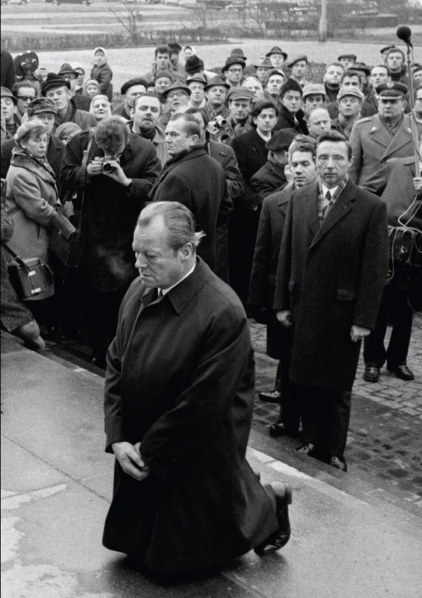
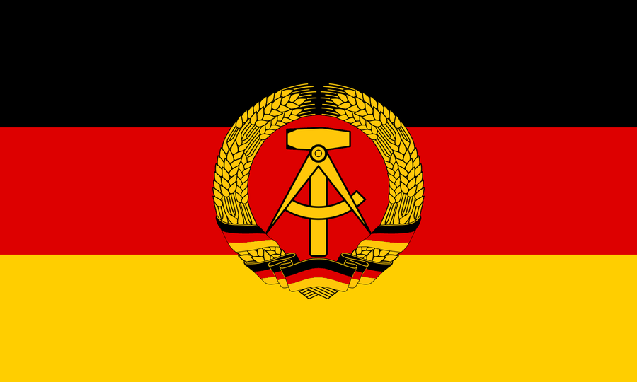
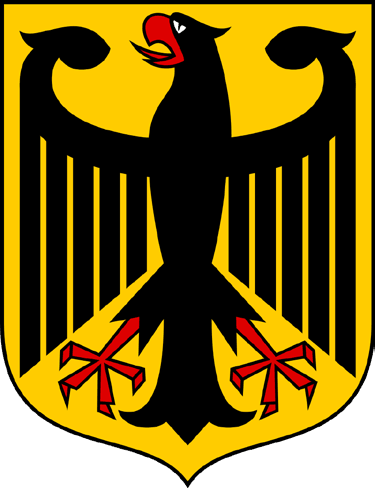
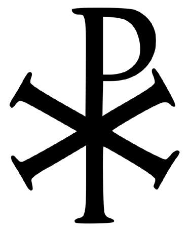
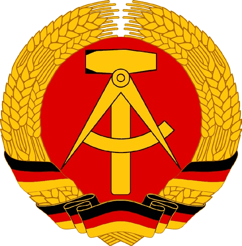

# General Questions 181-210

> Questions 181 to 210 of the official catalog. Answer first, then open the solution. Every question is bilingual and carries its own vocabulary table.

[Overview](../index.md) | [Mock test](../mock-test.md)

---

## Frage 181

> **Frage:** Was wollte Willy Brandt mit seinem Kniefall 1970 im ehemaligen jüdischen Ghetto in Warschau ausdrücken?  
> **English:** What did Willy Brandt want to express with his kneeling gesture in 1970 at the former Jewish ghetto in Warsaw?

| # | Antwort | English |
|---|---|---|
| a | Er hat sich den ehemaligen Alliierten unterworfen. | He submitted to the former Allied powers. |
| b | Er bat Polen und die polnischen Juden um Vergebung. | He asked Poland and Polish Jews for forgiveness. |
| c | Er zeigte seine Demut vor dem Warschauer Pakt. | He showed his humility before the Warsaw Pact. |
| d | Er sprach ein Gebet am Grab des Unbekannten Soldaten. | He said a prayer at the Tomb of the Unknown Soldier. |

??? success "Lösung / Answer - open after you have chosen"

    **b) Er bat Polen und die polnischen Juden um Vergebung.**  
    He asked Poland and Polish Jews for forgiveness.

    **Warum / Why:** In 1970, Chancellor Willy Brandt unexpectedly knelt at the memorial for the Warsaw Ghetto Uprising, asking forgiveness on behalf of Germany for the crimes of the Nazi era against Poland and its Jewish population. The gesture became a famous symbol of German reconciliation.

??? note "Wortschatz / Vocabulary"

    | Deutsch | English |
    |---|---|
    | Kniefall | the kneeling |
    | ehemalig | former |
    | jüdisch | Jewish |
    | Warschau | Warsaw |
    | bitten | to ask / to request |
    | Polen | Poland |
    | polnisch | Polish |
    | Jude | the Jew |
    | Vergebung | forgiveness |
    | Alliierte | the Allies |
    | zeigen | to show |
    | Demut | humility |

---

## Frage 182

> **Frage:** Wie heißt das jüdische Gebetshaus?  
> **English:** What is a Jewish house of worship called?

| # | Antwort | English |
|---|---|---|
| a | Basilika | Basilica |
| b | Moschee | Mosque |
| c | Synagoge | Synagogue |
| d | Kirche | Church |

??? success "Lösung / Answer - open after you have chosen"

    **c) Synagoge**  
    Synagogue

    **Warum / Why:** A synagogue is the Jewish house of worship and community gathering. Germany had over 2,000 synagogues before the Nazi era. During the November Pogrom of 1938, over 1,400 were destroyed. Today, new synagogues have been built across Germany, including notable ones in Munich (Ohel Jakob, 2006) and Dresden (2001). A basilica and church are Christian, a mosque is Islamic.

??? note "Wortschatz / Vocabulary"

    | Deutsch | English |
    |---|---|
    | heißen | to be called |
    | jüdisch | Jewish |
    | Gebetshaus | the house of prayer |
    | Synagoge | the synagogue |
    | Basilika | the basilica |
    | Moschee | the mosque |
    | Kirche | the church |

---

## Frage 183

> **Frage:** Wann war in der Bundesrepublik Deutschland das "Wirtschaftswunder"?  
> **English:** When was the "economic miracle" (Wirtschaftswunder) in West Germany?

| # | Antwort | English |
|---|---|---|
| a | 40er Jahre | the 1940s |
| b | 50er Jahre | the 1950s |
| c | 70er Jahre | the 1970s |
| d | 80er Jahre | the 1980s |

??? success "Lösung / Answer - open after you have chosen"

    **b) 50er Jahre**  
    the 1950s

    **Warum / Why:** West Germany's rapid postwar economic recovery, known as the Wirtschaftswunder, took place mainly in the 1950s.

??? note "Wortschatz / Vocabulary"

    | Deutsch | English |
    |---|---|
    | Bundesrepublik | the Federal Republic |
    | Deutschland | Germany |
    | Wirtschaftswunder | the economic miracle |
    | Jahr | the year |

---

## Frage 184

> **Frage:** Auf welcher rechtlichen Grundlage wurde der Staat Israel gegründet?  
> **English:** On what legal basis was the State of Israel founded?

| # | Antwort | English |
|---|---|---|
| a | eine Resolution der Vereinten Nationen | a United Nations resolution |
| b | ein Beschluss des Zionistenkongresses | a decision of the Zionist Congress |
| c | ein Vorschlag der Bundesregierung | a proposal by the German Federal Government |
| d | ein Vorschlag der UdSSR | a proposal by the USSR |

??? success "Lösung / Answer - open after you have chosen"

    **a) eine Resolution der Vereinten Nationen**  
    a United Nations resolution

    **Warum / Why:** Israel was founded on May 14, 1948, based on UN General Assembly Resolution 181 (November 29, 1947), which called for the partition of the British Mandate of Palestine into a Jewish state and an Arab state. Germany recognizes Israel's right to exist as part of its "Staatsräson" (reason of state), rooted in Germany's historical responsibility for the Holocaust.

??? note "Wortschatz / Vocabulary"

    | Deutsch | English |
    |---|---|
    | rechtlich | legal |
    | Grundlage | the basis |
    | Staat | the state |
    | gründen | to found |
    | Vereinen | to unite |
    | Nation | the nation |
    | Beschluss | the decision |
    | Vorschlag | the proposal |
    | Bundesregierung | the Federal Government |

---

## Frage 185

> **Frage:** Wofür stand der Ausdruck "Eiserner Vorhang"? Für die Abschottung …  
> **English:** What did the term "Iron Curtain" refer to? The isolation of …

| # | Antwort | English |
|---|---|---|
| a | des Warschauer Pakts gegen den Westen | the Warsaw Pact from the West. |
| b | Norddeutschlands gegen Süddeutschland | Northern Germany from Southern Germany. |
| c | Nazi-Deutschlands gegen die Alliierten | Nazi Germany from the Allies. |
| d | Europas gegen die USA | Europe from the USA. |

??? success "Lösung / Answer - open after you have chosen"

    **a) des Warschauer Pakts gegen den Westen**  
    the Warsaw Pact from the West.

    **Warum / Why:** The "Iron Curtain" symbolized the political and military barrier separating the Soviet-led Warsaw Pact bloc from Western Europe during the Cold War.

??? note "Wortschatz / Vocabulary"

    | Deutsch | English |
    |---|---|
    | Stand | the status |
    | Ausdruck | the expression |
    | Vorhang | the curtain |
    | Abschottung | the isolation |
    | Pakt | the pact |
    | Westen | the west |
    | Alliierte | the Allies |

---

## Frage 186

> **Frage:** Im Jahr 1953 gab es in der DDR einen Aufstand, an den lange Zeit in der Bundesrepublik Deutschland ein Feiertag erinnerte. Wann war das?  
> **English:** In 1953 there was an uprising in the GDR, long commemorated by a holiday in West Germany. When was it?

| # | Antwort | English |
|---|---|---|
| a | 1. Mai | May 1 |
| b | 17. Juni | June 17 |
| c | 20. Juli | July 20 |
| d | 9. November | November 9 |

??? success "Lösung / Answer - open after you have chosen"

    **b) 17. Juni**  
    June 17

    **Warum / Why:** The June 17, 1953 uprising in East Germany was commemorated as a public holiday ("Tag der Deutschen Einheit") in West Germany until reunification in 1990.

??? note "Wortschatz / Vocabulary"

    | Deutsch | English |
    |---|---|
    | Jahr | the year |
    | geben | to give |
    | Ddr | the GDR (East Germany) |
    | Aufstehen | to get up |
    | lange | long |
    | Zeit | the time |
    | Bundesrepublik | the Federal Republic |
    | Deutschland | Germany |
    | Feiertag | the public holiday |
    | erinnern | to remember |
    | Juni | June |
    | Mai | May |

---

## Frage 187

> **Frage:** Welcher deutsche Staat hatte eine schwarz-rot-goldene Flagge mit Hammer, Zirkel und Ährenkranz?  
> **English:** Which German state had a black-red-gold flag with hammer, compass, and wreath of grain?

| # | Antwort | English |
|---|---|---|
| a | Preußen | Prussia |
| b | Bundesrepublik Deutschland | Federal Republic of Germany |
| c | "Drittes Reich" | "Third Reich" |
| d | DDR | GDR |

??? success "Lösung / Answer - open after you have chosen"

    **d) DDR**  
    GDR

    **Warum / Why:** The GDR's flag featured the hammer, compass, and wreath of grain - symbolizing workers, intellectuals, and farmers - added to the standard black-red-gold in 1959.

??? note "Wortschatz / Vocabulary"

    | Deutsch | English |
    |---|---|
    | deutsch | German |
    | Staat | the state |
    | Flagge | the flag |
    | Zirkel | the circle / pair of compasses |
    | Ährenkranz | the wreath of corn |
    | Ddr | the GDR (East Germany) |
    | Bundesrepublik | the Federal Republic |
    | Deutschland | Germany |
    | Reich | the empire |

---

## Frage 188

> **Frage:** In welchem Jahr wurde die Mauer in Berlin gebaut?  
> **English:** In what year was the Berlin Wall built?

| # | Antwort | English |
|---|---|---|
| a | 1953 | 1953 |
| b | 1956 | 1956 |
| c | 1959 | 1959 |
| d | 1961 | 1961 |

??? success "Lösung / Answer - open after you have chosen"

    **d) 1961**  
    1961

    **Warum / Why:** The Berlin Wall was built in 1961.

??? note "Wortschatz / Vocabulary"

    | Deutsch | English |
    |---|---|
    | Jahr | the year |
    | Mauer | the Wall |
    | bauen | to build |

---

## Frage 189

> **Frage:** Wann baute die DDR die Mauer in Berlin?  
> **English:** When did the GDR build the Berlin Wall?

| # | Antwort | English |
|---|---|---|
| a | 1919 | 1919 |
| b | 1933 | 1933 |
| c | 1961 | 1961 |
| d | 1990 | 1990 |

??? success "Lösung / Answer - open after you have chosen"

    **c) 1961**  
    1961

    **Warum / Why:** The GDR built the Berlin Wall in 1961.

??? note "Wortschatz / Vocabulary"

    | Deutsch | English |
    |---|---|
    | bauen | to build |
    | Ddr | the GDR (East Germany) |
    | Mauer | the Wall |

---

## Frage 190

> **Frage:** Was bedeutet die Abkürzung DDR?  
> **English:** What does the abbreviation GDR stand for?

| # | Antwort | English |
|---|---|---|
| a | Dritter Deutscher Rundfunk | Third German Broadcasting |
| b | Die Deutsche Republik | The German Republic |
| c | Dritte Deutsche Republik | Third German Republic |
| d | Deutsche Demokratische Republik | German Democratic Republic |

??? success "Lösung / Answer - open after you have chosen"

    **d) Deutsche Demokratische Republik**  
    German Democratic Republic

    **Warum / Why:** DDR stands for Deutsche Demokratische Republik (German Democratic Republic), the official name of East Germany.

??? note "Wortschatz / Vocabulary"

    | Deutsch | English |
    |---|---|
    | bedeuten | to mean |
    | Abkürzung | the abbreviation |
    | Ddr | the GDR (East Germany) |
    | Deutsch | German |
    | Demokratisch | democratic |
    | Republik | republic |
    | Rundfunk | broadcasting |
    | Dritte | third |

---

## Frage 191

> **Frage:** Wann wurde die Mauer in Berlin für alle geöffnet?  
> **English:** When was the Berlin Wall opened for everyone?

| # | Antwort | English |
|---|---|---|
| a | 1987 | 1987 |
| b | 1989 | 1989 |
| c | 1992 | 1992 |
| d | 1995 | 1995 |

??? success "Lösung / Answer - open after you have chosen"

    **b) 1989**  
    1989

    **Warum / Why:** The Berlin Wall opened on November 9, 1989.

??? note "Wortschatz / Vocabulary"

    | Deutsch | English |
    |---|---|
    | Mauer | the Wall |
    | öffnen | to open |

---

## Frage 192

> **Frage:** Welches heutige deutsche Bundesland gehörte früher zum Gebiet der DDR?  
> **English:** Which present-day German federal state used to belong to the GDR?

| # | Antwort | English |
|---|---|---|
| a | Brandenburg | Brandenburg |
| b | Bayern | Bavaria |
| c | Saarland | Saarland |
| d | Hessen | Hesse |

??? success "Lösung / Answer - open after you have chosen"

    **a) Brandenburg**  
    Brandenburg

    **Warum / Why:** Brandenburg was part of East Germany (GDR) - Bavaria, Saarland, and Hesse were all in West Germany.

??? note "Wortschatz / Vocabulary"

    | Deutsch | English |
    |---|---|
    | heutig | current |
    | deutsch | German |
    | Bundesland | the federal state |
    | gehören | to belong |
    | früher | earlier |
    | Gebiet | the area |
    | Ddr | the GDR (East Germany) |
    | Bayern | Bavaria |
    | Hessen | Hesse |

---

## Frage 193

> **Frage:** Von 1961 bis 1989 war Berlin …  
> **English:** From 1961 to 1989, Berlin was …

| # | Antwort | English |
|---|---|---|
| a | ohne Bürgermeister. | without a mayor. |
| b | ein eigener Staat. | its own state. |
| c | durch eine Mauer geteilt. | divided by a wall. |
| d | nur mit dem Flugzeug erreichbar. | only accessible by plane. |

??? success "Lösung / Answer - open after you have chosen"

    **c) durch eine Mauer geteilt.**  
    divided by a wall.

    **Warum / Why:** From 1961 to 1989, the Berlin Wall physically divided the city into East and West Berlin.

??? note "Wortschatz / Vocabulary"

    | Deutsch | English |
    |---|---|
    | Mauer | the Wall |
    | teilen | to share / to divide |
    | Bürgermeister | the mayor |
    | eigen | own |
    | Staat | the state |
    | Flugzeug | the aeroplane |

---

## Frage 194

> **Frage:** Am 3. Oktober feiert man in Deutschland den Tag der Deutschen …  
> **English:** On October 3, Germany celebrates the Day of German …

| # | Antwort | English |
|---|---|---|
| a | Einheit. | Unity. |
| b | Nation. | Nation. |
| c | Bundesländer. | Federal States. |
| d | Städte. | Cities. |

??? success "Lösung / Answer - open after you have chosen"

    **a) Einheit.**  
    Unity.

    **Warum / Why:** October 3 is German Unity Day (Tag der Deutschen Einheit), commemorating reunification in 1990.

??? note "Wortschatz / Vocabulary"

    | Deutsch | English |
    |---|---|
    | Oktober | October |
    | feiern | to celebrate |
    | Deutschland | Germany |
    | Tag | the day |
    | Deutsch | German |
    | Einheit | unity |
    | Bundesland | the federal state |
    | Stadt | the city |

---

## Frage 195

> **Frage:** Welches heutige deutsche Bundesland gehörte früher zum Gebiet der DDR?  
> **English:** Which present-day German federal state used to belong to the GDR?

| # | Antwort | English |
|---|---|---|
| a | Hessen | Hesse |
| b | Sachsen-Anhalt | Saxony-Anhalt |
| c | Nordrhein-Westfalen | North Rhine-Westphalia |
| d | Saarland | Saarland |

??? success "Lösung / Answer - open after you have chosen"

    **b) Sachsen-Anhalt**  
    Saxony-Anhalt

    **Warum / Why:** Saxony-Anhalt was one of the five states forming East Germany.

??? note "Wortschatz / Vocabulary"

    | Deutsch | English |
    |---|---|
    | heutig | current |
    | deutsch | German |
    | Bundesland | the federal state |
    | gehören | to belong |
    | früher | earlier |
    | Gebiet | the area |
    | Ddr | the GDR (East Germany) |
    | Sachsen-Anhalt | Saxony-Anhalt |
    | Hessen | Hesse |
    | Nordrhein-Westfalen | North Rhine-Westphalia |

---

## Frage 196

> **Frage:** Warum nennt man die Zeit im Herbst 1989 in der DDR "Die Wende"? In dieser Zeit veränderte sich die DDR politisch …  
> **English:** Why is the autumn 1989 period in the GDR called "Die Wende" (The Turning Point)? During this time, the GDR changed politically …

| # | Antwort | English |
|---|---|---|
| a | von einer Diktatur zur Demokratie. | from a dictatorship to a democracy. |
| b | von einer liberalen Marktwirtschaft zum Sozialismus. | from a liberal market economy to socialism. |
| c | von einer Monarchie zur Sozialdemokratie. | from a monarchy to social democracy. |
| d | von einem religiösen Staat zu einem kommunistischen Staat. | from a religious state to a communist state. |

??? success "Lösung / Answer - open after you have chosen"

    **a) von einer Diktatur zur Demokratie.**  
    from a dictatorship to a democracy.

    **Warum / Why:** "Die Wende" refers to the GDR's transformation from a one-party dictatorship to democracy, culminating in reunification.

??? note "Wortschatz / Vocabulary"

    | Deutsch | English |
    |---|---|
    | nennen | to name |
    | Zeit | the time |
    | Herbst | the autumn |
    | Ddr | the GDR (East Germany) |
    | Wende | the turning point |
    | verändern | to change |
    | politisch | political |
    | Diktatur | the dictatorship |
    | Demokratie | democracy |
    | Marktwirtschaft | the market economy |
    | Sozialismus | socialism |
    | Monarchie | the monarchy |

---

## Frage 197

> **Frage:** Welches heutige deutsche Bundesland gehörte früher zum Gebiet der DDR?  
> **English:** Which present-day German federal state used to belong to the GDR?

| # | Antwort | English |
|---|---|---|
| a | Thüringen | Thuringia |
| b | Hessen | Hesse |
| c | Bayern | Bavaria |
| d | Bremen | Bremen |

??? success "Lösung / Answer - open after you have chosen"

    **a) Thüringen**  
    Thuringia

    **Warum / Why:** Thuringia was one of the five states forming East Germany.

??? note "Wortschatz / Vocabulary"

    | Deutsch | English |
    |---|---|
    | heutig | current |
    | deutsch | German |
    | Bundesland | the federal state |
    | gehören | to belong |
    | früher | earlier |
    | Gebiet | the area |
    | Ddr | the GDR (East Germany) |
    | Thüringen | Thuringia |
    | Hessen | Hesse |
    | Bayern | Bavaria |

---

## Frage 198

> **Frage:** Welches heutige deutsche Bundesland gehörte früher zum Gebiet der DDR?  
> **English:** Which present-day German federal state used to belong to the GDR?

| # | Antwort | English |
|---|---|---|
| a | Bayern | Bavaria |
| b | Niedersachsen | Lower Saxony |
| c | Sachsen | Saxony |
| d | Baden-Württemberg | Baden-Württemberg |

??? success "Lösung / Answer - open after you have chosen"

    **c) Sachsen**  
    Saxony

    **Warum / Why:** Saxony was one of the five states forming East Germany.

??? note "Wortschatz / Vocabulary"

    | Deutsch | English |
    |---|---|
    | heutig | current |
    | deutsch | German |
    | Bundesland | the federal state |
    | gehören | to belong |
    | früher | earlier |
    | Gebiet | the area |
    | Ddr | the GDR (East Germany) |
    | Sachsen | Saxony |
    | Bayern | Bavaria |
    | Niedersachsen | Lower Saxony |

---

## Frage 199

> **Frage:** Mit der Abkürzung "Stasi" meinte man in der DDR …  
> **English:** What did the abbreviation "Stasi" refer to in the GDR?

| # | Antwort | English |
|---|---|---|
| a | das Parlament. | the parliament. |
| b | das Ministerium für Staatssicherheit. | the Ministry for State Security. |
| c | eine regierende Partei. | a governing party. |
| d | das Ministerium für Volksbildung. | the Ministry of Public Education. |

??? success "Lösung / Answer - open after you have chosen"

    **b) das Ministerium für Staatssicherheit.**  
    the Ministry for State Security.

    **Warum / Why:** "Stasi" was the East German Ministry for State Security, the regime's secret police and intelligence agency.

??? note "Wortschatz / Vocabulary"

    | Deutsch | English |
    |---|---|
    | Abkürzung | the abbreviation |
    | Stasi | the Stasi (state security) |
    | meinen | to mean / to think |
    | Ddr | the GDR (East Germany) |
    | Ministerium | the ministry |
    | Staatssicherheit | the state security |
    | Parlament | parliament |
    | regierend | governing |
    | Partei | the party |
    | Volksbildung | public education |

---

## Frage 200

> **Frage:** Welches heutige deutsche Bundesland gehörte früher zum Gebiet der DDR?  
> **English:** Which present-day German federal state used to belong to the GDR?

| # | Antwort | English |
|---|---|---|
| a | Hessen | Hesse |
| b | Schleswig-Holstein | Schleswig-Holstein |
| c | Mecklenburg-Vorpommern | Mecklenburg-Western Pomerania |
| d | Saarland | Saarland |

??? success "Lösung / Answer - open after you have chosen"

    **c) Mecklenburg-Vorpommern**  
    Mecklenburg-Western Pomerania

    **Warum / Why:** Mecklenburg-Western Pomerania was one of the five states forming East Germany.

??? note "Wortschatz / Vocabulary"

    | Deutsch | English |
    |---|---|
    | heutig | current |
    | deutsch | German |
    | Bundesland | the federal state |
    | gehören | to belong |
    | früher | earlier |
    | Gebiet | the area |
    | Ddr | the GDR (East Germany) |
    | Mecklenburg-Vorpommern | Mecklenburg-Western Pomerania |
    | Hessen | Hesse |

---

## Frage 201

> **Frage:** Welche der folgenden Auflistungen enthält nur Bundesländer, die zum Gebiet der früheren DDR gehörten?  
> **English:** Which of the following lists contains only federal states that belonged to the former GDR?

| # | Antwort | English |
|---|---|---|
| a | Niedersachsen, Nordrhein-Westfalen, Hessen, Schleswig-Holstein, Brandenburg | Lower Saxony, NRW, Hesse, Schleswig-Holstein, Brandenburg |
| b | Mecklenburg-Vorpommern, Brandenburg, Sachsen, Sachsen-Anhalt, Thüringen | Mecklenburg-W. Pomerania, Brandenburg, Saxony, Saxony-Anhalt, Thuringia |
| c | Bayern, Baden-Württemberg, Rheinland-Pfalz, Thüringen, Sachsen | Bavaria, Baden-Württemberg, Rhineland-Palatinate, Thuringia, Saxony |
| d | Sachsen, Thüringen, Hessen, Niedersachen, Brandenburg | Saxony, Thuringia, Hesse, Lower Saxony, Brandenburg |

??? success "Lösung / Answer - open after you have chosen"

    **b) Mecklenburg-Vorpommern, Brandenburg, Sachsen, Sachsen-Anhalt, Thüringen**  
    Mecklenburg-W. Pomerania, Brandenburg, Saxony, Saxony-Anhalt, Thuringia

    **Warum / Why:** The five former East German states are Mecklenburg-Western Pomerania, Brandenburg, Saxony, Saxony-Anhalt, and Thuringia.

??? note "Wortschatz / Vocabulary"

    | Deutsch | English |
    |---|---|
    | Bundesland | the federal state |
    | Gebiet | the area |
    | Ddr | the GDR (East Germany) |
    | gehören | to belong |
    | Mecklenburg-Vorpommern | Mecklenburg-Western Pomerania |
    | Sachsen | Saxony |
    | Sachsen-Anhalt | Saxony-Anhalt |
    | Thüringen | Thuringia |
    | Niedersachsen | Lower Saxony |
    | Nordrhein-Westfalen | North Rhine-Westphalia |
    | Hessen | Hesse |
    | Bayern | Bavaria |

---

## Frage 202

> **Frage:** Zu wem gehörte die DDR im "Kalten Krieg"?  
> **English:** Whose side was the GDR on during the "Cold War"?

| # | Antwort | English |
|---|---|---|
| a | zu den Westmächten | to the Western powers |
| b | zum Warschauer Pakt | to the Warsaw Pact |
| c | zur NATO | to NATO |
| d | zu den blockfreien Staaten | to the non-aligned states |

??? success "Lösung / Answer - open after you have chosen"

    **b) zum Warschauer Pakt**  
    to the Warsaw Pact

    **Warum / Why:** The GDR was a member of the Soviet-led Warsaw Pact, the Eastern Bloc's military alliance.

??? note "Wortschatz / Vocabulary"

    | Deutsch | English |
    |---|---|
    | gehören | to belong |
    | Ddr | the GDR (East Germany) |
    | Krieg | the war |
    | Pakt | the pact |
    | Staat | the state |

---

## Frage 203

> **Frage:** Wie hieß das Wirtschaftssystem der DDR?  
> **English:** What was the GDR's economic system called?

| # | Antwort | English |
|---|---|---|
| a | Marktwirtschaft | Market economy |
| b | Planwirtschaft | Planned economy |
| c | Angebot und Nachfrage | Supply and demand |
| d | Kapitalismus | Capitalism |

??? success "Lösung / Answer - open after you have chosen"

    **b) Planwirtschaft**  
    Planned economy

    **Warum / Why:** The GDR had a centrally planned economy (Planwirtschaft), controlled by the state, unlike the market economy of West Germany.

??? note "Wortschatz / Vocabulary"

    | Deutsch | English |
    |---|---|
    | heißen | to be called |
    | Wirtschaftssystem | the economic system |
    | Ddr | the GDR (East Germany) |
    | Planwirtschaft | the planned economy |
    | Marktwirtschaft | the market economy |
    | Angebot | the offer |
    | Nachfrage | the demand |
    | Kapitalismus | capitalism |

---

## Frage 204

> **Frage:** Wie wurden die Bundesrepublik Deutschland und die DDR zu einem Staat?  
> **English:** How did West Germany and the GDR become one state?

| # | Antwort | English |
|---|---|---|
| a | Die Bundesrepublik hat die DDR besetzt. | The Federal Republic occupied the GDR. |
| b | Die heutigen fünf östlichen Bundesländer sind der Bundesrepublik Deutschland beigetreten. | Today's five eastern states joined West Germany. |
| c | Die westlichen Bundesländer sind der DDR beigetreten. | The western states joined the GDR. |
| d | Die DDR hat die Bundesrepublik Deutschland besetzt. | The GDR occupied the Federal Republic of Germany. |

??? success "Lösung / Answer - open after you have chosen"

    **b) Die heutigen fünf östlichen Bundesländer sind der Bundesrepublik Deutschland beigetreten.**  
    Today's five eastern states joined West Germany.

    **Warum / Why:** Reunification happened through the five eastern states formally joining (acceding to) the Federal Republic in 1990, not through occupation.

??? note "Wortschatz / Vocabulary"

    | Deutsch | English |
    |---|---|
    | Bundesrepublik | the Federal Republic |
    | Deutschland | Germany |
    | Ddr | the GDR (East Germany) |
    | Staat | the state |
    | heutig | current |
    | fünf | five |
    | östlich | eastern |
    | Bundesland | the federal state |
    | beitreten | to join |
    | besetzen | to occupy |
    | westlich | western |

---

## Frage 205

> **Frage:** Mit dem Beitritt der DDR zur Bundesrepublik Deutschland gehören die neuen Bundesländer nun auch …  
> **English:** With the GDR's accession to West Germany, the new federal states now also belong to the …

| # | Antwort | English |
|---|---|---|
| a | zur Europäischen Union. | the European Union. |
| b | zum Warschauer Pakt. | the Warsaw Pact. |
| c | zur OPEC. | OPEC. |
| d | zur Europäischen Verteidigungsgemeinschaft. | the European Defense Community. |

??? success "Lösung / Answer - open after you have chosen"

    **a) zur Europäischen Union.**  
    the European Union.

    **Warum / Why:** Since reunification, the new eastern states are part of the European Union along with the rest of Germany.

??? note "Wortschatz / Vocabulary"

    | Deutsch | English |
    |---|---|
    | Beitritt | the accession |
    | Ddr | the GDR (East Germany) |
    | Bundesrepublik | the Federal Republic |
    | Deutschland | Germany |
    | gehören | to belong |
    | neu | new |
    | Bundesland | the federal state |
    | Europäisch | European |
    | Pakt | the pact |
    | Verteidigungsgemeinschaft | the defence community |

---

## Frage 206

> **Frage:** Woran erinnern die sogenannten „Stolpersteine“ in Deutschland?  
> **English:** What do the so-called "Stolpersteine" (stumbling stones) in Germany commemorate?

| # | Antwort | English |
|---|---|---|
| a | an berühmte deutsche Politikerinnen und Politiker | famous German politicians |
| b | an die Opfer des Nationalsozialismus | the victims of National Socialism |
| c | an Verkehrstote | traffic fatalities |
| d | an bekannte jüdische Musiker | famous Jewish musicians |

??? success "Lösung / Answer - open after you have chosen"

    **b) an die Opfer des Nationalsozialismus**  
    the victims of National Socialism

    **Warum / Why:** Stolpersteine ("stumbling stones") are small brass plaques embedded in sidewalks in front of the last known freely-chosen residences of victims of the Nazi regime. Created by artist Gunter Demnig since 1992, each stone bears the name, birth year, and fate of a victim - mostly Jews, but also Roma, disabled people, political opponents, and others. With over 100,000 stones in more than 30 countries, it is the world's largest decentralized memorial.

??? note "Wortschatz / Vocabulary"

    | Deutsch | English |
    |---|---|
    | erinnern | to remember |
    | Deutschland | Germany |
    | Opfern | to sacrifice |
    | Nationalsozialismus | National Socialism |
    | berühmt | famous |
    | deutsch | German |
    | Politikerin | the politician (female) |
    | Politiker | the politician |
    | Verkehrstote | the road deaths |
    | bekannt | well-known |
    | jüdisch | Jewish |
    | Musiker | the musician |

---

## Frage 207

> **Frage:** In welchem Militärbündnis war die DDR Mitglied?  
> **English:** Which military alliance was the GDR a member of?

| # | Antwort | English |
|---|---|---|
| a | in der NATO | in NATO |
| b | im Rheinbund | in the Confederation of the Rhine |
| c | im Warschauer Pakt | in the Warsaw Pact |
| d | im Europabündnis | in the European Alliance |

??? success "Lösung / Answer - open after you have chosen"

    **c) im Warschauer Pakt**  
    in the Warsaw Pact

    **Warum / Why:** The GDR was a member of the Warsaw Pact, the Soviet-led Eastern Bloc military alliance.

??? note "Wortschatz / Vocabulary"

    | Deutsch | English |
    |---|---|
    | Militärbündnis | the military alliance |
    | Ddr | the GDR (East Germany) |
    | Mitglied | the member |
    | Pakt | the pact |

---

## Frage 208

> **Frage:** Was war die "Stasi"?  
> **English:** What was the "Stasi"?

| # | Antwort | English |
|---|---|---|
| a | der Geheimdienst im "Dritten Reich" | the secret service in the "Third Reich" |
| b | eine berühmte deutsche Gedenkstätte | a famous German memorial site |
| c | der Geheimdienst der DDR | the GDR's secret service |
| d | ein deutscher Sportverein während des Zweiten Weltkrieges | a German sports club during WWII |

??? success "Lösung / Answer - open after you have chosen"

    **c) der Geheimdienst der DDR**  
    the GDR's secret service

    **Warum / Why:** The Stasi was the GDR's secret service (intelligence and secret police agency).

??? note "Wortschatz / Vocabulary"

    | Deutsch | English |
    |---|---|
    | Stasi | the Stasi (state security) |
    | Geheimdienst | the secret service |
    | Ddr | the GDR (East Germany) |
    | Dritte | third |
    | Reich | the empire |
    | berühmt | famous |
    | deutsch | German |
    | Gedenkstätte | the memorial |
    | Sportverein | the sports club |
    | während | during |
    | Zweit | second |
    | Weltkrieg | the world war |

---

## Frage 209

> **Frage:** Welches war das Wappen der Deutschen Demokratischen Republik?  
> **English:** Which was the coat of arms of the German Democratic Republic (GDR)?

| Bild 1 | Bild 2 | Bild 3 | Bild 4 |
|---|---|---|---|
|  |  |  |  |

| # | Antwort | English |
|---|---|---|
| a | Bild 1 | Picture 1 |
| b | Bild 2 | Picture 2 |
| c | Bild 3 | Picture 3 |
| d | Bild 4 | Picture 4 |

??? success "Lösung / Answer - open after you have chosen"

    **d) Bild 4**  
    Picture 4

    **Warum / Why:** The GDR's coat of arms featured a hammer and compass encircled by a wreath of grain, symbolizing the alliance of workers, intellectuals, and farmers.

??? note "Wortschatz / Vocabulary"

    | Deutsch | English |
    |---|---|
    | Wappen | the coat of arms |
    | Deutsch | German |
    | Demokratisch | democratic |
    | Republik | republic |
    | Bild | the picture |

---

## Frage 210

> **Frage:** Was ereignete sich am 17. Juni 1953 in der DDR?  
> **English:** What happened on June 17, 1953 in the GDR?

| # | Antwort | English |
|---|---|---|
| a | der feierliche Beitritt zum Warschauer Pakt | the ceremonial accession to the Warsaw Pact |
| b | landesweite Streiks und ein Volksaufstand | nationwide strikes and a popular uprising |
| c | der 1. SED-Parteitag | the 1st SED party congress |
| d | der erste Besuch Fidel Castros | Fidel Castro's first visit |

??? success "Lösung / Answer - open after you have chosen"

    **b) landesweite Streiks und ein Volksaufstand**  
    nationwide strikes and a popular uprising

    **Warum / Why:** June 17, 1953 saw a nationwide popular uprising and strikes in East Germany against the communist government, brutally suppressed by Soviet forces.

??? note "Wortschatz / Vocabulary"

    | Deutsch | English |
    |---|---|
    | Juni | June |
    | Ddr | the GDR (East Germany) |
    | Streik | the strike |
    | Volksaufstand | the popular uprising |
    | Beitritt | the accession |
    | Pakt | the pact |
    | erst | first |
    | Besuchen | to visit / to attend |
    | Fidel | cheerful |

---

## Set check

- [ ] I answered all 30 questions before opening any solution.
- [ ] I scored at least 24/30.
- [ ] I reviewed every wrong answer and said the correct sentence aloud.

---

[← Questions 151-180](06-questions-151-180.md) | [Overview](../index.md) | [Questions 211-240 →](08-questions-211-240.md)
