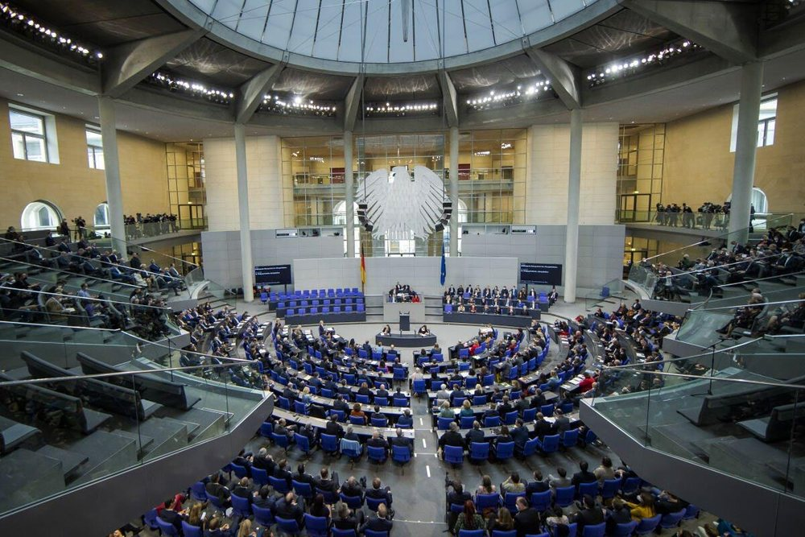
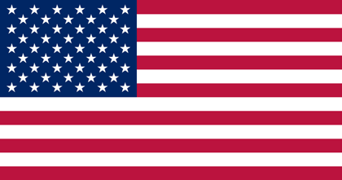
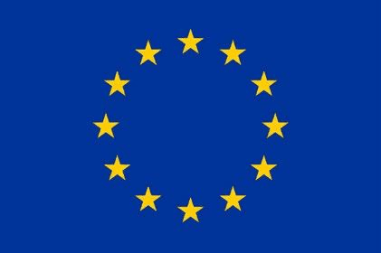
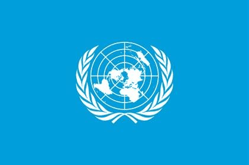
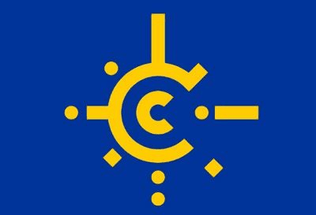
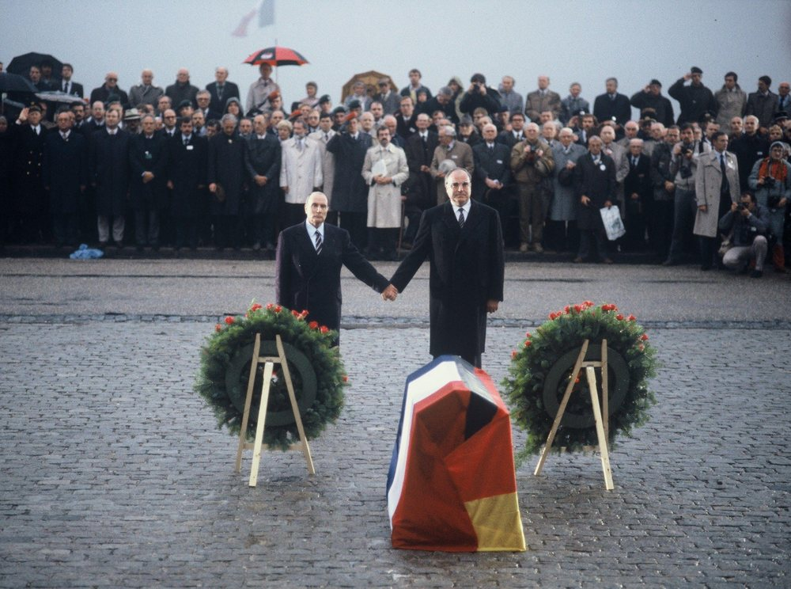

# General Questions 211-240

> Questions 211 to 240 of the official catalog. Answer first, then open the solution. Every question is bilingual and carries its own vocabulary table.

[Overview](../index.md) | [Mock test](../mock-test.md)

---

## Frage 211

> **Frage:** Welcher Politiker steht für die "Ostverträge"?  
> **English:** Which politician is associated with the "Eastern Treaties"?

| # | Antwort | English |
|---|---|---|
| a | Helmut Kohl | Helmut Kohl |
| b | Willy Brandt | Willy Brandt |
| c | Michail Gorbatschow | Mikhail Gorbachev |
| d | Ludwig Erhard | Ludwig Erhard |

??? success "Lösung / Answer - open after you have chosen"

    **b) Willy Brandt**  
    Willy Brandt

    **Warum / Why:** Willy Brandt's "Ostpolitik" led to the Eastern Treaties, normalizing relations with Eastern Bloc countries in the early 1970s.

??? note "Wortschatz / Vocabulary"

    | Deutsch | English |
    |---|---|
    | Politiker | the politician |
    | stehen | to stand |

---

## Frage 212

> **Frage:** Wie heißt Deutschland mit vollem Namen?  
> **English:** What is Germany's full official name?

| # | Antwort | English |
|---|---|---|
| a | Bundesstaat Deutschland | Federal State Germany |
| b | Bundesländer Deutschland | Federal States Germany |
| c | Bundesrepublik Deutschland | Federal Republic of Germany |
| d | Bundesbezirk Deutschland | Federal District Germany |

??? success "Lösung / Answer - open after you have chosen"

    **c) Bundesrepublik Deutschland**  
    Federal Republic of Germany

    **Warum / Why:** Germany's official full name is the Bundesrepublik Deutschland (Federal Republic of Germany).

??? note "Wortschatz / Vocabulary"

    | Deutsch | English |
    |---|---|
    | heißen | to be called |
    | Deutschland | Germany |
    | Bundesrepublik | the Federal Republic |
    | Bundesstaat | federal state |
    | Bundesland | the federal state |

---

## Frage 213

> **Frage:** Wie viele Einwohner hat Deutschland?  
> **English:** How many inhabitants does Germany have?

| # | Antwort | English |
|---|---|---|
| a | 70 Millionen | 70 million |
| b | 78 Millionen | 78 million |
| c | 84 Millionen | 84 million |
| d | 90 Millionen | 90 million |

??? success "Lösung / Answer - open after you have chosen"

    **c) 84 Millionen**  
    84 million

    **Warum / Why:** Germany has approximately 84 million inhabitants, the most populous country in the EU.

??? note "Wortschatz / Vocabulary"

    | Deutsch | English |
    |---|---|
    | Einwohner | the inhabitant |
    | Deutschland | Germany |
    | Million | the million |

---

## Frage 214

> **Frage:** Welche Farben hat die deutsche Flagge?  
> **English:** What colors does the German flag have?

| # | Antwort | English |
|---|---|---|
| a | schwarz-rot-gold | black-red-gold |
| b | rot-weiß-schwarz | red-white-black |
| c | schwarz-rot-grün | black-red-green |
| d | schwarz-gelb-rot | black-yellow-red |

??? success "Lösung / Answer - open after you have chosen"

    **a) schwarz-rot-gold**  
    black-red-gold

    **Warum / Why:** The German flag is black-red-gold (schwarz-rot-gold).

??? note "Wortschatz / Vocabulary"

    | Deutsch | English |
    |---|---|
    | Farbe | the colour |
    | deutsch | German |
    | Flagge | the flag |
    | schwarz-rot-gold | black-red-gold |

---

## Frage 215

> **Frage:** Wer wird als "Kanzler der Deutschen Einheit" bezeichnet?  
> **English:** Who is referred to as the "Chancellor of German Unity"?

| # | Antwort | English |
|---|---|---|
| a | Gerhard Schröder | Gerhard Schröder |
| b | Helmut Kohl | Helmut Kohl |
| c | Konrad Adenauer | Konrad Adenauer |
| d | Helmut Schmidt | Helmut Schmidt |

??? success "Lösung / Answer - open after you have chosen"

    **b) Helmut Kohl**  
    Helmut Kohl

    **Warum / Why:** Helmut Kohl is called the "Chancellor of Unity" for overseeing German reunification in 1990.

??? note "Wortschatz / Vocabulary"

    | Deutsch | English |
    |---|---|
    | Kanzler | the Chancellor |
    | Deutsch | German |
    | Einheit | unity |
    | bezeichnen | to describe / to call |

---

## Frage 216

> **Frage:** Welches Symbol ist im Plenarsaal des Deutschen Bundestages zu sehen?  
> **English:** Which symbol can be seen in the German Bundestag?

| # | Antwort | English |
|---|---|---|
| a | der Bundesadler | the Federal Eagle. |
| b | die Fahne der Stadt Berlin | the flag of the city of Berlin. |
| c | der Reichsadler | the Imperial Eagle (Reichsadler). |
| d | die Reichskrone | the Imperial Crown (Reichskrone). |

??? success "Lösung / Answer - open after you have chosen"

    **a) der Bundesadler**  
    the Federal Eagle.

    **Warum / Why:** The Bundesadler (Federal Eagle) is the official emblem of Germany and is prominently displayed in the Bundestag's plenary chamber, distinct from the historical Reichsadler used before 1945.

??? note "Wortschatz / Vocabulary"

    | Deutsch | English |
    |---|---|
    | Plenarsaal | the plenary hall |
    | Deutsch | German |
    | Bundestag | the Federal Parliament |
    | sehen | to see |
    | Bundesadler | the federal eagle |
    | Fahne | the flag |
    | Stadt | the city |
    | Reichsadler | the imperial eagle |

---

## Frage 217

> **Frage:** In welchem Zeitraum gab es die Deutsche Demokratische Republik (DDR)?  
> **English:** During what period did the German Democratic Republic (GDR) exist?

| # | Antwort | English |
|---|---|---|
| a | 1919 bis 1927 | 1919 to 1927 |
| b | 1933 bis 1945 | 1933 to 1945 |
| c | 1945 bis 1961 | 1945 to 1961 |
| d | 1949 bis 1990 | 1949 to 1990 |

??? success "Lösung / Answer - open after you have chosen"

    **d) 1949 bis 1990**  
    1949 to 1990

    **Warum / Why:** The GDR existed from 1949 (founding) until 1990 (reunification).

??? note "Wortschatz / Vocabulary"

    | Deutsch | English |
    |---|---|
    | Zeitraum | the period |
    | geben | to give |
    | Deutsch | German |
    | Demokratisch | democratic |
    | Republik | republic |
    | Ddr | the GDR (East Germany) |

---

## Frage 218

> **Frage:** Wie viele Bundesländer kamen bei der Wiedervereinigung 1990 zur Bundesrepublik Deutschland hinzu?  
> **English:** How many federal states joined the Federal Republic of Germany during reunification in 1990?

| # | Antwort | English |
|---|---|---|
| a | 4 | 4 |
| b | 5 | 5 |
| c | 6 | 6 |
| d | 7 | 7 |

??? success "Lösung / Answer - open after you have chosen"

    **b) 5**  
    5

    **Warum / Why:** Five new states (Brandenburg, Mecklenburg-W. Pomerania, Saxony, Saxony-Anhalt, Thuringia) joined in 1990.

??? note "Wortschatz / Vocabulary"

    | Deutsch | English |
    |---|---|
    | Bundesland | the federal state |
    | kommen | to come |
    | Wiedervereinigung | reunification |
    | Bundesrepublik | the Federal Republic |
    | Deutschland | Germany |

---

## Frage 219

> **Frage:** Die Bundesrepublik Deutschland hat die Grenzen von heute seit …  
> **English:** The Federal Republic of Germany has had today's borders since …

| # | Antwort | English |
|---|---|---|
| a | 1933 | 1933. |
| b | 1949 | 1949. |
| c | 1971 | 1971. |
| d | 1990 | 1990. |

??? success "Lösung / Answer - open after you have chosen"

    **d) 1990**  
    1990.

    **Warum / Why:** Germany's current borders have been fixed since reunification in 1990.

??? note "Wortschatz / Vocabulary"

    | Deutsch | English |
    |---|---|
    | Bundesrepublik | the Federal Republic |
    | Deutschland | Germany |
    | Grenze | the border |

---

## Frage 220

> **Frage:** Der 27. Januar ist in Deutschland ein offizieller Gedenktag. Woran erinnert dieser Tag?  
> **English:** January 27 is an official day of remembrance in Germany. What does this day commemorate?

| # | Antwort | English |
|---|---|---|
| a | an das Ende des Zweiten Weltkrieges | the end of WWII |
| b | an die Verabschiedung des Grundgesetzes | the adoption of the Basic Law |
| c | an die Wiedervereinigung Deutschlands | German reunification |
| d | an die Opfer des Nationalsozialismus (Tag der Befreiung des Vernichtungslagers Auschwitz) | the victims of National Socialism (liberation of Auschwitz) |

??? success "Lösung / Answer - open after you have chosen"

    **d) an die Opfer des Nationalsozialismus (Tag der Befreiung des Vernichtungslagers Auschwitz)**  
    the victims of National Socialism (liberation of Auschwitz)

    **Warum / Why:** January 27 commemorates the victims of National Socialism, marking the anniversary of the liberation of Auschwitz concentration camp in 1945.

??? note "Wortschatz / Vocabulary"

    | Deutsch | English |
    |---|---|
    | Januar | January |
    | Deutschland | Germany |
    | offiziell | official |
    | Gedenktag | the memorial day |
    | erinnern | to remember |
    | Tag | the day |
    | Opfern | to sacrifice |
    | Nationalsozialismus | National Socialism |
    | Befreiung | the liberation |
    | Vernichtungslager | the extermination camp |
    | Ende | the end |
    | Zweit | second |

---

## Frage 221

> **Frage:** Deutschland ist Mitglied des Schengener Abkommens. Was bedeutet das?  
> **English:** Germany is a member of the Schengen Agreement. What does that mean?

| # | Antwort | English |
|---|---|---|
| a | Deutsche können in viele Länder Europas ohne Passkontrolle reisen. | Germans can travel to many European countries without passport control. |
| b | Alle Menschen können ohne Personenkontrolle in Deutschland einreisen. | All people can enter Germany without any identity check. |
| c | Deutsche können ohne Passkontrolle in jedes Land reisen. | Germans can travel to any country without passport control. |
| d | Deutsche können in jedem Land mit dem Euro bezahlen. | Germans can pay with the Euro in any country. |

??? success "Lösung / Answer - open after you have chosen"

    **a) Deutsche können in viele Länder Europas ohne Passkontrolle reisen.**  
    Germans can travel to many European countries without passport control.

    **Warum / Why:** The Schengen Agreement allows passport-free travel between member countries within Europe - not global travel or currency use.

??? note "Wortschatz / Vocabulary"

    | Deutsch | English |
    |---|---|
    | Deutschland | Germany |
    | Mitglied | the member |
    | bedeuten | to mean |
    | Deutsch | German |
    | Land | the country / federal state |
    | Passkontrolle | the passport check |
    | reisen | to travel |
    | Mensch | the human being |
    | Personenkontrolle | the identity check |
    | einreisen | to enter |
    | bezahlen | to pay |

---

## Frage 222

> **Frage:** Welches Land ist ein Nachbarland von Deutschland?  
> **English:** Which country is a neighboring country of Germany?

| # | Antwort | English |
|---|---|---|
| a | Ungarn | Hungary |
| b | Portugal | Portugal |
| c | Spanien | Spain |
| d | Schweiz | Switzerland |

??? success "Lösung / Answer - open after you have chosen"

    **d) Schweiz**  
    Switzerland

    **Warum / Why:** Switzerland directly borders Germany to the south - Hungary, Portugal, and Spain do not.

??? note "Wortschatz / Vocabulary"

    | Deutsch | English |
    |---|---|
    | Land | the country / federal state |
    | Nachbarland | the neighbouring country |
    | Deutschland | Germany |
    | Schweiz | Switzerland |
    | Ungarn | Hungary |
    | Spanien | Spain |

---

## Frage 223

> **Frage:** Welches Land ist ein Nachbarland von Deutschland?  
> **English:** Which country is a neighboring country of Germany?

| # | Antwort | English |
|---|---|---|
| a | Rumänien | Romania |
| b | Bulgarien | Bulgaria |
| c | Polen | Poland |
| d | Griechenland | Greece |

??? success "Lösung / Answer - open after you have chosen"

    **c) Polen**  
    Poland

    **Warum / Why:** Poland directly borders Germany to the east - Romania, Bulgaria, and Greece do not.

??? note "Wortschatz / Vocabulary"

    | Deutsch | English |
    |---|---|
    | Land | the country / federal state |
    | Nachbarland | the neighbouring country |
    | Deutschland | Germany |
    | Polen | Poland |
    | Rumänien | Romania |
    | Bulgarien | Bulgaria |
    | Griechenland | Greece |

---

## Frage 224

> **Frage:** Was bedeutet die Abkürzung EU?  
> **English:** What does the abbreviation EU stand for?

| # | Antwort | English |
|---|---|---|
| a | Europäische Unternehmen | European Enterprises |
| b | Europäische Union | European Union |
| c | Einheitliche Union | Unified Union |
| d | Euro Union | Euro Union |

??? success "Lösung / Answer - open after you have chosen"

    **b) Europäische Union**  
    European Union

    **Warum / Why:** EU stands for Europäische Union (European Union).

??? note "Wortschatz / Vocabulary"

    | Deutsch | English |
    |---|---|
    | bedeuten | to mean |
    | Abkürzung | the abbreviation |
    | Europäisch | European |
    | Unternehmen | the company |

---

## Frage 225

> **Frage:** In welchem anderen Land gibt es eine große deutschsprachige Bevölkerung?  
> **English:** In which other country is there a large German-speaking population?

| # | Antwort | English |
|---|---|---|
| a | Tschechien | Czech Republic |
| b | Norwegen | Norway |
| c | Spanien | Spain |
| d | Österreich | Austria |

??? success "Lösung / Answer - open after you have chosen"

    **d) Österreich**  
    Austria

    **Warum / Why:** Austria has a large German-speaking population, as German is its official language.

??? note "Wortschatz / Vocabulary"

    | Deutsch | English |
    |---|---|
    | Land | the country / federal state |
    | geben | to give |
    | groß | big |
    | Bevölkerung | the population |
    | Österreich | Austria |
    | Tschechien | the Czech Republic |
    | Norwegen | Norway |
    | Spanien | Spain |

---

## Frage 226

> **Frage:** Welche ist die Flagge der Europäischen Union?  
> **English:** Which is the flag of the European Union?

| Bild 1 | Bild 2 | Bild 3 | Bild 4 |
|---|---|---|---|
|  |  |  |  |

| # | Antwort | English |
|---|---|---|
| a | Bild 1 | Picture 1 |
| b | Bild 2 | Picture 2 |
| c | Bild 3 | Picture 3 |
| d | Bild 4 | Picture 4 |

??? success "Lösung / Answer - open after you have chosen"

    **b) Bild 2**  
    Picture 2

    **Warum / Why:** The EU flag is blue with a circle of gold stars, shown as image 2 among the choices.

??? note "Wortschatz / Vocabulary"

    | Deutsch | English |
    |---|---|
    | Flagge | the flag |
    | Europäisch | European |
    | Bild | the picture |

---

## Frage 227

> **Frage:** Welches Land ist ein Nachbarland von Deutschland?  
> **English:** Which country is a neighboring country of Germany?

| # | Antwort | English |
|---|---|---|
| a | Finnland | Finland |
| b | Dänemark | Denmark |
| c | Norwegen | Norway |
| d | Schweden | Sweden |

??? success "Lösung / Answer - open after you have chosen"

    **b) Dänemark**  
    Denmark

    **Warum / Why:** Denmark directly borders Germany to the north - Finland, Norway, and Sweden do not.

??? note "Wortschatz / Vocabulary"

    | Deutsch | English |
    |---|---|
    | Land | the country / federal state |
    | Nachbarland | the neighbouring country |
    | Deutschland | Germany |
    | Dänemark | Denmark |
    | Norwegen | Norway |
    | Schweden | Sweden |

---

## Frage 228

> **Frage:** Wie wird der Beitritt der DDR zur Bundesrepublik Deutschland im Jahr 1990 allgemein genannt?  
> **English:** What is the GDR's accession to the Federal Republic of Germany in 1990 generally called?

| # | Antwort | English |
|---|---|---|
| a | NATO-Osterweiterung | NATO's eastward enlargement |
| b | EU-Osterweiterung | EU's eastward enlargement |
| c | Deutsche Wiedervereinigung | German reunification |
| d | Europäische Gemeinschaft | European Community |

??? success "Lösung / Answer - open after you have chosen"

    **c) Deutsche Wiedervereinigung**  
    German reunification

    **Warum / Why:** This event is called German reunification (Deutsche Wiedervereinigung) - distinct from the EU's later eastward enlargement in 2004.

??? note "Wortschatz / Vocabulary"

    | Deutsch | English |
    |---|---|
    | Beitritt | the accession |
    | Ddr | the GDR (East Germany) |
    | Bundesrepublik | the Federal Republic |
    | Deutschland | Germany |
    | Jahr | the year |
    | allgemein | general |
    | nennen | to name |
    | Deutsch | German |
    | Wiedervereinigung | reunification |
    | Europäisch | European |
    | Gemeinschaft | the community |

---

## Frage 229

> **Frage:** Welches Land ist ein Nachbarland von Deutschland?  
> **English:** Which country is a neighboring country of Germany?

| # | Antwort | English |
|---|---|---|
| a | Spanien | Spain |
| b | Bulgarien | Bulgaria |
| c | Norwegen | Norway |
| d | Luxemburg | Luxembourg |

??? success "Lösung / Answer - open after you have chosen"

    **d) Luxemburg**  
    Luxembourg

    **Warum / Why:** Luxembourg directly borders Germany to the west - Spain, Bulgaria, and Norway do not.

??? note "Wortschatz / Vocabulary"

    | Deutsch | English |
    |---|---|
    | Land | the country / federal state |
    | Nachbarland | the neighbouring country |
    | Deutschland | Germany |
    | Luxemburg | Luxembourg |
    | Spanien | Spain |
    | Bulgarien | Bulgaria |
    | Norwegen | Norway |

---

## Frage 230

> **Frage:** Das Europäische Parlament wird regelmäßig gewählt, nämlich alle …  
> **English:** For how many years are members of the European Parliament elected?

| # | Antwort | English |
|---|---|---|
| a | 5 Jahre. | 5 years. |
| b | 6 Jahre. | 6 years. |
| c | 7 Jahre. | 7 years. |
| d | 8 Jahre. | 8 years. |

??? success "Lösung / Answer - open after you have chosen"

    **a) 5 Jahre.**  
    5 years.

    **Warum / Why:** Members of the European Parliament are elected for 5-year terms.

??? note "Wortschatz / Vocabulary"

    | Deutsch | English |
    |---|---|
    | Europäisch | European |
    | Parlament | parliament |
    | regelmäßig | regular |
    | wählen | to vote / to choose |
    | Jahr | the year |

---

## Frage 231

> **Frage:** Was bedeutet der Begriff "europäische Integration"?  
> **English:** What does the term "European integration" mean?

| # | Antwort | English |
|---|---|---|
| a | Damit sind amerikanische Einwanderinnen und Einwanderer in Europa gemeint. | It refers to American immigrants in Europe. |
| b | Der Begriff meint den Einwanderungsstopp nach Europa. | The term refers to a halt on immigration to Europe. |
| c | Damit sind europäische Auswanderinnen und Auswanderer in den USA gemeint. | It refers to European emigrants in the USA. |
| d | Der Begriff meint den Zusammenschluss europäischer Staaten zur EU. | The term refers to the union of European states into the EU. |

??? success "Lösung / Answer - open after you have chosen"

    **d) Der Begriff meint den Zusammenschluss europäischer Staaten zur EU.**  
    The term refers to the union of European states into the EU.

    **Warum / Why:** European integration refers to the political and economic union of European states into the EU.

??? note "Wortschatz / Vocabulary"

    | Deutsch | English |
    |---|---|
    | bedeuten | to mean |
    | Begriff | the term |
    | europäisch | European |
    | meinen | to mean / to think |
    | Zusammenschluss | the merger |
    | Staat | the state |
    | amerikanisch | American |
    | Einwanderer | the immigrant |
    | Europa | Europe |
    | Auswanderer | the emigrant |

---

## Frage 232

> **Frage:** Wer wird bei der Europawahl gewählt?  
> **English:** What does the Maastricht Treaty establish?

| # | Antwort | English |
|---|---|---|
| a | die Europäische Kommission | the European Commission |
| b | die Länder, die in die EU eintreten dürfen | the countries allowed to join the EU |
| c | die Abgeordneten des Europäischen Parlaments | the members of the European Parliament |
| d | die europäische Verfassung | the European constitution |

??? success "Lösung / Answer - open after you have chosen"

    **c) die Abgeordneten des Europäischen Parlaments**  
    the members of the European Parliament

    **Warum / Why:** The Maastricht Treaty (1992) established the European Union itself, including provisions for the European Parliament's members and structure.

??? note "Wortschatz / Vocabulary"

    | Deutsch | English |
    |---|---|
    | wählen | to vote / to choose |
    | Abgeordnete | the member of parliament |
    | Europäisch | European |
    | Parlament | parliament |
    | Kommission | the commission |
    | Land | the country / federal state |
    | eintreten | to enter / to stand up for |
    | Verfassung | the constitution |

---

## Frage 233

> **Frage:** Welches Land ist ein Nachbarland von Deutschland?  
> **English:** Which country is a neighboring country of Germany?

| # | Antwort | English |
|---|---|---|
| a | Tschechien | Czech Republic |
| b | Bulgarien | Bulgaria |
| c | Griechenland | Greece |
| d | Portugal | Portugal |

??? success "Lösung / Answer - open after you have chosen"

    **a) Tschechien**  
    Czech Republic

    **Warum / Why:** The Czech Republic directly borders Germany to the southeast - Bulgaria, Greece, and Portugal do not.

??? note "Wortschatz / Vocabulary"

    | Deutsch | English |
    |---|---|
    | Land | the country / federal state |
    | Nachbarland | the neighbouring country |
    | Deutschland | Germany |
    | Tschechien | the Czech Republic |
    | Bulgarien | Bulgaria |
    | Griechenland | Greece |

---

## Frage 234

> **Frage:** Wo ist ein Sitz des Europäischen Parlaments?  
> **English:** Where is the European Parliament mainly located?

| # | Antwort | English |
|---|---|---|
| a | London | London |
| b | Paris | Paris |
| c | Berlin | Berlin |
| d | Straßburg | Strasbourg |

??? success "Lösung / Answer - open after you have chosen"

    **d) Straßburg**  
    Strasbourg

    **Warum / Why:** The European Parliament's official seat is Strasbourg, France, though it also has facilities in Brussels and Luxembourg.

??? note "Wortschatz / Vocabulary"

    | Deutsch | English |
    |---|---|
    | Sitz | the seat |
    | Europäisch | European |
    | Parlament | parliament |
    | Straßburg | Strasbourg |

---

## Frage 235

> **Frage:** Der damalige französische Staatspräsident François Mitterrand und der damalige deutsche Bundeskanzler Helmut Kohl gedenken in Verdun gemeinsam der Toten beider Weltkriege. Welches Ziel der Europäischen Union wird bei diesem Treffen deutlich?  
> **English:** French President François Mitterrand and German Chancellor Helmut Kohl jointly commemorate the dead of both World Wars in Verdun. Which goal of the European Union becomes clear at this meeting?

| # | Antwort | English |
|---|---|---|
| a | Freundschaft zwischen England und Deutschland | friendship between England and Germany |
| b | Reisefreiheit in alle Länder der EU | freedom of travel to all EU countries |
| c | Frieden und Sicherheit in den Ländern der EU | peace and security in the countries of the EU |
| d | einheitliche Feiertage in den Ländern der EU | unified public holidays across EU countries |

??? success "Lösung / Answer - open after you have chosen"

    **c) Frieden und Sicherheit in den Ländern der EU**  
    peace and security in the countries of the EU

    **Warum / Why:** The 1984 Verdun meeting, where Mitterrand and Kohl famously held hands at the war memorial, symbolized Franco-German reconciliation and the EU's founding goal of ensuring lasting peace and security among former enemy nations.

??? note "Wortschatz / Vocabulary"

    | Deutsch | English |
    |---|---|
    | damalig | former / at that time |
    | französisch | French |
    | deutsch | German |
    | Bundeskanzler | the Federal Chancellor |
    | gedenken | to commemorate |
    | beide | both |
    | Weltkrieg | the world war |
    | Ziel | the goal |
    | Europäisch | European |
    | Treffen | the meeting |
    | Frieden | the peace |
    | Sicherheit | the security |

---

## Frage 236

> **Frage:** Wie viele Mitgliedstaaten hat die EU heute?  
> **English:** How many member states does the EU have today?

| # | Antwort | English |
|---|---|---|
| a | 21 | 21 |
| b | 23 | 23 |
| c | 25 | 25 |
| d | 27 | 27 |

??? success "Lösung / Answer - open after you have chosen"

    **d) 27**  
    27

    **Warum / Why:** The European Union currently has 27 member states.

??? note "Wortschatz / Vocabulary"

    | Deutsch | English |
    |---|---|
    | Mitgliedstaat | the member state |

---

## Frage 237

> **Frage:** 2007 wurde das 50-jährige Jubiläum der "Römischen Verträge" gefeiert. Was war der Inhalt der Verträge?  
> **English:** What was established by the Treaties of Rome in 1957?

| # | Antwort | English |
|---|---|---|
| a | Beitritt Deutschlands zur NATO | Germany's accession to NATO |
| b | Gründung der Europäischen Wirtschaftsgemeinschaft (EWG) | Founding of the European Economic Community (EEC) |
| c | Verpflichtung Deutschlands zu Reparationsleistungen | Germany's obligation to pay reparations |
| d | Festlegung der Oder-Neiße-Linie als Ostgrenze | Establishment of the Oder-Neisse line as the eastern border |

??? success "Lösung / Answer - open after you have chosen"

    **b) Gründung der Europäischen Wirtschaftsgemeinschaft (EWG)**  
    Founding of the European Economic Community (EEC)

    **Warum / Why:** The 1957 Treaties of Rome founded the European Economic Community (EEC), the EU's predecessor.

??? note "Wortschatz / Vocabulary"

    | Deutsch | English |
    |---|---|
    | Jubiläum | the anniversary |
    | Römisch | Roman |
    | Vertrag | the treaty / contract |
    | feiern | to celebrate |
    | Inhalt | the content |
    | Gründung | the founding |
    | Europäisch | European |
    | Wirtschaftsgemeinschaft | the economic community |
    | Beitritt | the accession |
    | Verpflichtung | the obligation |
    | Ostgrenze | the eastern border |

---

## Frage 238

> **Frage:** An welchen Orten arbeitet das Europäische Parlament?  
> **English:** Where are the institutions of the European Union headquartered?

| # | Antwort | English |
|---|---|---|
| a | Paris, London und Den Haag | Paris, London, and The Hague |
| b | Straßburg, Luxemburg und Brüssel | Strasbourg, Luxembourg, and Brussels |
| c | Rom, Bern und Wien | Rome, Bern, and Vienna |
| d | Bonn, Zürich und Mailand | Bonn, Zurich, and Milan |

??? success "Lösung / Answer - open after you have chosen"

    **b) Straßburg, Luxemburg und Brüssel**  
    Strasbourg, Luxembourg, and Brussels

    **Warum / Why:** EU institutions are spread across Strasbourg (Parliament), Luxembourg (Court of Justice), and Brussels (Commission, Council).

??? note "Wortschatz / Vocabulary"

    | Deutsch | English |
    |---|---|
    | arbeiten | to work |
    | Europäisch | European |
    | Parlament | parliament |
    | Straßburg | Strasbourg |
    | Luxemburg | Luxembourg |

---

## Frage 239

> **Frage:** Durch welche Verträge schloss sich die Bundesrepublik Deutschland mit anderen Staaten zur Europäischen Wirtschaftsgemeinschaft zusammen?  
> **English:** How did the European Economic Community (EEC) come about?

| # | Antwort | English |
|---|---|---|
| a | durch die "Hamburger Verträge" | through the "Hamburg Treaties" |
| b | durch die "Römischen Verträge" | through the "Treaties of Rome" |
| c | durch die "Pariser Verträge" | through the "Treaties of Paris" |
| d | durch die "Londoner Verträge" | through the "London Treaties" |

??? success "Lösung / Answer - open after you have chosen"

    **b) durch die "Römischen Verträge"**  
    through the "Treaties of Rome"

    **Warum / Why:** The EEC was established through the "Treaties of Rome" in 1957.

??? note "Wortschatz / Vocabulary"

    | Deutsch | English |
    |---|---|
    | Vertrag | the treaty / contract |
    | schließen | to close |
    | Bundesrepublik | the Federal Republic |
    | Deutschland | Germany |
    | Staat | the state |
    | Europäisch | European |
    | Wirtschaftsgemeinschaft | the economic community |
    | zusammen | together |
    | Römisch | Roman |
    | Hamburger | the Hamburger (person from Hamburg) |
    | Pariser | the Parisian |

---

## Frage 240

> **Frage:** Seit wann bezahlt man in Deutschland mit dem Euro in bar?  
> **English:** When was the Euro introduced as cash currency?

| # | Antwort | English |
|---|---|---|
| a | 1995 | 1995 |
| b | 1998 | 1998 |
| c | 2002 | 2002 |
| d | 2005 | 2005 |

??? success "Lösung / Answer - open after you have chosen"

    **c) 2002**  
    2002

    **Warum / Why:** Euro cash (coins and notes) was introduced in 2002, though the currency existed for electronic transactions since 1999.

??? note "Wortschatz / Vocabulary"

    | Deutsch | English |
    |---|---|
    | bezahlen | to pay |
    | Deutschland | Germany |
    | bar | cash |

---

## Set check

- [ ] I answered all 30 questions before opening any solution.
- [ ] I scored at least 24/30.
- [ ] I reviewed every wrong answer and said the correct sentence aloud.

---

[← Questions 181-210](07-questions-181-210.md) | [Overview](../index.md) | [Questions 241-270 →](09-questions-241-270.md)
