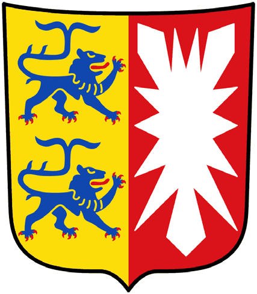
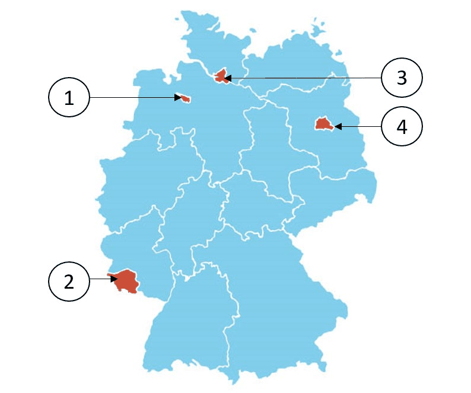

# Bremen - State Questions

> The 10 official questions for Bremen. In the real test, 3 of these are added to the 30 general questions. Answer first, then open the solution.

[Overview](../index.md) | [All states](../states-at-a-glance.md) | [Mock test](../mock-test.md)

---

## Steckbrief / State profile

| Fact | German | Answer |
|---|---|---|
| Capital | die Landeshauptstadt | **Bremen** |
| Flag | die Landesflagge | `rot-weiß` (red-white) |
| Parliament | das Landesparlament | die Bürgerschaft |
| Term | die Wahlperiode | 4 years |
| Voting age | das Wahlalter (Kommunalwahlen) | 16 |
| Head of government | der Regierungschef | Präsidentin/Präsident des Senates |

## Frage 1

> **Frage:** Welches Wappen gehört zur Freien Hansestadt Bremen?  
> **English:** Which coat of arms belongs to Bremen?

| Bild 1 | Bild 2 | Bild 3 | Bild 4 |
|---|---|---|---|
|  |  |  |  |

| # | Antwort | English |
|---|---|---|
| a | Bild 1 | Picture 1 |
| b | Bild 2 | Picture 2 |
| c | Bild 3 | Picture 3 |
| d | Bild 4 | Picture 4 |

??? success "Lösung / Answer - open after you have chosen"

    **c) Bild 3**  
    Picture 3

    **Warum / Why:** Bremen's coat of arms features the "Bremen Key" - a silver key on a red shield - symbolizing the city's historic role as a free Hanseatic trading port.

??? note "Wortschatz / Vocabulary"

    | Deutsch | English |
    |---|---|
    | Wappen | the coat of arms |
    | gehören | to belong |
    | Frei | free |
    | Bild | the picture |

---

## Frage 2

> **Frage:** Welches ist ein Stadtteil von Bremen?  
> **English:** Which of these is a district (Stadtteil) of Bremen?

| # | Antwort | English |
|---|---|---|
| a | Altona | Altona |
| b | Hemelingen | Hemelingen |
| c | Pankow | Pankow |
| d | Babelsberg | Babelsberg |

??? success "Lösung / Answer - open after you have chosen"

    **b) Hemelingen**  
    Hemelingen

    **Warum / Why:** Hemelingen is located in Bremen; the other options are districts in different German states.

??? note "Wortschatz / Vocabulary"

    | Deutsch | English |
    |---|---|
    | Stadtteil | the city district |

---

## Frage 3

> **Frage:** Für wie viele Jahre wird das Landesparlament in Bremen gewählt?  
> **English:** For how many years is the state parliament in Bremen elected?

| # | Antwort | English |
|---|---|---|
| a | 3 | 3 |
| b | 4 | 4 |
| c | 5 | 5 |
| d | 6 | 6 |

??? success "Lösung / Answer - open after you have chosen"

    **b) 4**  
    4

    **Warum / Why:** The state parliament of Bremen is elected for a term of 4 years.

??? note "Wortschatz / Vocabulary"

    | Deutsch | English |
    |---|---|
    | Jahr | the year |
    | Landesparlament | the state parliament |
    | wählen | to vote / to choose |

---

## Frage 4

> **Frage:** Ab welchem Alter darf man in Bremen bei den Wahlen zur Bürgerschaft (Landtag) wählen?  
> **English:** From what age can people vote in local elections in Bremen?

| # | Antwort | English |
|---|---|---|
| a | 14 | 14 |
| b | 16 | 16 |
| c | 18 | 18 |
| d | 20 | 20 |

??? success "Lösung / Answer - open after you have chosen"

    **b) 16**  
    16

    **Warum / Why:** In Bremen, the minimum voting age for local elections is 16.

??? note "Wortschatz / Vocabulary"

    | Deutsch | English |
    |---|---|
    | Alter | the age |
    | Wahlen | the elections |
    | Bürgerschaft | the citizens' assembly |
    | Landtag | the state parliament |
    | wählen | to vote / to choose |

---

## Frage 5

> **Frage:** Welche Farben hat die Landesflagge von Bremen?  
> **English:** What colors does the state flag of Bremen have?

| # | Antwort | English |
|---|---|---|
| a | blau-weiß-rot | blue-white-red |
| b | rot-weiß | red-white |
| c | grün-weiß-rot | green-white-red |
| d | schwarz-gold | black-gold |

??? success "Lösung / Answer - open after you have chosen"

    **b) rot-weiß**  
    red-white

    **Warum / Why:** The state flag of Bremen is red-white.

??? note "Wortschatz / Vocabulary"

    | Deutsch | English |
    |---|---|
    | Farbe | the colour |
    | Landesflagge | the state flag |
    | rot-weiß | red-white |
    | blau-weiß-rot | blue-white-red |
    | grün-weiß-rot | green-white-red |
    | schwarz-gold | black-gold |

---

## Frage 6

> **Frage:** Wo können Sie sich in Bremen über politische Themen informieren?  
> **English:** Where can you get information about political topics in Bremen?

| # | Antwort | English |
|---|---|---|
| a | beim Ordnungsamt der Gemeinde | at the municipal public order office |
| b | bei der Landeszentrale für politische Bildung | at the State Agency for Civic Education |
| c | bei den Kirchen | at the churches |
| d | bei der Verbraucherzentrale | at the Consumer Advice Centre |

??? success "Lösung / Answer - open after you have chosen"

    **b) bei der Landeszentrale für politische Bildung**  
    at the State Agency for Civic Education

    **Warum / Why:** Civic/political education information in Bremen is provided at the State Agency for Civic Education.

??? note "Wortschatz / Vocabulary"

    | Deutsch | English |
    |---|---|
    | politisch | political |
    | Thema | the topic |
    | informieren | to inform |
    | Landeszentrale | the state agency for civic education |
    | Bildung | education |
    | Ordnungsamt | the public order office |
    | Gemeinde | the municipality |
    | Kirche | the church |
    | Verbraucherzentrale | the consumer advice centre |

---

## Frage 7

> **Frage:** Was ist ein deutscher Stadtstaat?  
> **English:** Which federal state is a city-state?

| # | Antwort | English |
|---|---|---|
| a | Bremen | Bremen |
| b | München | Munich |
| c | Frankfurt | Frankfurt |
| d | Erfurt | Erfurt |

??? success "Lösung / Answer - open after you have chosen"

    **a) Bremen**  
    Bremen

    **Warum / Why:** Bremen is one of Germany's three city-states (Stadtstaaten), along with Berlin and Hamburg.

??? note "Wortschatz / Vocabulary"

    | Deutsch | English |
    |---|---|
    | deutsch | German |
    | Stadtstaat | the city-state |
    | München | Munich |

---

## Frage 8

> **Frage:** Welches Bundesland ist Bremen?  
> **English:** Which (highlighted) federal state is Bremen?

| # | Antwort | English |
|---|---|---|
| a | 1 | Number 1 |
| b | 2 | Number 2 |
| c | 3 | Number 3 |
| d | 4 | Number 4 |

??? success "Lösung / Answer - open after you have chosen"

    **a) 1**  
    Number 1

    **Warum / Why:** Bremen is a small city-state made up of two enclaves entirely surrounded by Lower Saxony in northwestern Germany.

??? note "Wortschatz / Vocabulary"

    | Deutsch | English |
    |---|---|
    | Bundesland | the federal state |

---

## Frage 9

> **Frage:** Wie nennt man die Regierungschefin/den Regierungschef des Stadtstaates Bremen?  
> **English:** What is the head of government in Bremen called?

| # | Antwort | English |
|---|---|---|
| a | Ministerpräsidentin/Ministerpräsident | Minister-President |
| b | Erste Bürgermeisterin/Erster Bürgermeister | First Mayor |
| c | Präsidentin/Präsident des Senates | President of the Senate |
| d | Regierende Bürgermeisterin/Regierender Bürgermeister | Governing Mayor |

??? success "Lösung / Answer - open after you have chosen"

    **c) Präsidentin/Präsident des Senates**  
    President of the Senate

    **Warum / Why:** The head of government in Bremen holds the title President of the Senate.

??? note "Wortschatz / Vocabulary"

    | Deutsch | English |
    |---|---|
    | nennen | to name |
    | Regierungschefin | the head of government (female) |
    | Regierungschef | the head of government |
    | Stadtstaat | the city-state |
    | Präsident | the president |
    | Senat | the senate |
    | Ministerpräsident | the Minister-President |
    | Erst | first |
    | Bürgermeister | the mayor |
    | Regierend | governing |

---

## Frage 10

> **Frage:** Welche Senatorin/welchen Senator hat Bremen nicht?  
> **English:** Which Senator does Bremen NOT have?

| # | Antwort | English |
|---|---|---|
| a | Senatorin/Senator für Außenbeziehungen | Senator for External Affairs |
| b | Finanzsenatorin/Finanzsenator | Finance Senator |
| c | Justizsenatorin/Justizsenator | Justice Senator |
| d | Innensenatorin/Innensenator | Interior Senator |

??? success "Lösung / Answer - open after you have chosen"

    **a) Senatorin/Senator für Außenbeziehungen**  
    Senator for External Affairs

    **Warum / Why:** Foreign affairs are a federal responsibility in Germany, not a state matter - so no German state has this ministry.

??? note "Wortschatz / Vocabulary"

    | Deutsch | English |
    |---|---|
    | Senator | the senator |
    | Außenbeziehungen | foreign relations |
    | Finanzsenatorin | the Senator for Finance (female) |
    | Finanzsenator | the Senator for Finance |
    | Justizsenatorin | the Senator for Justice (female) |
    | Justizsenator | the Senator for Justice |
    | Innensenatorin | the Senator for the Interior (female) |
    | Innensenator | the Senator for the Interior |

---

## Set check

- [ ] I answered all 10 questions before opening any solution.
- [ ] I scored at least 8/10.
- [ ] I can name the capital, flag colours and leader title of this state from memory.

---

[← Brandenburg](04-brandenburg.md) | [Overview](../index.md) | [Hamburg →](06-hamburg.md)
