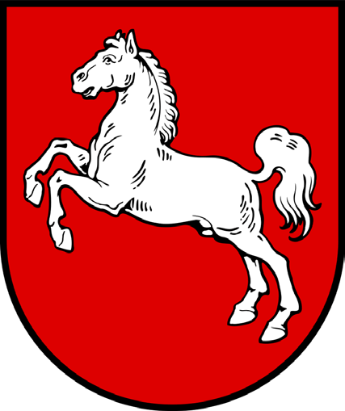
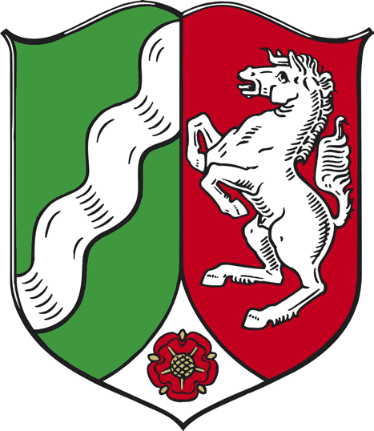
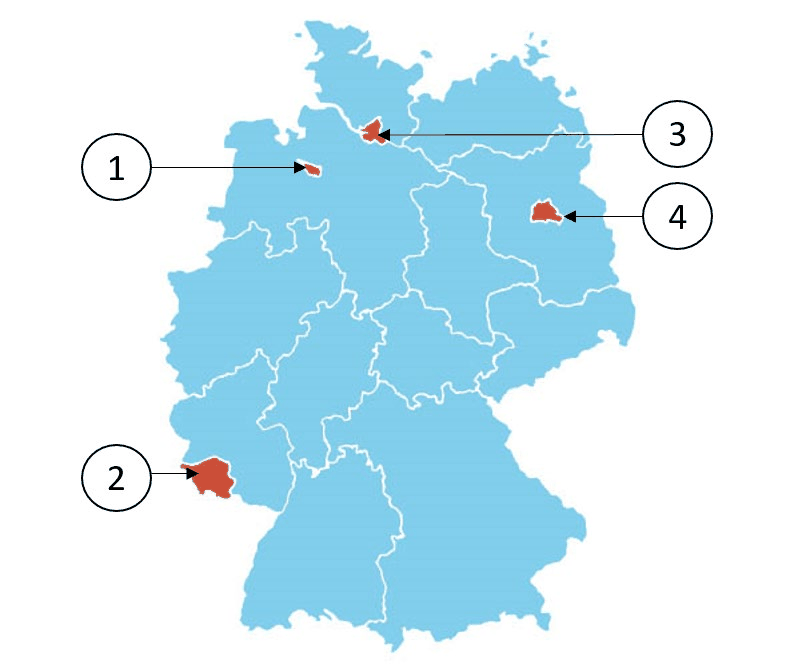

# Hamburg - State Questions

> The 10 official questions for Hamburg. In the real test, 3 of these are added to the 30 general questions. Answer first, then open the solution.

[Overview](../index.md) | [All states](../states-at-a-glance.md) | [Mock test](../mock-test.md)

---

## Steckbrief / State profile

| Fact | German | Answer |
|---|---|---|
| Capital | die Landeshauptstadt | **Hamburg** |
| Flag | die Landesflagge | `weiß-rot` (white-red) |
| Parliament | das Landesparlament | die Bürgerschaft |
| Term | die Wahlperiode | 5 years |
| Voting age | das Wahlalter (Kommunalwahlen) | 16 |
| Head of government | der Regierungschef | Erste Bürgermeisterin/Erster Bürgermeister |

## Frage 1

> **Frage:** Welches Wappen gehört zur Freien und Hansestadt Hamburg?  
> **English:** Which coat of arms belongs to Hamburg?

| Bild 1 | Bild 2 | Bild 3 | Bild 4 |
|---|---|---|---|
|  |  |  |  |

| # | Antwort | English |
|---|---|---|
| a | Bild 1 | Picture 1 |
| b | Bild 2 | Picture 2 |
| c | Bild 3 | Picture 3 |
| d | Bild 4 | Picture 4 |

??? success "Lösung / Answer - open after you have chosen"

    **b) Bild 2**  
    Picture 2

    **Warum / Why:** Hamburg's coat of arms depicts a white castle gate with towers on a red shield, symbolizing the city's historic status as a fortified Hanseatic trading center.

??? note "Wortschatz / Vocabulary"

    | Deutsch | English |
    |---|---|
    | Wappen | the coat of arms |
    | gehören | to belong |
    | Frei | free |
    | Bild | the picture |

---

## Frage 2

> **Frage:** Welches ist ein Bezirk von Hamburg?  
> **English:** Which of these is a district (Bezirk) in Hamburg?

| # | Antwort | English |
|---|---|---|
| a | Altona | Altona |
| b | Hemelingen | Hemelingen |
| c | Pankow | Pankow |
| d | Mecklenburgische Seenplatte | Mecklenburg Lake District |

??? success "Lösung / Answer - open after you have chosen"

    **a) Altona**  
    Altona

    **Warum / Why:** Altona is located in Hamburg; the other options are districts in different German states.

??? note "Wortschatz / Vocabulary"

    | Deutsch | English |
    |---|---|
    | Bezirk | the district |
    | Seenplatte | the lakeland |

---

## Frage 3

> **Frage:** Für wie viele Jahre wird das Landesparlament in Hamburg gewählt?  
> **English:** For how many years is the state parliament in Hamburg elected?

| # | Antwort | English |
|---|---|---|
| a | 3 | 3 |
| b | 4 | 4 |
| c | 5 | 5 |
| d | 6 | 6 |

??? success "Lösung / Answer - open after you have chosen"

    **c) 5**  
    5

    **Warum / Why:** The state parliament of Hamburg is elected for a term of 5 years.

??? note "Wortschatz / Vocabulary"

    | Deutsch | English |
    |---|---|
    | Jahr | the year |
    | Landesparlament | the state parliament |
    | wählen | to vote / to choose |

---

## Frage 4

> **Frage:** Ab welchem Alter darf man in Hamburg bei Kommunalwahlen (Wahl der Bezirksversammlungen) wählen?  
> **English:** From what age can people vote in local elections in Hamburg?

| # | Antwort | English |
|---|---|---|
| a | 14 | 14 |
| b | 16 | 16 |
| c | 18 | 18 |
| d | 20 | 20 |

??? success "Lösung / Answer - open after you have chosen"

    **b) 16**  
    16

    **Warum / Why:** In Hamburg, the minimum voting age for local elections is 16.

??? note "Wortschatz / Vocabulary"

    | Deutsch | English |
    |---|---|
    | Alter | the age |
    | Kommunalwahl | the local election |
    | Wahl | the election |
    | wählen | to vote / to choose |

---

## Frage 5

> **Frage:** Welche Farben hat die Landesflagge von Hamburg?  
> **English:** What colors does the state flag of Hamburg have?

| # | Antwort | English |
|---|---|---|
| a | blau-weiß-rot | blue-white-red |
| b | weiß-rot | white-red |
| c | grün-weiß-rot | green-white-red |
| d | schwarz-gelb | black-yellow |

??? success "Lösung / Answer - open after you have chosen"

    **b) weiß-rot**  
    white-red

    **Warum / Why:** The state flag of Hamburg is white-red.

??? note "Wortschatz / Vocabulary"

    | Deutsch | English |
    |---|---|
    | Farbe | the colour |
    | Landesflagge | the state flag |
    | weiß-rot | white-red |
    | blau-weiß-rot | blue-white-red |
    | grün-weiß-rot | green-white-red |
    | schwarz-gelb | black-yellow |

---

## Frage 6

> **Frage:** Wo können Sie sich in Hamburg über politische Themen informieren?  
> **English:** Where can you get information about political topics in Hamburg?

| # | Antwort | English |
|---|---|---|
| a | beim Ordnungsamt der Gemeinde | at the municipal public order office |
| b | bei der Verbraucherzentrale | at the Consumer Advice Centre |
| c | bei den Kirchen | at the churches |
| d | bei der Landeszentrale für politische Bildung | at the State Agency for Civic Education |

??? success "Lösung / Answer - open after you have chosen"

    **d) bei der Landeszentrale für politische Bildung**  
    at the State Agency for Civic Education

    **Warum / Why:** Civic/political education information in Hamburg is provided at the State Agency for Civic Education.

??? note "Wortschatz / Vocabulary"

    | Deutsch | English |
    |---|---|
    | politisch | political |
    | Thema | the topic |
    | informieren | to inform |
    | Landeszentrale | the state agency for civic education |
    | Bildung | education |
    | Ordnungsamt | the public order office |
    | Gemeinde | the municipality |
    | Verbraucherzentrale | the consumer advice centre |
    | Kirche | the church |

---

## Frage 7

> **Frage:** Welches Bundesland ist ein Stadtstaat?  
> **English:** Which federal state is a city-state?

| # | Antwort | English |
|---|---|---|
| a | Hamburg | Hamburg |
| b | Sachsen | Saxony |
| c | Bayern | Bavaria |
| d | Thüringen | Thuringia |

??? success "Lösung / Answer - open after you have chosen"

    **a) Hamburg**  
    Hamburg

    **Warum / Why:** Hamburg is one of Germany's three city-states (Stadtstaaten), along with Berlin and Bremen/Hamburg.

??? note "Wortschatz / Vocabulary"

    | Deutsch | English |
    |---|---|
    | Bundesland | the federal state |
    | Stadtstaat | the city-state |
    | Sachsen | Saxony |
    | Bayern | Bavaria |
    | Thüringen | Thuringia |

---

## Frage 8

> **Frage:** Welches Bundesland ist Hamburg?  
> **English:** Which (highlighted) federal state is Hamburg?

| # | Antwort | English |
|---|---|---|
| a | 1 | Number 1 |
| b | 2 | Number 2 |
| c | 3 | Number 3 |
| d | 4 | Number 4 |

??? success "Lösung / Answer - open after you have chosen"

    **c) 3**  
    Number 3

    **Warum / Why:** Hamburg is a city-state in northern Germany, surrounded by the states of Schleswig-Holstein and Lower Saxony.

??? note "Wortschatz / Vocabulary"

    | Deutsch | English |
    |---|---|
    | Bundesland | the federal state |

---

## Frage 9

> **Frage:** Wie nennt man die Regierungschefin/den Regierungschef des Stadtstaates Hamburg?  
> **English:** What is the head of government in Hamburg called?

| # | Antwort | English |
|---|---|---|
| a | Ministerpräsidentin/Ministerpräsident | Minister-President |
| b | Erste Bürgermeisterin/Erster Bürgermeister | First Mayor |
| c | Regierende Senatorin/Regierender Senator | Governing Senator |
| d | Oberbürgermeisterin/Oberbürgermeister | Lord Mayor |

??? success "Lösung / Answer - open after you have chosen"

    **b) Erste Bürgermeisterin/Erster Bürgermeister**  
    First Mayor

    **Warum / Why:** The head of government in Hamburg holds the title First Mayor.

??? note "Wortschatz / Vocabulary"

    | Deutsch | English |
    |---|---|
    | nennen | to name |
    | Regierungschefin | the head of government (female) |
    | Regierungschef | the head of government |
    | Stadtstaat | the city-state |
    | Erst | first |
    | Bürgermeister | the mayor |
    | Ministerpräsident | the Minister-President |
    | Regierend | governing |
    | Senator | the senator |

---

## Frage 10

> **Frage:** Welche Senatorin/welchen Senator hat Hamburg nicht?  
> **English:** Which Senator does Hamburg NOT have?

| # | Antwort | English |
|---|---|---|
| a | Justizsenatorin/Justizsenator | Justice Senator |
| b | Senatorin/Senator für Außenbeziehungen | Senator for External Affairs |
| c | Finanzsenatorin/Finanzsenator | Finance Senator |
| d | Innensenatorin/Innensenator | Interior Senator |

??? success "Lösung / Answer - open after you have chosen"

    **b) Senatorin/Senator für Außenbeziehungen**  
    Senator for External Affairs

    **Warum / Why:** Foreign affairs are a federal responsibility in Germany, not a state matter - so no German state has this ministry.

??? note "Wortschatz / Vocabulary"

    | Deutsch | English |
    |---|---|
    | Senator | the senator |
    | Außenbeziehungen | foreign relations |
    | Justizsenatorin | the Senator for Justice (female) |
    | Justizsenator | the Senator for Justice |
    | Finanzsenatorin | the Senator for Finance (female) |
    | Finanzsenator | the Senator for Finance |
    | Innensenatorin | the Senator for the Interior (female) |
    | Innensenator | the Senator for the Interior |

---

## Set check

- [ ] I answered all 10 questions before opening any solution.
- [ ] I scored at least 8/10.
- [ ] I can name the capital, flag colours and leader title of this state from memory.

---

[← Bremen](05-bremen.md) | [Overview](../index.md) | [Hessen →](07-hessen.md)
