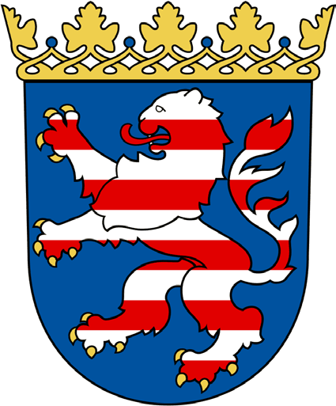
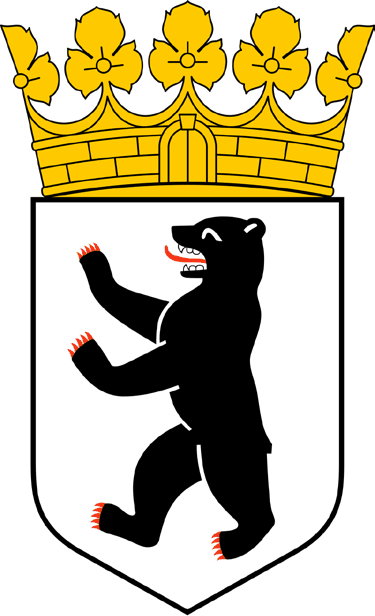
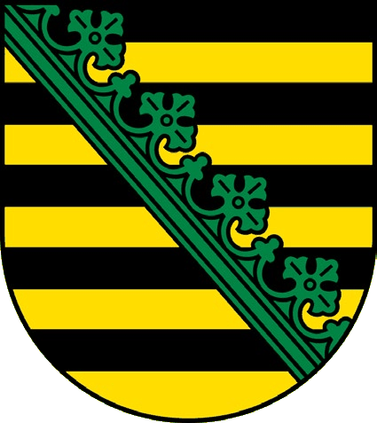
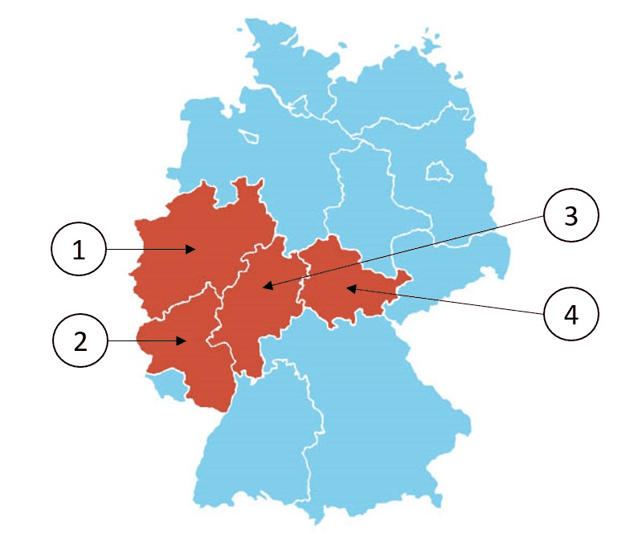

# Hessen - State Questions

> The 10 official questions for Hessen. In the real test, 3 of these are added to the 30 general questions. Answer first, then open the solution.

[Overview](../index.md) | [All states](../states-at-a-glance.md) | [Mock test](../mock-test.md)

---

## Steckbrief / State profile

| Fact | German | Answer |
|---|---|---|
| Capital | die Landeshauptstadt | **Wiesbaden** |
| Flag | die Landesflagge | `rot-weiß` (red-white) |
| Parliament | das Landesparlament | der Landtag |
| Term | die Wahlperiode | 5 years |
| Voting age | das Wahlalter (Kommunalwahlen) | 18 |
| Head of government | der Regierungschef | Ministerpräsidentin/Ministerpräsident |

## Frage 1

> **Frage:** Welches Wappen gehört zum Bundesland Hessen?  
> **English:** Which coat of arms belongs to Hessen (Hesse)?

| Bild 1 | Bild 2 | Bild 3 | Bild 4 |
|---|---|---|---|
|  |  |  |  |

| # | Antwort | English |
|---|---|---|
| a | Bild 1 | Picture 1 |
| b | Bild 2 | Picture 2 |
| c | Bild 3 | Picture 3 |
| d | Bild 4 | Picture 4 |

??? success "Lösung / Answer - open after you have chosen"

    **a) Bild 1**  
    Picture 1

    **Warum / Why:** The correct coat of arms shows Hesse's traditional red-and-white striped lion (the "Hessian Lion"), used as the state symbol since the Middle Ages. Hesse is also home to Frankfurt am Main, Germany's financial capital and seat of the European Central Bank (ECB), though the state capital is Wiesbaden.

??? note "Wortschatz / Vocabulary"

    | Deutsch | English |
    |---|---|
    | Wappen | the coat of arms |
    | gehören | to belong |
    | Bundesland | the federal state |
    | Hessen | Hesse |
    | Bild | the picture |

---

## Frage 2

> **Frage:** Welches ist ein Landkreis in Hessen?  
> **English:** Which of these is a district (Landkreis) in Hesse?

| # | Antwort | English |
|---|---|---|
| a | Ammerland | Ammerland |
| b | Altötting | Altötting |
| c | Prignitz | Prignitz |
| d | Main-Taunus-Kreis | Main-Taunus-Kreis |

??? success "Lösung / Answer - open after you have chosen"

    **d) Main-Taunus-Kreis**  
    Main-Taunus-Kreis

    **Warum / Why:** Main-Taunus-Kreis is a district located in Hesse, near Frankfurt. Ammerland is in Lower Saxony, Altötting is in Bavaria, and Prignitz is in Brandenburg.

??? note "Wortschatz / Vocabulary"

    | Deutsch | English |
    |---|---|
    | Landkreis | the district |
    | Hessen | Hesse |

---

## Frage 3

> **Frage:** Für wie viele Jahre wird der Landtag in Hessen gewählt?  
> **English:** For how many years is the state parliament (Landtag) in Hesse elected?

| # | Antwort | English |
|---|---|---|
| a | 3 | 3 |
| b | 4 | 4 |
| c | 5 | 5 |
| d | 6 | 6 |

??? success "Lösung / Answer - open after you have chosen"

    **c) 5**  
    5

    **Warum / Why:** The Hessian Landtag is elected for a term of 5 years, longer than the 4-year term common in most other German states.

??? note "Wortschatz / Vocabulary"

    | Deutsch | English |
    |---|---|
    | Jahr | the year |
    | Landtag | the state parliament |
    | Hessen | Hesse |
    | wählen | to vote / to choose |

---

## Frage 4

> **Frage:** Ab welchem Alter darf man in Hessen bei Kommunalwahlen wählen?  
> **English:** From what age can people vote in local (municipal) elections in Hesse?

| # | Antwort | English |
|---|---|---|
| a | 14 | 14 |
| b | 16 | 16 |
| c | 18 | 18 |
| d | 20 | 20 |

??? success "Lösung / Answer - open after you have chosen"

    **c) 18**  
    18

    **Warum / Why:** In Hesse, the minimum voting age for municipal elections is 18 - unlike some other German states, which allow voting from age 16 at the local level.

??? note "Wortschatz / Vocabulary"

    | Deutsch | English |
    |---|---|
    | Alter | the age |
    | Hessen | Hesse |
    | Kommunalwahl | the local election |
    | wählen | to vote / to choose |

---

## Frage 5

> **Frage:** Welche Farben hat die Landesflagge von Hessen?  
> **English:** What colors does the state flag of Hesse have?

| # | Antwort | English |
|---|---|---|
| a | blau-weiß-rot | blue-white-red |
| b | rot-weiß | red-white |
| c | schwarz-gold | black-gold |
| d | grün-weiß-rot | green-white-red |

??? success "Lösung / Answer - open after you have chosen"

    **b) rot-weiß**  
    red-white

    **Warum / Why:** The state flag of Hesse is red-white, matching the colors of the Hessian Lion coat of arms.

??? note "Wortschatz / Vocabulary"

    | Deutsch | English |
    |---|---|
    | Farbe | the colour |
    | Landesflagge | the state flag |
    | Hessen | Hesse |
    | rot-weiß | red-white |
    | blau-weiß-rot | blue-white-red |
    | schwarz-gold | black-gold |
    | grün-weiß-rot | green-white-red |

---

## Frage 6

> **Frage:** Wo können Sie sich in Hessen über politische Themen informieren?  
> **English:** Where can you get information about political topics in Hesse?

| # | Antwort | English |
|---|---|---|
| a | bei der Landeszentrale für politische Bildung | at the State Agency for Civic Education |
| b | bei der Verbraucherzentrale | at the Consumer Advice Centre |
| c | beim Ordnungsamt der Gemeinde | at the municipal public order office |
| d | bei den Kirchen | at the churches |

??? success "Lösung / Answer - open after you have chosen"

    **a) bei der Landeszentrale für politische Bildung**  
    at the State Agency for Civic Education

    **Warum / Why:** The Landeszentrale für politische Bildung provides neutral, non-partisan information on political topics for citizens in Hesse.

??? note "Wortschatz / Vocabulary"

    | Deutsch | English |
    |---|---|
    | Hessen | Hesse |
    | politisch | political |
    | Thema | the topic |
    | informieren | to inform |
    | Landeszentrale | the state agency for civic education |
    | Bildung | education |
    | Verbraucherzentrale | the consumer advice centre |
    | Ordnungsamt | the public order office |
    | Gemeinde | the municipality |
    | Kirche | the church |

---

## Frage 7

> **Frage:** Die Landeshauptstadt von Hessen heißt …  
> **English:** The state capital of Hesse is called …

| # | Antwort | English |
|---|---|---|
| a | Kassel. | Kassel. |
| b | Darmstadt. | Darmstadt. |
| c | Frankfurt. | Frankfurt. |
| d | Wiesbaden. | Wiesbaden. |

??? success "Lösung / Answer - open after you have chosen"

    **d) Wiesbaden.**  
    Wiesbaden.

    **Warum / Why:** Wiesbaden is the state capital of Hesse - not Frankfurt, which is the largest city in the state but not its capital.

??? note "Wortschatz / Vocabulary"

    | Deutsch | English |
    |---|---|
    | Landeshauptstadt | the state capital |
    | Hessen | Hesse |
    | heißen | to be called |

---

## Frage 8

> **Frage:** Welches Bundesland ist Hessen?  
> **English:** Which (highlighted) federal state is Hesse?

| # | Antwort | English |
|---|---|---|
| a | 1 | Number 1 |
| b | 2 | Number 2 |
| c | 3 | Number 3 |
| d | 4 | Number 4 |

??? success "Lösung / Answer - open after you have chosen"

    **c) 3**  
    Number 3

    **Warum / Why:** Hesse is located in west-central Germany, bordering North Rhine-Westphalia, Rhineland-Palatinate, Bavaria, Thuringia, Lower Saxony, and Baden-Württemberg.

??? note "Wortschatz / Vocabulary"

    | Deutsch | English |
    |---|---|
    | Bundesland | the federal state |
    | Hessen | Hesse |

---

## Frage 9

> **Frage:** Wie nennt man die Regierungschefin/den Regierungschef in Hessen?  
> **English:** What is the head of government in Hesse called?

| # | Antwort | English |
|---|---|---|
| a | Erste Ministerin/Erster Minister | First Minister |
| b | Premierministerin/Premierminister | Prime Minister |
| c | Bürgermeisterin/Bürgermeister | Mayor |
| d | Ministerpräsidentin/Ministerpräsident | Minister-President |

??? success "Lösung / Answer - open after you have chosen"

    **d) Ministerpräsidentin/Ministerpräsident**  
    Minister-President

    **Warum / Why:** As in all German states, the head of government in Hesse holds the title Ministerpräsident/in (Minister-President) - not Prime Minister or Mayor. As of 2025: Boris Rhein (CDU).

??? note "Wortschatz / Vocabulary"

    | Deutsch | English |
    |---|---|
    | nennen | to name |
    | Regierungschefin | the head of government (female) |
    | Regierungschef | the head of government |
    | Hessen | Hesse |
    | Ministerpräsident | the Minister-President |
    | Erst | first |
    | Minister | the minister |
    | Premierministerin | the Prime Minister (female) |
    | Premierminister | the Prime Minister |
    | Bürgermeister | the mayor |

---

## Frage 10

> **Frage:** Welche Ministerin/welchen Minister hat Hessen nicht?  
> **English:** Which minister does Hesse NOT have?

| # | Antwort | English |
|---|---|---|
| a | Justizministerin/Justizminister | Minister of Justice |
| b | Außenministerin/Außenminister | Minister of Foreign Affairs |
| c | Finanzministerin/Finanzminister | Minister of Finance |
| d | Innenministerin/Innenminister | Minister of the Interior |

??? success "Lösung / Answer - open after you have chosen"

    **b) Außenministerin/Außenminister**  
    Minister of Foreign Affairs

    **Warum / Why:** Foreign affairs are a federal responsibility in Germany, not a state matter - so no German state, including Hesse, has a Minister of Foreign Affairs.

??? note "Wortschatz / Vocabulary"

    | Deutsch | English |
    |---|---|
    | Minister | the minister |
    | Hessen | Hesse |
    | Außenministerin | the Foreign Minister (female) |
    | Außenminister | the Foreign Minister |
    | Justizministerin | the Justice Minister (female) |
    | Justizminister | the Justice Minister |
    | Finanzministerin | the Finance Minister (female) |
    | Finanzminister | the Finance Minister |
    | Innenministerin | the Interior Minister (female) |
    | Innenminister | the Interior Minister |

---

## Set check

- [ ] I answered all 10 questions before opening any solution.
- [ ] I scored at least 8/10.
- [ ] I can name the capital, flag colours and leader title of this state from memory.

---

[← Hamburg](06-hamburg.md) | [Overview](../index.md) | [Mecklenburg-Vorpommern →](08-mecklenburg-vorpommern.md)
