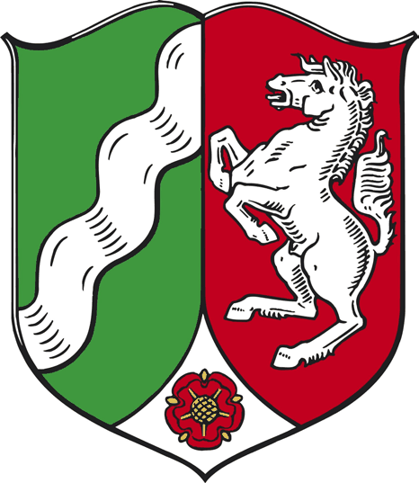
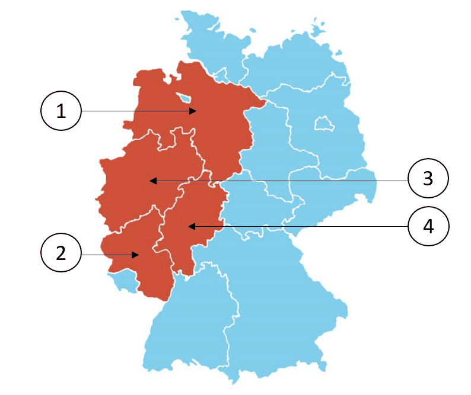

# Nordrhein-Westfalen - State Questions

> The 10 official questions for Nordrhein-Westfalen. In the real test, 3 of these are added to the 30 general questions. Answer first, then open the solution.

[Overview](../index.md) | [All states](../states-at-a-glance.md) | [Mock test](../mock-test.md)

---

## Steckbrief / State profile

| Fact | German | Answer |
|---|---|---|
| Capital | die Landeshauptstadt | **Düsseldorf** |
| Flag | die Landesflagge | `grün-weiß-rot` (green-white-red) |
| Parliament | das Landesparlament | der Landtag |
| Term | die Wahlperiode | 5 years |
| Voting age | das Wahlalter (Kommunalwahlen) | 16 |
| Head of government | der Regierungschef | Ministerpräsidentin/Ministerpräsident |

## Frage 1

> **Frage:** Welches Wappen gehört zum Bundesland Nordrhein-Westfalen?  
> **English:** Which coat of arms belongs to North Rhine-Westphalia?

| Bild 1 | Bild 2 | Bild 3 | Bild 4 |
|---|---|---|---|
|  |  |  |  |

| # | Antwort | English |
|---|---|---|
| a | Bild 1 | Picture 1 |
| b | Bild 2 | Picture 2 |
| c | Bild 3 | Picture 3 |
| d | Bild 4 | Picture 4 |

??? success "Lösung / Answer - open after you have chosen"

    **b) Bild 2**  
    Picture 2

    **Warum / Why:** North Rhine-Westphalia's coat of arms combines elements representing its constituent historic regions - the Rhineland, Westphalia, and Lippe.

??? note "Wortschatz / Vocabulary"

    | Deutsch | English |
    |---|---|
    | Wappen | the coat of arms |
    | gehören | to belong |
    | Bundesland | the federal state |
    | Nordrhein-Westfalen | North Rhine-Westphalia |
    | Bild | the picture |

---

## Frage 2

> **Frage:** Welches ist ein Landkreis in Nordrhein-Westfalen?  
> **English:** Which of these is a district (Landkreis) in North Rhine-Westphalia?

| # | Antwort | English |
|---|---|---|
| a | Ammerland | Ammerland |
| b | Rhein-Sieg-Kreis | Rhein-Sieg-Kreis |
| c | Nordfriesland | North Frisia |
| d | Vogtlandkreis | Vogtlandkreis |

??? success "Lösung / Answer - open after you have chosen"

    **b) Rhein-Sieg-Kreis**  
    Rhein-Sieg-Kreis

    **Warum / Why:** Rhein-Sieg-Kreis is located in North Rhine-Westphalia; the other options are districts in different German states.

??? note "Wortschatz / Vocabulary"

    | Deutsch | English |
    |---|---|
    | Landkreis | the district |
    | Nordrhein-Westfalen | North Rhine-Westphalia |

---

## Frage 3

> **Frage:** Für wie viele Jahre wird der Landtag in Nordrhein-Westfalen gewählt?  
> **English:** For how many years is the state parliament in North Rhine-Westphalia elected?

| # | Antwort | English |
|---|---|---|
| a | 3 | 3 |
| b | 4 | 4 |
| c | 5 | 5 |
| d | 6 | 6 |

??? success "Lösung / Answer - open after you have chosen"

    **c) 5**  
    5

    **Warum / Why:** The state parliament of North Rhine-Westphalia is elected for a term of 5 years.

??? note "Wortschatz / Vocabulary"

    | Deutsch | English |
    |---|---|
    | Jahr | the year |
    | Landtag | the state parliament |
    | Nordrhein-Westfalen | North Rhine-Westphalia |
    | wählen | to vote / to choose |

---

## Frage 4

> **Frage:** Ab welchem Alter darf man in Nordrhein-Westfalen bei Kommunalwahlen wählen?  
> **English:** From what age can people vote in local elections in North Rhine-Westphalia?

| # | Antwort | English |
|---|---|---|
| a | 14 | 14 |
| b | 16 | 16 |
| c | 18 | 18 |
| d | 20 | 20 |

??? success "Lösung / Answer - open after you have chosen"

    **b) 16**  
    16

    **Warum / Why:** In North Rhine-Westphalia, the minimum voting age for local elections is 16.

??? note "Wortschatz / Vocabulary"

    | Deutsch | English |
    |---|---|
    | Alter | the age |
    | Nordrhein-Westfalen | North Rhine-Westphalia |
    | Kommunalwahl | the local election |
    | wählen | to vote / to choose |

---

## Frage 5

> **Frage:** Welche Farben hat die Landesflagge von Nordrhein-Westfalen?  
> **English:** What colors does the state flag of North Rhine-Westphalia have?

| # | Antwort | English |
|---|---|---|
| a | rot-weiß | red-white |
| b | grün-weiß-rot | green-white-red |
| c | schwarz-gold | black-gold |
| d | blau-weiß-rot | blue-white-red |

??? success "Lösung / Answer - open after you have chosen"

    **b) grün-weiß-rot**  
    green-white-red

    **Warum / Why:** The state flag of North Rhine-Westphalia is green-white-red.

??? note "Wortschatz / Vocabulary"

    | Deutsch | English |
    |---|---|
    | Farbe | the colour |
    | Landesflagge | the state flag |
    | Nordrhein-Westfalen | North Rhine-Westphalia |
    | grün-weiß-rot | green-white-red |
    | rot-weiß | red-white |
    | schwarz-gold | black-gold |
    | blau-weiß-rot | blue-white-red |

---

## Frage 6

> **Frage:** Wo können Sie sich in Nordrhein-Westfalen über politische Themen informieren?  
> **English:** Where can you get information about political topics in North Rhine-Westphalia?

| # | Antwort | English |
|---|---|---|
| a | bei den Kirchen | at the churches |
| b | beim Ordnungsamt der Gemeinde | at the municipal public order office |
| c | bei der Verbraucherzentrale | at the Consumer Advice Centre |
| d | bei der Landeszentrale für politische Bildung | at the State Agency for Civic Education |

??? success "Lösung / Answer - open after you have chosen"

    **d) bei der Landeszentrale für politische Bildung**  
    at the State Agency for Civic Education

    **Warum / Why:** Civic/political education information in North Rhine-Westphalia is provided at the State Agency for Civic Education.

??? note "Wortschatz / Vocabulary"

    | Deutsch | English |
    |---|---|
    | Nordrhein-Westfalen | North Rhine-Westphalia |
    | politisch | political |
    | Thema | the topic |
    | informieren | to inform |
    | Landeszentrale | the state agency for civic education |
    | Bildung | education |
    | Kirche | the church |
    | Ordnungsamt | the public order office |
    | Gemeinde | the municipality |
    | Verbraucherzentrale | the consumer advice centre |

---

## Frage 7

> **Frage:** Die Landeshauptstadt von Nordrhein-Westfalen heißt …  
> **English:** The state capital of North Rhine-Westphalia is called …

| # | Antwort | English |
|---|---|---|
| a | Köln. | Cologne. |
| b | Bonn. | Bonn. |
| c | Düsseldorf. | Düsseldorf. |
| d | Dortmund. | Dortmund. |

??? success "Lösung / Answer - open after you have chosen"

    **c) Düsseldorf.**  
    Düsseldorf.

    **Warum / Why:** Düsseldorf. is the state capital of North Rhine-Westphalia.

??? note "Wortschatz / Vocabulary"

    | Deutsch | English |
    |---|---|
    | Landeshauptstadt | the state capital |
    | Nordrhein-Westfalen | North Rhine-Westphalia |
    | heißen | to be called |
    | Köln | Cologne |

---

## Frage 8

> **Frage:** Welches Bundesland ist Nordrhein-Westfalen?  
> **English:** Which (highlighted) federal state is North Rhine-Westphalia?

| # | Antwort | English |
|---|---|---|
| a | 1 | Number 1 |
| b | 2 | Number 2 |
| c | 3 | Number 3 |
| d | 4 | Number 4 |

??? success "Lösung / Answer - open after you have chosen"

    **c) 3**  
    Number 3

    **Warum / Why:** North Rhine-Westphalia is Germany's most populous state, located in the west, bordering the Netherlands and Belgium.

??? note "Wortschatz / Vocabulary"

    | Deutsch | English |
    |---|---|
    | Bundesland | the federal state |
    | Nordrhein-Westfalen | North Rhine-Westphalia |

---

## Frage 9

> **Frage:** Wie nennt man die Regierungschefin/den Regierungschef in Nordrhein-Westfalen?  
> **English:** What is the head of government in North Rhine-Westphalia called?

| # | Antwort | English |
|---|---|---|
| a | Erste Ministerin/Erster Minister | First Minister |
| b | Premierministerin/Premierminister | Prime Minister |
| c | Bürgermeisterin/Bürgermeister | Mayor |
| d | Ministerpräsidentin/Ministerpräsident | Minister-President |

??? success "Lösung / Answer - open after you have chosen"

    **d) Ministerpräsidentin/Ministerpräsident**  
    Minister-President

    **Warum / Why:** The head of government in North Rhine-Westphalia holds the title Minister-President.

??? note "Wortschatz / Vocabulary"

    | Deutsch | English |
    |---|---|
    | nennen | to name |
    | Regierungschefin | the head of government (female) |
    | Regierungschef | the head of government |
    | Nordrhein-Westfalen | North Rhine-Westphalia |
    | Ministerpräsident | the Minister-President |
    | Erst | first |
    | Minister | the minister |
    | Premierministerin | the Prime Minister (female) |
    | Premierminister | the Prime Minister |
    | Bürgermeister | the mayor |

---

## Frage 10

> **Frage:** Welche Ministerin/welchen Minister hat Nordrhein-Westfalen nicht?  
> **English:** Which minister does North Rhine-Westphalia NOT have?

| # | Antwort | English |
|---|---|---|
| a | Justizministerin/Justizminister | Minister of Justice |
| b | Außenministerin/Außenminister | Minister of Foreign Affairs |
| c | Finanzministerin/Finanzminister | Minister of Finance |
| d | Innenministerin/Innenminister | Minister of the Interior |

??? success "Lösung / Answer - open after you have chosen"

    **b) Außenministerin/Außenminister**  
    Minister of Foreign Affairs

    **Warum / Why:** Foreign affairs are a federal responsibility in Germany, not a state matter - so no German state has this ministry.

??? note "Wortschatz / Vocabulary"

    | Deutsch | English |
    |---|---|
    | Minister | the minister |
    | Nordrhein-Westfalen | North Rhine-Westphalia |
    | Außenministerin | the Foreign Minister (female) |
    | Außenminister | the Foreign Minister |
    | Justizministerin | the Justice Minister (female) |
    | Justizminister | the Justice Minister |
    | Finanzministerin | the Finance Minister (female) |
    | Finanzminister | the Finance Minister |
    | Innenministerin | the Interior Minister (female) |
    | Innenminister | the Interior Minister |

---

## Set check

- [ ] I answered all 10 questions before opening any solution.
- [ ] I scored at least 8/10.
- [ ] I can name the capital, flag colours and leader title of this state from memory.

---

[← Niedersachsen](09-niedersachsen.md) | [Overview](../index.md) | [Rheinland-Pfalz →](11-rheinland-pfalz.md)
