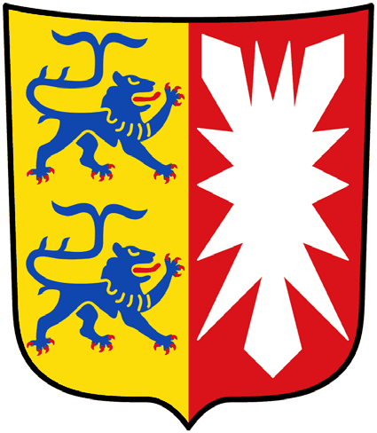
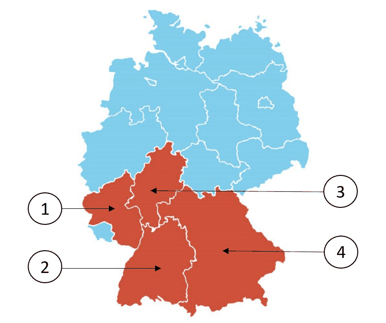

# Rheinland-Pfalz - State Questions

> The 10 official questions for Rheinland-Pfalz. In the real test, 3 of these are added to the 30 general questions. Answer first, then open the solution.

[Overview](../index.md) | [All states](../states-at-a-glance.md) | [Mock test](../mock-test.md)

---

## Steckbrief / State profile

| Fact | German | Answer |
|---|---|---|
| Capital | die Landeshauptstadt | **Mainz** |
| Flag | die Landesflagge | `schwarz-rot-gold` (black-red-gold) |
| Parliament | das Landesparlament | der Landtag |
| Term | die Wahlperiode | 5 years |
| Voting age | das Wahlalter (Kommunalwahlen) | 18 |
| Head of government | der Regierungschef | Ministerpräsidentin/Ministerpräsident |

## Frage 1

> **Frage:** Welches Wappen gehört zum Bundesland Rheinland-Pfalz?  
> **English:** Which coat of arms belongs to Rhineland-Palatinate?

| Bild 1 | Bild 2 | Bild 3 | Bild 4 |
|---|---|---|---|
|  |  |  |  |

| # | Antwort | English |
|---|---|---|
| a | Bild 1 | Picture 1 |
| b | Bild 2 | Picture 2 |
| c | Bild 3 | Picture 3 |
| d | Bild 4 | Picture 4 |

??? success "Lösung / Answer - open after you have chosen"

    **a) Bild 1**  
    Picture 1

    **Warum / Why:** Rhineland-Palatinate's coat of arms combines a cross, a wheel, and a lion, representing the historic territories of Trier, Mainz, and the Palatinate that were joined to form the state.

??? note "Wortschatz / Vocabulary"

    | Deutsch | English |
    |---|---|
    | Wappen | the coat of arms |
    | gehören | to belong |
    | Bundesland | the federal state |
    | Rheinland-Pfalz | Rhineland-Palatinate |
    | Bild | the picture |

---

## Frage 2

> **Frage:** Welches ist ein Landkreis in Rheinland-Pfalz?  
> **English:** Which of these is a district (Landkreis) in Rhineland-Palatinate?

| # | Antwort | English |
|---|---|---|
| a | Westerwaldkreis | Westerwaldkreis |
| b | Altötting | Altötting |
| c | Emsland | Emsland |
| d | Prignitz | Prignitz |

??? success "Lösung / Answer - open after you have chosen"

    **a) Westerwaldkreis**  
    Westerwaldkreis

    **Warum / Why:** Westerwaldkreis is located in Rhineland-Palatinate; the other options are districts in different German states.

??? note "Wortschatz / Vocabulary"

    | Deutsch | English |
    |---|---|
    | Landkreis | the district |
    | Rheinland-Pfalz | Rhineland-Palatinate |

---

## Frage 3

> **Frage:** Für wie viele Jahre wird der Landtag in Rheinland-Pfalz gewählt?  
> **English:** For how many years is the state parliament in Rhineland-Palatinate elected?

| # | Antwort | English |
|---|---|---|
| a | 3 | 3 |
| b | 4 | 4 |
| c | 5 | 5 |
| d | 6 | 6 |

??? success "Lösung / Answer - open after you have chosen"

    **c) 5**  
    5

    **Warum / Why:** The state parliament of Rhineland-Palatinate is elected for a term of 5 years.

??? note "Wortschatz / Vocabulary"

    | Deutsch | English |
    |---|---|
    | Jahr | the year |
    | Landtag | the state parliament |
    | Rheinland-Pfalz | Rhineland-Palatinate |
    | wählen | to vote / to choose |

---

## Frage 4

> **Frage:** Ab welchem Alter darf man in Rheinland-Pfalz bei Kommunalwahlen wählen?  
> **English:** From what age can people vote in local elections in Rhineland-Palatinate?

| # | Antwort | English |
|---|---|---|
| a | 14 | 14 |
| b | 16 | 16 |
| c | 18 | 18 |
| d | 20 | 20 |

??? success "Lösung / Answer - open after you have chosen"

    **c) 18**  
    18

    **Warum / Why:** In Rhineland-Palatinate, the minimum voting age for local elections is 18.

??? note "Wortschatz / Vocabulary"

    | Deutsch | English |
    |---|---|
    | Alter | the age |
    | Rheinland-Pfalz | Rhineland-Palatinate |
    | Kommunalwahl | the local election |
    | wählen | to vote / to choose |

---

## Frage 5

> **Frage:** Welche Farben hat die Landesflagge von Rheinland-Pfalz?  
> **English:** What colors does the state flag of Rhineland-Palatinate have?

| # | Antwort | English |
|---|---|---|
| a | weiß-rot | white-red |
| b | schwarz-rot-gold | black-red-gold |
| c | schwarz-gelb | black-yellow |
| d | grün-weiß-rot | green-white-red |

??? success "Lösung / Answer - open after you have chosen"

    **b) schwarz-rot-gold**  
    black-red-gold

    **Warum / Why:** The state flag of Rhineland-Palatinate is black-red-gold.

??? note "Wortschatz / Vocabulary"

    | Deutsch | English |
    |---|---|
    | Farbe | the colour |
    | Landesflagge | the state flag |
    | Rheinland-Pfalz | Rhineland-Palatinate |
    | schwarz-rot-gold | black-red-gold |
    | weiß-rot | white-red |
    | schwarz-gelb | black-yellow |
    | grün-weiß-rot | green-white-red |

---

## Frage 6

> **Frage:** Wo können Sie sich in Rheinland-Pfalz über politische Themen informieren?  
> **English:** Where can you get information about political topics in Rhineland-Palatinate?

| # | Antwort | English |
|---|---|---|
| a | bei den Kirchen | at the churches |
| b | bei der Verbraucherzentrale | at the Consumer Advice Centre |
| c | beim Ordnungsamt der Gemeinde | at the municipal public order office |
| d | bei der Landeszentrale für politische Bildung | at the State Agency for Civic Education |

??? success "Lösung / Answer - open after you have chosen"

    **d) bei der Landeszentrale für politische Bildung**  
    at the State Agency for Civic Education

    **Warum / Why:** Civic/political education information in Rhineland-Palatinate is provided at the State Agency for Civic Education.

??? note "Wortschatz / Vocabulary"

    | Deutsch | English |
    |---|---|
    | Rheinland-Pfalz | Rhineland-Palatinate |
    | politisch | political |
    | Thema | the topic |
    | informieren | to inform |
    | Landeszentrale | the state agency for civic education |
    | Bildung | education |
    | Kirche | the church |
    | Verbraucherzentrale | the consumer advice centre |
    | Ordnungsamt | the public order office |
    | Gemeinde | the municipality |

---

## Frage 7

> **Frage:** Die Landeshauptstadt von Rheinland-Pfalz heißt …  
> **English:** The state capital of Rhineland-Palatinate is called …

| # | Antwort | English |
|---|---|---|
| a | Mainz. | Mainz. |
| b | Kaiserslautern. | Kaiserslautern. |
| c | Ludwigshafen. | Ludwigshafen. |
| d | Koblenz. | Koblenz. |

??? success "Lösung / Answer - open after you have chosen"

    **a) Mainz.**  
    Mainz.

    **Warum / Why:** Mainz. is the state capital of Rhineland-Palatinate.

??? note "Wortschatz / Vocabulary"

    | Deutsch | English |
    |---|---|
    | Landeshauptstadt | the state capital |
    | Rheinland-Pfalz | Rhineland-Palatinate |
    | heißen | to be called |

---

## Frage 8

> **Frage:** Welches Bundesland ist Rheinland-Pfalz?  
> **English:** Which (highlighted) federal state is Rhineland-Palatinate?

| # | Antwort | English |
|---|---|---|
| a | 1 | Number 1 |
| b | 2 | Number 2 |
| c | 3 | Number 3 |
| d | 4 | Number 4 |

??? success "Lösung / Answer - open after you have chosen"

    **a) 1**  
    Number 1

    **Warum / Why:** Rhineland-Palatinate lies in southwestern Germany, bordering France, Luxembourg, and Belgium.

??? note "Wortschatz / Vocabulary"

    | Deutsch | English |
    |---|---|
    | Bundesland | the federal state |
    | Rheinland-Pfalz | Rhineland-Palatinate |

---

## Frage 9

> **Frage:** Wie nennt man die Regierungschefin/den Regierungschef in Rheinland-Pfalz?  
> **English:** What is the head of government in Rhineland-Palatinate called?

| # | Antwort | English |
|---|---|---|
| a | Erste Ministerin/Erster Minister | First Minister |
| b | Premierministerin/Premierminister | Prime Minister |
| c | Bürgermeisterin/Bürgermeister | Mayor |
| d | Ministerpräsidentin/Ministerpräsident | Minister-President |

??? success "Lösung / Answer - open after you have chosen"

    **d) Ministerpräsidentin/Ministerpräsident**  
    Minister-President

    **Warum / Why:** The head of government in Rhineland-Palatinate holds the title Minister-President.

??? note "Wortschatz / Vocabulary"

    | Deutsch | English |
    |---|---|
    | nennen | to name |
    | Regierungschefin | the head of government (female) |
    | Regierungschef | the head of government |
    | Rheinland-Pfalz | Rhineland-Palatinate |
    | Ministerpräsident | the Minister-President |
    | Erst | first |
    | Minister | the minister |
    | Premierministerin | the Prime Minister (female) |
    | Premierminister | the Prime Minister |
    | Bürgermeister | the mayor |

---

## Frage 10

> **Frage:** Welche Ministerin/welchen Minister hat Rheinland-Pfalz nicht?  
> **English:** Which minister does Rhineland-Palatinate NOT have?

| # | Antwort | English |
|---|---|---|
| a | Justizministerin/Justizminister | Minister of Justice |
| b | Außenministerin/Außenminister | Minister of Foreign Affairs |
| c | Finanzministerin/Finanzminister | Minister of Finance |
| d | Innenministerin/Innenminister | Minister of the Interior |

??? success "Lösung / Answer - open after you have chosen"

    **b) Außenministerin/Außenminister**  
    Minister of Foreign Affairs

    **Warum / Why:** Foreign affairs are a federal responsibility in Germany, not a state matter - so no German state has this ministry.

??? note "Wortschatz / Vocabulary"

    | Deutsch | English |
    |---|---|
    | Minister | the minister |
    | Rheinland-Pfalz | Rhineland-Palatinate |
    | Außenministerin | the Foreign Minister (female) |
    | Außenminister | the Foreign Minister |
    | Justizministerin | the Justice Minister (female) |
    | Justizminister | the Justice Minister |
    | Finanzministerin | the Finance Minister (female) |
    | Finanzminister | the Finance Minister |
    | Innenministerin | the Interior Minister (female) |
    | Innenminister | the Interior Minister |

---

## Set check

- [ ] I answered all 10 questions before opening any solution.
- [ ] I scored at least 8/10.
- [ ] I can name the capital, flag colours and leader title of this state from memory.

---

[← Nordrhein-Westfalen](10-nordrhein-westfalen.md) | [Overview](../index.md) | [Saarland →](12-saarland.md)
