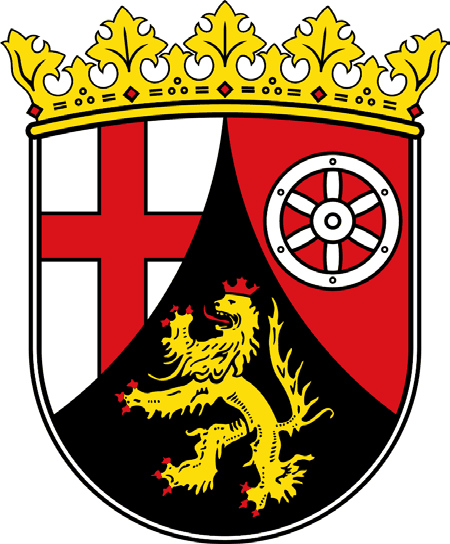
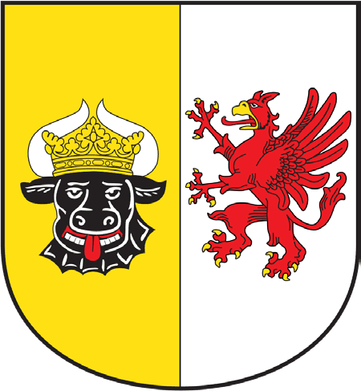
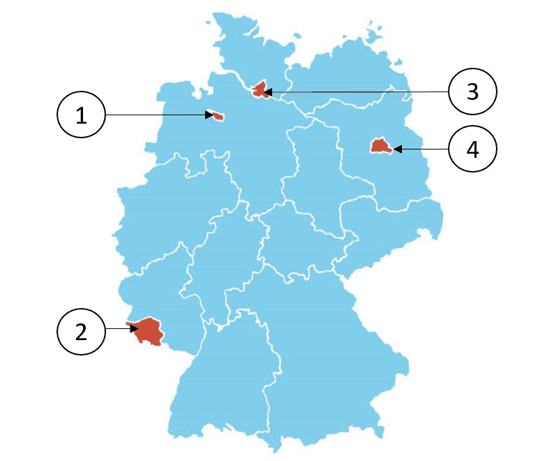

# Saarland - State Questions

> The 10 official questions for Saarland. In the real test, 3 of these are added to the 30 general questions. Answer first, then open the solution.

[Overview](../index.md) | [All states](../states-at-a-glance.md) | [Mock test](../mock-test.md)

---

## Steckbrief / State profile

| Fact | German | Answer |
|---|---|---|
| Capital | die Landeshauptstadt | **Saarbrücken** |
| Flag | die Landesflagge | `schwarz-rot-gold` (black-red-gold) |
| Parliament | das Landesparlament | der Landtag |
| Term | die Wahlperiode | 5 years |
| Voting age | das Wahlalter (Kommunalwahlen) | 18 |
| Head of government | der Regierungschef | Ministerpräsidentin/Ministerpräsident |

## Frage 1

> **Frage:** Welches Wappen gehört zum Bundesland Saarland?  
> **English:** Which coat of arms belongs to Saarland?

| Bild 1 | Bild 2 | Bild 3 | Bild 4 |
|---|---|---|---|
|  |  |  |  |

| # | Antwort | English |
|---|---|---|
| a | Bild 1 | Picture 1 |
| b | Bild 2 | Picture 2 |
| c | Bild 3 | Picture 3 |
| d | Bild 4 | Picture 4 |

??? success "Lösung / Answer - open after you have chosen"

    **d) Bild 4**  
    Picture 4

    **Warum / Why:** The Saarland's coat of arms combines symbols of the historic territories that were joined to form the state, reflecting its complex regional history between France and Germany.

??? note "Wortschatz / Vocabulary"

    | Deutsch | English |
    |---|---|
    | Wappen | the coat of arms |
    | gehören | to belong |
    | Bundesland | the federal state |
    | Bild | the picture |

---

## Frage 2

> **Frage:** Welches ist ein Landkreis im Saarland?  
> **English:** Which of these is a district (Landkreis) in Saarland?

| # | Antwort | English |
|---|---|---|
| a | Mecklenburgische Seenplatte | Mecklenburg Lake District |
| b | Altötting | Altötting |
| c | Neunkirchen | Neunkirchen |
| d | Rhein-Sieg-Kreis | Rhein-Sieg-Kreis |

??? success "Lösung / Answer - open after you have chosen"

    **c) Neunkirchen**  
    Neunkirchen

    **Warum / Why:** Neunkirchen is located in Saarland; the other options are districts in different German states.

??? note "Wortschatz / Vocabulary"

    | Deutsch | English |
    |---|---|
    | Landkreis | the district |
    | Seenplatte | the lakeland |

---

## Frage 3

> **Frage:** Für wie viele Jahre wird der Landtag des Saarlandes gewählt?  
> **English:** For how many years is the state parliament in Saarland elected?

| # | Antwort | English |
|---|---|---|
| a | 3 | 3 |
| b | 4 | 4 |
| c | 5 | 5 |
| d | 6 | 6 |

??? success "Lösung / Answer - open after you have chosen"

    **c) 5**  
    5

    **Warum / Why:** The state parliament of Saarland is elected for a term of 5 years.

??? note "Wortschatz / Vocabulary"

    | Deutsch | English |
    |---|---|
    | Jahr | the year |
    | Landtag | the state parliament |
    | Saarland | the Saarland |
    | wählen | to vote / to choose |

---

## Frage 4

> **Frage:** Ab welchem Alter darf man im Saarland bei Kommunalwahlen wählen?  
> **English:** From what age can people vote in local elections in Saarland?

| # | Antwort | English |
|---|---|---|
| a | 14 | 14 |
| b | 16 | 16 |
| c | 18 | 18 |
| d | 20 | 20 |

??? success "Lösung / Answer - open after you have chosen"

    **c) 18**  
    18

    **Warum / Why:** In Saarland, the minimum voting age for local elections is 18.

??? note "Wortschatz / Vocabulary"

    | Deutsch | English |
    |---|---|
    | Alter | the age |
    | Kommunalwahl | the local election |
    | wählen | to vote / to choose |

---

## Frage 5

> **Frage:** Welche Farben hat die Landesflagge des Saarlandes?  
> **English:** What colors does the state flag of Saarland have?

| # | Antwort | English |
|---|---|---|
| a | weiß-blau | white-blue |
| b | schwarz-rot-gold | black-red-gold |
| c | schwarz-gelb | black-yellow |
| d | grün-weiß-rot | green-white-red |

??? success "Lösung / Answer - open after you have chosen"

    **b) schwarz-rot-gold**  
    black-red-gold

    **Warum / Why:** The state flag of Saarland is black-red-gold.

??? note "Wortschatz / Vocabulary"

    | Deutsch | English |
    |---|---|
    | Farbe | the colour |
    | Landesflagge | the state flag |
    | Saarland | the Saarland |
    | schwarz-rot-gold | black-red-gold |
    | weiß-blau | white-blue |
    | schwarz-gelb | black-yellow |
    | grün-weiß-rot | green-white-red |

---

## Frage 6

> **Frage:** Wo können Sie sich im Saarland über politische Themen informieren?  
> **English:** Where can you get information about political topics in Saarland?

| # | Antwort | English |
|---|---|---|
| a | bei den Kirchen | at the churches |
| b | bei der Landeszentrale für politische Bildung | at the State Agency for Civic Education |
| c | bei der Verbraucherzentrale | at the Consumer Advice Centre |
| d | beim Ordnungsamt der Gemeinde | at the municipal public order office |

??? success "Lösung / Answer - open after you have chosen"

    **b) bei der Landeszentrale für politische Bildung**  
    at the State Agency for Civic Education

    **Warum / Why:** Civic/political education information in Saarland is provided at the State Agency for Civic Education.

??? note "Wortschatz / Vocabulary"

    | Deutsch | English |
    |---|---|
    | politisch | political |
    | Thema | the topic |
    | informieren | to inform |
    | Landeszentrale | the state agency for civic education |
    | Bildung | education |
    | Kirche | the church |
    | Verbraucherzentrale | the consumer advice centre |
    | Ordnungsamt | the public order office |
    | Gemeinde | the municipality |

---

## Frage 7

> **Frage:** Die Landeshauptstadt des Saarlandes heißt …  
> **English:** The state capital of Saarland is called …

| # | Antwort | English |
|---|---|---|
| a | Neunkirchen. | Neunkirchen. |
| b | Homburg. | Homburg. |
| c | Saarbrücken. | Saarbrücken. |
| d | Völklingen. | Völklingen. |

??? success "Lösung / Answer - open after you have chosen"

    **c) Saarbrücken.**  
    Saarbrücken.

    **Warum / Why:** Saarbrücken. is the state capital of Saarland.

??? note "Wortschatz / Vocabulary"

    | Deutsch | English |
    |---|---|
    | Landeshauptstadt | the state capital |
    | Saarland | the Saarland |
    | heißen | to be called |
    | Homburg | the Homburg (hat) |

---

## Frage 8

> **Frage:** Welches Bundesland ist das Saarland?  
> **English:** Which (highlighted) federal state is Saarland?

| # | Antwort | English |
|---|---|---|
| a | 1 | Number 1 |
| b | 2 | Number 2 |
| c | 3 | Number 3 |
| d | 4 | Number 4 |

??? success "Lösung / Answer - open after you have chosen"

    **b) 2**  
    Number 2

    **Warum / Why:** The Saarland is Germany's smallest area state (excluding the city-states), located in the southwest, bordering France and Luxembourg.

??? note "Wortschatz / Vocabulary"

    | Deutsch | English |
    |---|---|
    | Bundesland | the federal state |

---

## Frage 9

> **Frage:** Wie nennt man die Regierungschefin/den Regierungschef des Saarlandes?  
> **English:** What is the head of government in Saarland called?

| # | Antwort | English |
|---|---|---|
| a | Erste Ministerin/Erster Minister | First Minister |
| b | Premierministerin/Premierminister | Prime Minister |
| c | Bürgermeisterin/Bürgermeister | Mayor |
| d | Ministerpräsidentin/Ministerpräsident | Minister-President |

??? success "Lösung / Answer - open after you have chosen"

    **d) Ministerpräsidentin/Ministerpräsident**  
    Minister-President

    **Warum / Why:** The head of government in Saarland holds the title Minister-President.

??? note "Wortschatz / Vocabulary"

    | Deutsch | English |
    |---|---|
    | nennen | to name |
    | Regierungschefin | the head of government (female) |
    | Regierungschef | the head of government |
    | Saarland | the Saarland |
    | Ministerpräsident | the Minister-President |
    | Erst | first |
    | Minister | the minister |
    | Premierministerin | the Prime Minister (female) |
    | Premierminister | the Prime Minister |
    | Bürgermeister | the mayor |

---

## Frage 10

> **Frage:** Welche Ministerin/welchen Minister hat das Saarland nicht?  
> **English:** Which minister does Saarland NOT have?

| # | Antwort | English |
|---|---|---|
| a | Justizministerin/Justizminister | Minister of Justice |
| b | Außenministerin/Außenminister | Minister of Foreign Affairs |
| c | Finanzministerin/Finanzminister | Minister of Finance |
| d | Innenministerin/Innenminister | Minister of the Interior |

??? success "Lösung / Answer - open after you have chosen"

    **b) Außenministerin/Außenminister**  
    Minister of Foreign Affairs

    **Warum / Why:** Foreign affairs are a federal responsibility in Germany, not a state matter - so no German state has this ministry.

??? note "Wortschatz / Vocabulary"

    | Deutsch | English |
    |---|---|
    | Minister | the minister |
    | Außenministerin | the Foreign Minister (female) |
    | Außenminister | the Foreign Minister |
    | Justizministerin | the Justice Minister (female) |
    | Justizminister | the Justice Minister |
    | Finanzministerin | the Finance Minister (female) |
    | Finanzminister | the Finance Minister |
    | Innenministerin | the Interior Minister (female) |
    | Innenminister | the Interior Minister |

---

## Set check

- [ ] I answered all 10 questions before opening any solution.
- [ ] I scored at least 8/10.
- [ ] I can name the capital, flag colours and leader title of this state from memory.

---

[← Rheinland-Pfalz](11-rheinland-pfalz.md) | [Overview](../index.md) | [Sachsen →](13-sachsen.md)
